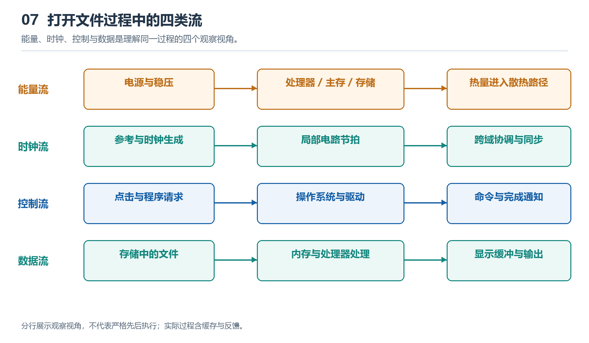

# 7.1 从按下电源键开始：能量流如何到达各模块

按下电源键，风扇开始转动，屏幕随后亮起。这个熟悉的动作容易让人以为：按钮接通电源，电流便同时到达所有部件。真实过程更有层次。许多计算机在关机但仍接着电源时，部分电路已经获得少量供电；按键发出开机请求后，电源与主板上的控制电路再按条件启用各路电压，使系统进入可以工作的状态。

本节以常见台式机为观察对象，沿着“插座—电源—主板—负载”的路径，追踪能量如何到达计算、存储和输入输出模块。

{width=95%}

四类流经常同时发生。把它们分别画出，有助于把供电故障、时序问题、任务调度和数据搬运问题区分开。

## 7.1.1 电源键首先发出一个请求

观察机箱内部，可以找到从前面板电源键通向主板的一组细线。它们与为主板供电的粗线束明显不同。这是一个重要线索：普通台式机的前面板按钮通常不直接承载整机工作所需的电流，而是让主板上的控制电路检测到一次按键动作。

在常见的 ATX 台式机中，只要交流输入和电源状态满足条件，即使系统尚未开机，电源也可以提供待机电源。待机电路负责监听电源键，并可能支持网络唤醒等功能。因此，操作系统中的“关机”通常不等于设备内部完全断电。

按下按钮后，控制电路根据当前状态发出启动请求，电源开始建立主要输出。笔记本电脑的路径有所不同：电池或适配器先经过电源管理电路，再由控制器协调各部分供电。两者共有的机制是：**先有能够接收请求的供电与控制基础，再逐步建立完整工作电源。**

## 7.1.2 电能经过转换，才能被模块使用

墙上插座提供的交流电不能直接送进处理器。台式机电源先将其转换为系统需要的直流电，再通过线缆和连接器送往主板、显卡及其他设备。主板和设备上的稳压电路继续转换电压，为不同芯片提供合适的电源。

可以沿以下路径建立一张简图：

| 路径位置 | 主要作用 | 可见线索 |
|---|---|---|
| 电源输入与电源内部 | 接收电能并完成主要转换 | 电源插口、机箱内的电源模块 |
| 供电线缆与连接器 | 把电能送到主板或设备 | 主板供电插头、处理器供电插头 |
| 主板与设备稳压区域 | 转换并稳定局部电压 | 电感、电容、功率器件 |
| 芯片及其他负载 | 利用电能完成工作 | 处理器、内存、控制器、风扇 |

这里的路径不是一条依次穿过所有设备的串联线路，而是一张不断分支的供电网络。处理器、内存和风扇各有供电支路；某些支路还会继续分成多个电压域，分别服务于芯片内部的不同区域。

电流也需要返回路径。主板中的地平面、线缆中的回路线共同构成电路。图中常用一根箭头表示“电源到处理器”，只是为了突出能量传递方向，不能据此认为电流到达芯片后便消失了。

## 7.1.3 各路电源为什么不能任意开启

建立电压需要时间，电路也必须确认供电达到要求。如果某个芯片的核心电路尚未获得稳定供电，与它连接的接口就开始活动，可能出现不符合设计要求的状态。因此，平台通常通过供电时序、状态信号和复位控制，协调各部分的启动。

可以把这个过程理解为几个条件逐步满足：电源输出建立，相关电路报告电压状态，控制逻辑允许后续供电继续开启，并在所需条件具备后解除相应模块的复位。复位的作用之一，是让电路在准备期间保持或回到规定的初始状态。

这并不意味着所有计算机都采用同一套固定顺序。具体过程取决于处理器、主板和电源管理设计，有些阶段可以并行，有些必须等待前一步完成。稳定的认识应当是：**获得电能只是工作条件之一，电压状态、复位和时钟等条件还需要相互配合。**

这也解释了为什么“风扇转了”不能证明整机已经正常启动。风扇所在支路获得供电，只能说明部分供电路径已经工作；处理器、内存或其他关键模块仍可能没有满足运行条件。

## 7.1.4 开机以后，能量流仍在变化

进入系统后，供电网络不会停留在一个固定状态。打开程序、播放视频或执行计算任务，都会改变各模块的活动程度，进而改变电流需求。处理器负载突然增加时，局部电容可以在短时间内帮助缓冲供电变化，稳压电路则通过调节维持所需电压。两者共同应对负载变化，具体效果受电路设计和工作条件限制。

系统还可以降低空闲模块的活动程度，或关闭部分区域的供电，以减少能耗。因而，追踪能量流不仅要问“电从哪里来”，还要问“此刻哪些模块在消耗电能，需求是否正在变化”。

电能进入设备后，最终大部分转化为热，少部分以光、声音或机械运动等形式输出。散热系统由此与供电路径衔接：供电支持工作，工作产生热量，热量再经过芯片封装、散热器和空气等路径离开设备。

## 7.1.5 从实物建立一条可验证的路径

观察时，可使用主板照片或在断电后查看机箱，标出主板供电接口、处理器供电接口及附近的稳压区域，再画出它们通往主要负载的分支。不要拆开电源模块；其内部可能保留危险电压。对无法从外观确认的连接，应查阅对应型号的手册，不把“位置相邻”当成“电气相连”。

可以用以下 Prompt 辅助整理：

> 你是一位计算机硬件教师。请根据我提供的主板型号、照片和接口标记，帮助绘制从电源输入到处理器、内存及扩展设备的供电路径。区分可见证据、依据常见设计作出的推断，以及需要手册确认的部分；解释待机供电、启动请求和局部稳压各自的作用，不臆测具体供电时序。

沿这条路径看，开机便从一个按钮动作展开为一组有条件的供电过程。能量使电路具备活动的物理基础；电路如何协调动作，还需要继续追踪它们的时间节拍。
