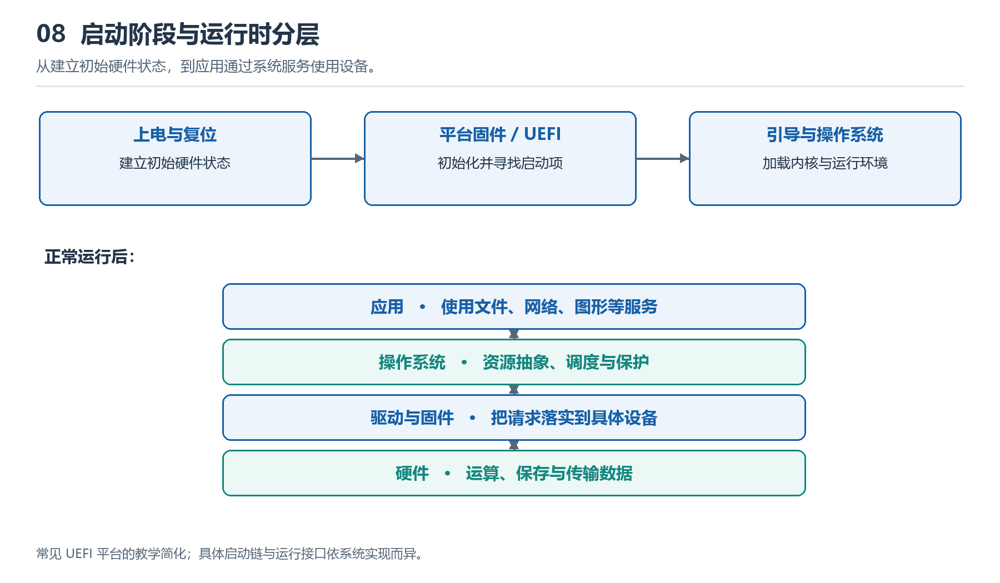

# 8.1 UEFI与启动过程：计算机如何完成最初配置

按下电源键后，屏幕通常不会立刻出现桌面。风扇先转动，显示器随后亮起，厂商标志可能短暂停留，操作系统才开始加载。这段间隔并非单纯的等待：计算机正在把刚获得供电的硬件，逐步组织成能够运行软件的系统。

此时，操作系统尚未接管，主存也可能尚未具备正常工作的条件。负责推进最初配置的是固件——保存在非易失性存储器中的底层程序。现代个人计算机常采用遵循 UEFI 规范的启动环境。UEFI 是“统一可扩展固件接口”的缩写，它规定固件与启动软件之间的接口及相关服务；主板中的具体固件则负责实现这些接口，并完成平台所需的初始化。

{width=95%}

启动逐步建立可运行环境；运行时则通过系统服务、驱动与硬件分层协作。分层明确职责，也隐藏部分实现细节。

## 8.1.1 从主板上的存储芯片开始

观察主板时，有时能找到保存固件的闪存芯片，但不能仅凭封装外形判断其身份，还需要结合芯片标记与主板资料。它保存的程序即使断电也能保留，使计算机不必先从硬盘加载操作系统，就能开始执行启动代码。

供电、复位等条件满足后，处理器从体系结构规定的入口开始执行，平台将执行路径引向固件代码。这时尚不能假定所有硬件都已可用。固件需要建立早期执行环境，逐步配置处理器相关功能、内存控制器和必要的互连，再为后续软件准备资源。

这也解释了一个容易忽略的问题：**主存还没有初始化，启动程序怎样运行？** 不同平台采用的办法有所差异，例如利用处理器内部资源建立临时工作空间。待主存可用后，启动过程再转入更完整的执行环境。启动本身也是一个分阶段建立条件的过程。

## 8.1.2 让硬件具备共同工作的条件

安装了内存条，并不意味着处理器一上电就能可靠访问它。固件及其调用的平台初始化代码需要读取内存配置信息，设置相关参数，并进行必要的训练，寻找适合当前连接条件的信号时序。更换内存或调整配置后，有些设备首次启动会明显变慢，其中一个原因就是重新进行这类工作。

接下来，固件还会发现和配置启动所需的设备。例如，识别 PCIe 设备，为相关设备安排地址空间，并使显示、键盘或存储设备具备启动阶段所需的基本功能。具体先后顺序取决于平台，某些工作也可能交错进行。

| 启动阶段的任务 | 要解决的问题 |
|---|---|
| 建立早期执行环境 | 让处理器能够继续执行初始化程序 |
| 初始化主存 | 为后续代码和数据提供可用空间 |
| 发现与配置设备 | 确认必要设备的位置及资源需求 |
| 选择启动目标 | 确定接下来加载哪个启动程序 |
| 向操作系统交接 | 传递内存布局和平台描述等信息 |

人们常把启动初期的检查称为“开机自检”，但它并不等于全面检测全部硬件。能够进入启动画面，只能说明系统通过了当时执行的必要步骤，不能据此断言内存、硬盘和散热系统都没有问题。

## 8.1.3 从找到磁盘到找到启动程序

硬件具备基本工作条件后，固件还要回答：接下来执行什么？

UEFI 启动管理器通常依据保存的启动项与启动顺序进行选择。一个启动项可以指向某个设备上的 EFI 可执行文件。对于常见的本地磁盘启动，这类文件一般位于 EFI 系统分区中；固件也可能按照可移动介质的约定路径寻找启动文件，或尝试网络启动。

因此，“从固态硬盘启动”并不是让处理器直接执行整个硬盘中的内容，而是先找到一个符合启动要求的程序。该程序可能是操作系统的引导加载器，也可能先显示菜单，再加载其他启动组件。随后，启动软件将操作系统内核及必要数据放入内存，为内核取得控制权准备条件。

以一台常见笔记本为例，可以把主要路径概括为：

**电源与复位条件满足 → 执行固件 → 初始化主存和必要设备 → 选择启动项 → 执行引导程序 → 加载并进入操作系统内核。**

这是用于理解的主线。实际设备可能加入恢复检查、身份验证或其他启动步骤。

## 8.1.4 交接的是控制权，也是系统信息

固件不能只把执行位置交给内核，还需要提供操作系统认识平台所需的信息。例如，内存映射帮助启动软件了解哪些内存区域可用，哪些区域需要保留；ACPI 表等平台描述则帮助操作系统理解设备配置、电源管理等关系。

在典型 UEFI 启动路径中，启动软件准备完成后，会调用 `ExitBootServices()`，结束固件启动服务的使用阶段。此后，操作系统逐步依靠自己的内存管理和设备驱动运行。

这不意味着全部固件功能都从此消失。UEFI 还定义了有限的运行时服务，例如访问某些固件变量；操作系统是否使用及如何使用这些服务，取决于具体实现。应把“启动服务结束”与“所有固件代码不再参与”区分开来。

一些设备还会启用安全启动。它依据平台配置的信任与撤销信息，检查启动组件是否符合执行策略，降低未经授权的启动代码进入执行链的风险。它保护的是启动链的一部分，不能替代操作系统更新或应用安全防护。

## 8.1.5 用启动现象建立观察线索

观察启动时，可以记录：何时出现厂商标志，何时出现引导菜单，何时进入操作系统画面。如果提示“找不到启动设备”，问题可能出在设备识别、启动项或启动文件等不同环节，不能直接推断硬盘已经损坏。画面只能提供线索，进一步判断仍需结合提示信息和设备资料。

可以向 AI 提出这样的任务：

> 你是一名计算机系统教师。请以“采用 UEFI、从本地固态硬盘启动的个人计算机”为对象，分阶段解释从复位到操作系统内核接管的过程。每阶段列出执行者、所需条件和输出结果；区分通用机制与平台差异，不把厂商标志当作精确阶段边界。涉及具体设备行为时，请列出需要查证的官方资料。

理解启动过程的关键，是看见条件如何逐层建立：固件先让必要硬件可用，启动软件再把操作系统带入内存，最后由操作系统接管日常资源管理。桌面的出现，正是这一连串交接的可见结果。
