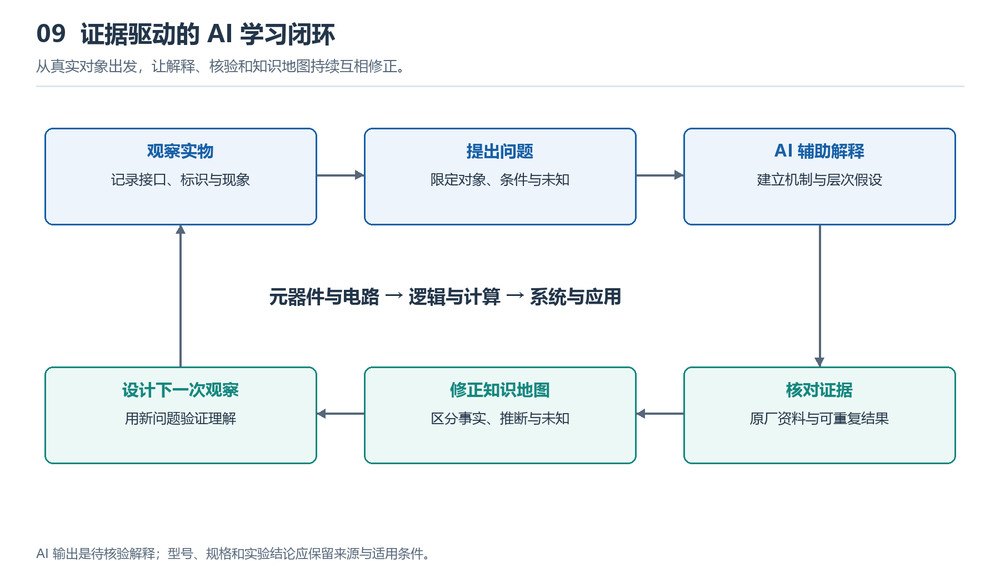

# 9.1 从元器件到逻辑门：电信号如何表达二进制状态

观察一块主板，我们能看到芯片、电阻、电容和连接它们的线路，却看不到正在运行的“0”和“1”。这两个符号不是藏在导线里的微小物体，而是人们赋予某些电气状态的含义。本节从一根信号线出发，理解连续变化的电压如何成为可判断的二进制状态，再看这些状态怎样通过逻辑门参与计算。

{width=95%}

用 AI 组织问题与解释，再回到资料和实验核验。把可观察对象与可检验机制连起来，才能让知识地图逐步可靠。

## 9.1.1 从电压到状态：0和1是一种约定

设想芯片内部有一条信号线，它相对于参考地具有一定电压。在常见的数字逻辑中，接收电路会把一个较低的电压范围识别为逻辑0，把一个较高的电压范围识别为逻辑1。

这里的关键是“范围”。逻辑0不要求电压恰好为零，逻辑1也不对应所有芯片通用的某个电压值。具体判定范围取决于器件、电源电压和接口规范。因此，不能把“高电平等于某个固定电压”当成普遍规则。

低电平范围与高电平范围之间，通常留有不能保证正确判定的区域。信号在切换时可以经过它，但如果接收电路在不合适的时刻读取，就可能无法可靠地判断状态。

| 物理层面的情况 | 逻辑层面的解释 |
|---|---|
| 电压落在规定的低电平输入范围内 | 可可靠地识别为0 |
| 电压落在规定的高电平输入范围内 | 可可靠地识别为1 |
| 电压处于两者之间 | 不能保证判定结果 |

物理电压会受到噪声、线路损耗和器件差异的影响。采用两个相隔一定距离的有效范围，可以让小幅扰动不立即改变逻辑判断。输出电平与输入判定边界之间预留的容忍空间，称为**噪声裕量**。数字系统的可靠性，部分来自这种对模拟误差的容忍，而不是电路中完全没有误差。

## 9.1.2 从元器件到开关：晶体管怎样控制信号

主板上的电阻、电容等元器件，为信号和供电创造工作条件。例如，电阻可以限制电流，或把信号线拉向确定电平；电容可以储存少量电荷，帮助减小供电波动。大量完成逻辑运算的晶体管，则集成在芯片内部，通常无法通过肉眼辨认。

在数字电路的入门模型中，可以把MOS晶体管理解为受电压控制的开关：施加在栅极上的电压，影响另外两个端子之间的导电能力。不过，真实晶体管的导通与关断不是毫无过渡的机械动作，它仍然遵循连续的电气规律。

现代芯片常用互补的两类MOS晶体管构成CMOS电路。以最基本的反相器为例，一部分晶体管负责把输出连接到电源方向，另一部分负责把输出连接到地：

- 输入为低电平时，输出被拉向高电平。
- 输入为高电平时，输出被拉向低电平。

这样就实现了“输入0，输出1；输入1，输出0”的非运算。逻辑功能由晶体管的连接方式形成；输出切换所需的能量来自供电，输入信号负责控制这条路径。

## 9.1.3 从开关到逻辑门：连接方式决定运算规则

把晶体管按不同结构连接，就能形成逻辑门。“门”表示一种输入状态与输出状态之间的规则。常见的非门、与门和或门，分别执行取反、“两个条件都成立”和“至少一个条件成立”的判断。

对于两个输入A、B，与门和或门的规则可以列成真值表：

| A | B | 与门输出 | 或门输出 |
|---|---|---|---|
| 0 | 0 | 0 | 0 |
| 0 | 1 | 0 | 1 |
| 1 | 0 | 0 | 1 |
| 1 | 1 | 1 | 1 |

假设某项设备操作需要同时满足“已经授权”和“设备就绪”。把满足条件记为1，允许执行的信号便可以用与运算表示。这个例子说明逻辑关系；真实系统可能还会通过软件、状态寄存器和保护电路共同实现判断。

逻辑门能够逐级连接，是因为前一级输出的电平可以被后一级识别。每一级电路还会借助自身供电，把有效输入重新形成符合要求的输出，帮助信号在多级处理中保持可辨认的状态。

## 9.1.4 从逻辑门到计算：还需要时间与记忆

逻辑门并不会瞬间给出结果。输入变化后，晶体管导电状态发生变化，输出节点上的电容需要充电或放电，输出才逐渐进入新的有效范围。这段过程表现为传播延迟。若信号经过多级逻辑，必须等待相关路径稳定后，才能可靠地使用结果。

只根据当前输入产生输出的电路，称为组合逻辑。加法器就是一种例子：它接收二进制数位和进位输入，经过逻辑门组合，产生和与进位输出。

计算机还需要保留先前的结果。通过反馈结构，可以构成具有稳定状态的电路；进一步形成锁存器、触发器等存储单元，再组织成寄存器。这样，电路便能记住一个状态，并在规定条件下更新。时钟为许多此类更新提供时间参照，但可靠工作仍要求输入满足相应的时序条件。

因此，从电信号到计算能力，可以沿着这条路径理解：

**电压范围表示状态 → 晶体管控制导电路径 → 逻辑门建立输入输出规则 → 组合电路完成运算 → 存储电路保留状态。**

## 9.1.5 用AI检查自己的理解

可以向AI提出下面的任务：

> 你是一名数字电路教师。请以CMOS反相器为对象，分别解释输入为0、输入为1和输入正在切换时，导电路径与输出电压如何变化。区分理想开关模型与真实器件行为，画出简化文字示意图，再提出两道理解检查题。不要假定通用电压值；涉及具体器件参数时，标明需要查阅的数据手册项目。

检查回答时，重点看它是否把逻辑状态与具体电压混为一谈，是否忽略供电与传播延迟。二进制的简洁，建立在精心设计的物理边界之上；理解这层关系，才能继续追问芯片如何把大量晶体管组织成更复杂的功能。
