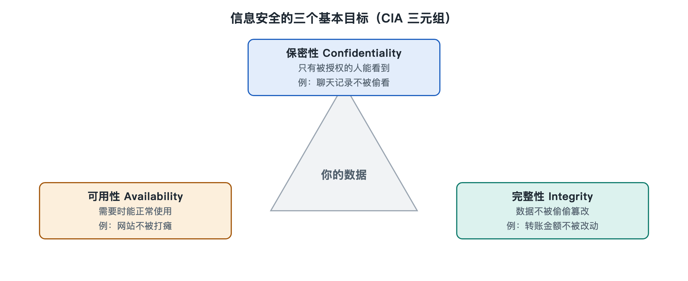

# 1.2 网络安全保护什么：保密性、完整性与可用性

打开手机里的银行应用，你至少在期待三件事：余额只有你自己看得到；转出去的金额不会被人偷偷改掉；需要用钱的时候，应用能正常打开。这三种期待说出来平淡，几乎所有安全措施都围绕它们展开。安全行业把它们概括为三个词：保密性（Confidentiality）、完整性（Integrity）和可用性（Availability），取英文首字母合称“CIA 三要素”，也有人叫“安全三角”。它和美国中央情报局没有关系，只是缩写碰巧相同。

上一节那条可疑短信，如果你真的点了链接、填了验证码，三件事可能同时出问题：账号信息泄露，是保密性受损；对方登录后修改了收款设置，是完整性受损；你的账号被冻结、登录不上，是可用性受损。下面把三者逐一拆开。

## 1.2.1 保密性：只让该看的人看到

保密性回答的问题是：信息会不会落到不该知道它的人手里。手机锁屏密码、聊天软件的端到端加密、医院病历只对主治医生开放，都是在维护保密性。

破坏保密性的方式大致有三类：

- **偷看**：在公共 Wi-Fi 上截获没有加密的通信，或者有人站在你身后看你输入密码；
- **骗取**：钓鱼短信、冒充客服的电话，让你自己把信息交出去；
- **越权**：系统权限设置不当，普通员工也能翻阅全公司的工资表。

对应的防护手段也有三类：用**加密**让偷看的人只看到乱码，用**认证**确认对方到底是谁，用**访问控制**规定谁能看什么。这三项分别在第二章和第六章展开。保密性有一个特点：泄露通常不可逆。密码泄露可以改，身份证号和指纹却换不了，所以生物特征和身份信息尤其需要严格保护。

## 1.2.2 完整性：东西没有被悄悄改过

完整性关心的是信息是否准确、是否被未经授权地篡改。它和保密性不同：一份公开的政府公告，人人都能看，谈不上保密，但如果有人把公告里的电话号码换成诈骗号码，危害可能很大。

生活里的完整性问题比想象中常见：

- 下载的软件安装包被人在中途植入了恶意代码；
- 发票或合同的电子文件里，金额被改动了一位数；
- 网页在传输途中被插入广告或跳转链接。

维护完整性的常用工具有两种。一是**哈希**（Hash，又称散列），它把任意长度的数据压缩成一串固定长度的“指纹”，数据哪怕只改动一个字节，指纹都会变得面目全非。很多软件下载页会附上这串指纹，供用户核对。二是**数字签名**，它不仅能证明内容没被改过，还能证明内容确实出自声称的那个人或机构。手机系统只安装带有合法签名的更新包，靠的就是这个机制。

## 1.2.3 可用性：需要的时候用得上

可用性指的是授权用户在需要时能够正常访问信息和服务。一个系统即使数据完好、无人窃取，但在你急需挂号、缴费或报警时打不开，安全目标同样落空了。

威胁可用性的因素既有人为的，也有非人为的：

| 来源 | 例子 | 常见对策 |
|---|---|---|
| 恶意攻击 | 拒绝服务攻击用海量请求挤垮网站；勒索软件把文件加密锁死 | 流量清洗、限流、离线备份 |
| 技术故障 | 硬盘损坏、软件缺陷导致服务崩溃 | 冗余部署、定期备份 |
| 自然与环境 | 停电、火灾、洪水冲击机房 | 异地容灾、备用电源 |
| 人为失误 | 运维人员误删数据库 | 权限分级、操作复核、可回滚 |

勒索软件值得多说一句：它同时打击三要素。文件被加密锁住，影响可用性；不少勒索团伙还会先把数据偷走，再威胁公开，这又破坏了保密性。所以对组织来说，它往往是最棘手的威胁之一，第三章讲“恢复”时会再回来讨论。

## 1.2.4 三者之间的拉扯

三要素并不总是同向的，加强其中一项，常常会让另一项吃亏。

- 把账号保护得极严，每次登录都要三重验证，保密性提高了，但你在紧急时刻可能因为手机不在身边而登录不上，可用性下降；
- 为了防止数据丢失，把文件复制到多个地方备份，可用性提高了，可每多一份副本，就多一个可能泄露的地方；
- 对每笔交易都做严格校验，完整性更有保障，处理速度却可能变慢。

不同系统的侧重点也不同。军事和情报系统通常把保密性放在首位；银行转账系统极其看重完整性，账上的一分钱都不能错；医院急诊、电网调度这类系统，可用性往往排在最前，因为停摆几分钟就可能危及生命。安全工作的难点不在于把每一项都做到极致，而在于根据系统的用途找到合适的平衡。

在三要素之外，业界还常补充几项相关目标，比如**真实性**（确认身份和来源是真的）、**不可否认性**（发出指令的人事后不能抵赖）。它们可以看作完整性和认证的延伸，后面讲数字签名时会自然遇到。

## 1.2.5 用三要素给事件“体检”

三要素的实际用处，在于给你一把通用的尺子。今后遇到任何安全新闻或自身遭遇，都可以先问三个问题：什么信息被不该看的人看到了？什么东西被改了？什么服务用不了了？比如某平台“数据泄露”，主要是保密性问题；某网站首页被换成黑客标语，是完整性问题；某游戏服务器因攻击瘫痪一整晚，是可用性问题。先分清受损的是哪一项，再去找对应的防线，思路就不容易乱。

知道了要保护什么，下一个问题是：保护的范围有多大？你的手机、公司的服务器、城市的供水系统，都需要这三要素，但它们的边界和责任人各不相同。下一节就来划定网络安全系统的边界。
