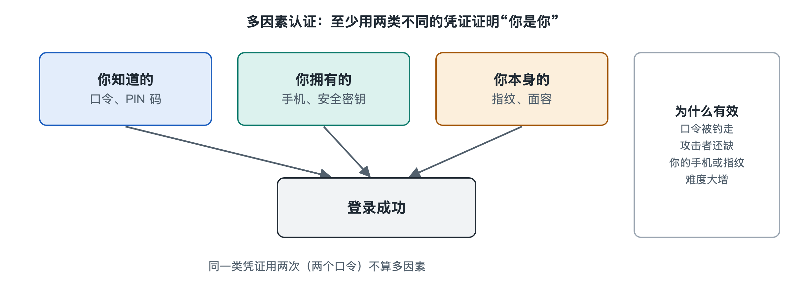

# 2.1 身份与访问管理：账号、口令与多因素认证

早上打开手机，你可能在几分钟里就“证明”了好几次自己是谁：用面容解锁屏幕，打开网银时又刷了一次脸，登录邮箱时输入了密码，换了新电脑登录购物网站，还收到一条六位数的短信验证码。第一章那条可疑短信里，骗子真正想要的往往也是这类东西：你的账号、密码，或者那串验证码。拿到这些，对方就能在网络上冒充你。

在网络安全系统里，负责回答“你是谁、你能做什么”的这一部分，叫作身份与访问管理（Identity and Access Management，IAM）。它是整座安全大楼的门禁系统。本节就从你手里的几个账号出发，把它拆成几个零件来看。

## 2.1.1 三个问题：识别、认证、授权

办公楼的门禁可以拆成三步：报上姓名，出示工牌，保安按工牌决定你能进哪几层。IAM 做的事情与此相同。

| 环节 | 回答的问题 | 日常例子 | 英文 |
|---|---|---|---|
| 识别 | 你声称自己是谁？ | 输入手机号或用户名 | Identification |
| 认证 | 怎么证明真是你？ | 输入密码、刷脸、填验证码 | Authentication |
| 授权 | 你被允许做什么？ | 普通用户只能看自己的订单，管理员能改商品价格 | Authorization |

这三步常被混为一谈。用户名不是秘密，很多网站的用户名就是你的手机号，知道它并不等于能登录。真正挡住冒充者的是认证。认证通过以后，授权决定你能碰哪些数据。很多严重事故并不是认证被攻破，而是授权给得太宽：一个实习生账号能导出全公司客户名单，账号一旦被盗，损失就很大。授权的细节留到第六章“访问控制”再展开，本节重点讲前两步。

此外，组织里的 IAM 还管账号的整个生命周期：员工入职时开通账号，调岗时调整权限，离职当天收回权限。现实中常见的漏洞是离职员工的账号多年没有注销，没人记得它还存在，攻击者却可能找到它。

## 2.1.2 口令：最古老也最脆弱的钥匙

口令（Password，俗称密码）属于“你知道的东西”。它便宜、通用，但有几个先天弱点：

- **容易猜。**人习惯用生日、姓名拼音、“123456”这类组合。各类安全机构和厂商每年公布的“最常见密码”榜单上，这些组合常年排在前列。
- **容易重复。**一个人有几十个账号，记不住几十个不同的密码，于是到处用同一个。某个小论坛数据库泄露后，攻击者会拿泄露的“账号＋密码”批量去试其他网站，这叫撞库（Credential Stuffing）。你在一个小网站用过的密码，可能就这样连累你的邮箱和支付账号。
- **容易被骗走。**钓鱼短信和仿冒网站不需要破解任何东西，只需要你自己把密码填进去。

那么网站为什么不会因为数据库泄露就直接暴露你的明文密码？规范的系统不保存密码本身，只保存经过哈希（Hash）运算得到的“指纹”。登录时把你输入的内容做同样的运算，比对指纹是否一致。哈希的原理在第六章讨论。读者现在只需记住：如果某个网站能把你的原密码通过邮件“发还”给你，说明它很可能在明文保存密码，这是一个危险信号。

对普通用户来说，比较可行的做法是：**用较长的口令短语代替复杂的短密码，每个重要账号使用不同的密码，并交给密码管理器记忆。**主流浏览器和手机系统在写作时都自带密码管理功能，也有独立的密码管理软件。这样你只需记住一个足够强的主密码。

## 2.1.3 多因素认证：给门加第二把锁

既然单靠口令不可靠，就再加一道门槛。认证因素通常分为三类：

1. **你知道的**：密码、PIN 码、密保问题；
2. **你拥有的**：手机、硬件安全密钥、银行 U 盾；
3. **你本身的特征**：指纹、面容、声纹等生物特征。

同时使用两类或以上不同的因素，就是多因素认证（Multi-Factor Authentication，MFA），只用两类时常称双因素认证（2FA）。关键在于“不同类”：两个密码叠加仍然只算一类，被同一次钓鱼一起骗走的概率很高；而“密码＋手机”要求攻击者既知道你的密码，又能拿到你的手机，难度高得多。

不同的第二因素强度不同，大致可以这样比较：

| 第二因素 | 工作方式 | 主要风险 |
|---|---|---|
| 短信验证码 | 服务方把一次性码发到你的手机号 | 被骗读出验证码；手机号被冒名补卡（SIM 卡劫持） |
| 认证器应用验证码 | 手机应用每隔约 30 秒生成一次新码，不经过运营商网络 | 仍可能被仿冒网站实时骗走 |
| 推送确认 | 手机弹窗问“是否本人登录” | 攻击者反复发起请求，诱使用户烦躁之下点“同意” |
| 硬件安全密钥、通行密钥 | 设备与真实网站的域名绑定，用密码学方式应答 | 抗钓鱼能力较强；设备丢失需要有备用方案 |

这张表的结论可以记成一句话：**开启 MFA 的账号通常比只用密码安全得多，但第二因素一旦需要“人转述”，就仍然可能被骗。**这正是诈骗短信里常出现“请把收到的验证码告诉客服”这类话术的原因。验证码是给系统看的，不是给任何人看的，真正的客服不会向你索要。

## 2.1.4 从门禁看系统：身份是新的边界

过去的企业安全思路像城堡：内网之内都可信，防火墙挡在外面。如今员工在家里、咖啡馆用笔记本办公，数据放在云上，城墙的意义变弱，“这个请求来自谁、可信程度如何”变得更重要。安全业界常说“身份是新的边界”，指的就是这种转变。很多组织采用单点登录（Single Sign-On，SSO）：员工只在统一的身份平台登录一次，就能进入邮箱、文档、报销等系统。这样做方便集中加强认证、集中收回权限，代价是身份平台一旦失守，影响范围也随之扩大，所以它本身要受到最严格的保护。

回到你的手机：你的邮箱和手机号往往是其他账号“找回密码”的通道，相当于整串钥匙的总钥匙。保护身份，优先保护这两个账号。

身份系统决定了“谁能进门”，但进门的人用的是哪台设备，这台设备是否干净，是另一道防线要回答的问题。下一节转向你手中的电脑和手机，看终端安全怎样把守这一关。
