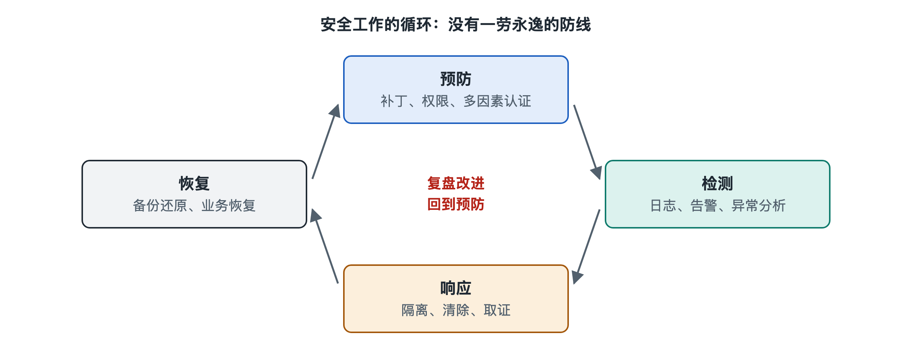

# 3.1 预防：把攻击挡在门外

早上出门前，你会锁门、关窗、把钥匙放进口袋；你不会等小偷进了屋才想起换锁。网络安全里的“预防”（Prevention）就是这把锁和这扇窗：在攻击真正得手之前，让它根本进不来，或者进来也做不成事。第二章我们拆出了身份、终端、网络边界、密码组件和安全运营中心几个部件，本节换个角度问：这些部件合在一起，怎样完成“挡在门外”这项功能？

## 3.1.1 回到那条短信：预防在哪几处起了作用

还是那条“您的快递异常，请点击链接处理”的短信。假设你没有被骗，往往不是一处防线单独起了作用，而是几处叠在一起：

- **运营商和手机系统的拦截**：不少手机系统和运营商会对疑似诈骗短信做过滤或标注，一部分短信没到你眼前就被归入了骚扰信息。
- **浏览器的风险网址提示**：即使点开了，主流浏览器通常会对照已知的恶意网址名单，弹出红色警告页。
- **账号的多因素认证**：就算在假网站上输入了密码，攻击者拿去登录时还缺一个验证码或一次手机确认。
- **你自己的判断**：知道“正规快递不会让你填银行卡”，直接删掉。

这四处分属不同部件，却服务于同一个功能：在攻击链的早期截断它。可以说，预防不是某一个产品，而是分散在系统各处的一组“门槛”。

## 3.1.2 预防的四类基本手段

把各种预防措施归一归类，大体可以分成下面四种思路：

| 手段 | 核心想法 | 日常例子 | 组织中的例子 |
|---|---|---|---|
| 减少暴露 | 门越少越好守 | 卸载不用的App，关闭不用的蓝牙 | 关闭不必要的服务和端口，下线旧系统 |
| 加固门锁 | 让每扇门更难撬 | 设长而独特的密码，开启多因素认证 | 统一身份管理，强制多因素认证 |
| 及时修补 | 别留已知的破洞 | 系统和App提示更新就更新 | 漏洞管理、按优先级打补丁 |
| 限制权限 | 进来也拿不走太多 | App只给必要权限 | 最小权限、网络分段 |

其中“及时修补”最常被低估。公开报道中的大量入侵事件，利用的并不是无人知晓的新漏洞，而是厂商早已发布补丁、但受害方没有及时安装的旧漏洞。2017 年 WannaCry 勒索软件在全球蔓延时，它利用的 Windows 漏洞，微软在此前几个月就已发布了修补程序——这是公开报道中被反复提及的事实。更新提示看似烦人，却往往是成本最低的一道防线。

另一个值得单独说的是“安全配置”。很多设备出厂时为了好用，默认设置偏宽松，比如默认密码、默认开启远程管理。家里的路由器就是典型：改掉默认管理密码、及时升级固件，就已经堵上了不少常见入口。组织里也有类似做法，行业中常把这叫作“安全基线”或“加固”（Hardening），即为每类系统规定一份必须满足的最低配置清单。

## 3.1.3 为什么预防永远不够，却仍然最划算

预防有一个先天的局限：防御者要守住所有门，攻击者只需找到一扇没锁的。再完善的预防也会有漏网之鱼——员工可能在一个精心伪造的场景里交出密码，某个软件可能藏着尚未公开的漏洞，安全业内称之为“零日漏洞”（Zero-day）。所以，现代安全体系不会把全部希望押在预防上，而是在后面接着检测、响应和恢复，这正是本章接下来几节要讲的内容。

但这并不削弱预防的价值。可以用一个“漏斗”来想象：攻击企图像大量沙子倒下来，每一层预防措施都筛掉一部分，最后漏到检测和响应环节的数量少了很多，安全团队才有精力处理真正危险的那几粒。如果没有预防，后面的团队会被海量低级攻击淹没。从成本看，挡住一次攻击，通常远比事后清理、恢复和赔偿便宜，这也是业内普遍认同的经验。

## 3.1.4 好的预防要“让正确的事变容易”

预防措施如果太麻烦，人就会绕开它。要求每月换一个极复杂的密码，结果很多人把密码写在便利贴上贴在显示器旁；登录步骤繁琐，有人就干脆和同事共用账号。这提醒我们，预防设计的关键不只是“更严格”，而是“让安全的做法同时也是省事的做法”。

近年的一些变化正体现了这个思路：

- **密码管理器**替你生成并记住每个网站不同的复杂密码，你只需记一个主密码。
- **通行密钥**（Passkey）由苹果、谷歌、微软等厂商联合推动（写作时的情况），用设备上的指纹或面容解锁来登录，既不用记密码，又难以被钓鱼网站骗走。
- **自动更新**让系统在夜里充电时完成补丁安装，不需要用户记着去点。

这些设计背后的原理，我们会在第六章的认证机制和第八章的人因安全中继续展开。

## 3.1.5 小结

预防是安全系统的第一道功能：通过减少暴露、加固门锁、及时修补和限制权限，在攻击链的早期把绝大多数攻击挡住。它分散在身份、终端、网络边界等各个部件之中，不能单独承担全部安全责任，却是性价比最高的一环。对你个人而言，今天就能做的三件事是：打开系统自动更新，为重要账号开启多因素认证，删掉手机里不再使用的App。

门总有被撬开的时候。下一节我们就来看，当攻击者已经溜进来，系统怎样发现他的踪迹——这就是“检测”。
