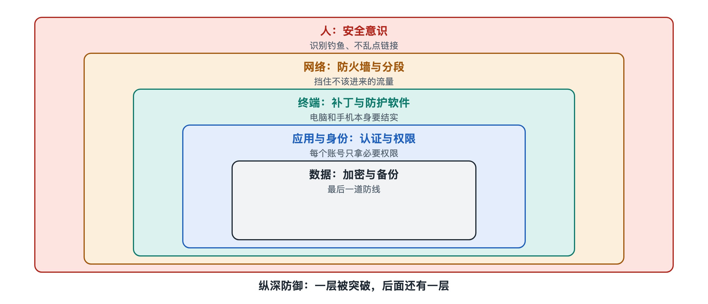

# 4.1 攻击者与防御者：攻击链与纵深防御

回到那条可疑短信。它看起来只是一句“您的快递地址异常，请点击链接更新”，但站在攻击者的角度，这条短信只是一整套行动中的一步。之前，他们收集了号码，搭好了仿冒网站。之后，他们还要骗你输入账号密码，再用这些信息登录、转账或继续冒充你去骗你的亲友。站在防御者的角度，你的手机、运营商、银行和网站，各自都有机会在某一步把这条链条截断。

前三章分别讲了网络安全系统的对象、组成和功能。从这一节开始，我们把视线转向这些部分之间的关系。第一组要看的关系，是攻击者和防御者之间的关系。它可以用两个概念来概括：攻击链和纵深防御。

## 4.1.1 攻击不是一个动作，而是一条链

普通人常把“被黑”想象成一瞬间的事：点了一下，就完了。安全行业更习惯把一次攻击看成一连串互相依赖的阶段。2011 年前后，美国洛克希德·马丁公司的研究人员借用军事上的“杀伤链”说法，提出了“网络杀伤链”（Cyber Kill Chain）模型。它把一次有针对性的入侵分成七个阶段。下表用防御视角概括这七个阶段，并对照钓鱼短信的例子：

| 阶段 | 含义 | 钓鱼短信里的对应 |
|---|---|---|
| 侦察 | 收集目标信息 | 获取手机号、了解你常用的快递或银行 |
| 武器化 | 准备攻击载体 | 制作仿冒网页或恶意安装包 |
| 投递 | 把载体送到目标面前 | 群发短信 |
| 利用 | 让载体起作用 | 你点开链接，信以为真 |
| 安装 | 建立立足点 | 诱导安装“客服”应用或开启屏幕共享 |
| 命令与控制 | 远程操控 | 攻击者远程查看或操作手机 |
| 目标行动 | 实现真正意图 | 盗取资金、窃取信息、继续冒充你 |

这个模型最初针对的是企业网络入侵，套在个人诈骗上并不完全贴合，但思路是相通的。它的价值不在于背下七个名词，而在于一个判断：**攻击者必须每一步都成功，防御者只要在任意一步打断，整次攻击就会失败或大打折扣。** 识破短信，打断的是“利用”；手机拦截可疑安装包，打断的是“安装”；银行发现异常转账并冻结，打断的是“目标行动”。

后来，非营利组织 MITRE 维护的 ATT&CK 知识库（全称为“对抗战术、技术与常识”，Adversarial Tactics, Techniques, and Common Knowledge）把公开报道中观察到的攻击行为细分成十几类“战术”和数百种“技术”，比七阶段模型更细，也更贴近防御人员的日常工作。写作时，它已经是许多组织描述和对照攻击行为的通用语言。第五章 5.1 节会沿着这条线，更细致地讲一次入侵怎样一步步展开。

## 4.1.2 纵深防御：不把安全押在一道门上

既然攻击是一条链，防御就不该只有一个点。设想一座古城：城外有护城河，河后有城墙，城门有守卫，城里还有内城和粮仓的锁。敌人越过一道防线，后面还有下一道。这就是“纵深防御”（Defense in Depth）：用多层、彼此独立的防护措施保护同一个目标，任何一层失效都不致全盘崩溃。

用在一个普通人的账号上，纵深防御大致是这样一套组合：

1. **信息层**：少在公开场合暴露手机号、身份证号，降低被精准“侦察”的概率。
2. **通道层**：运营商和手机系统的骚扰拦截，过滤一部分诈骗短信。
3. **人这一层**：看到“点击链接”“紧急”“验证”等字样先停下，通过官方应用或客服电话核实。
4. **账号层**：设置强密码并开启多因素认证，即使密码泄露，对方也难以登录。
5. **设备层**：只从官方应用商店安装软件，保持系统更新，不轻易授予屏幕共享等高风险权限。
6. **业务层**：银行的异常交易监测、大额转账延时或二次确认。
7. **恢复层**：重要资料有备份，出事后能及时挂失、冻结、报警。

企业的做法结构相同，只是层次更多：边界防火墙、邮件过滤、终端防护、权限分级、日志监测、数据加密和离线备份，分别对应第二、三章拆解过的组件。

## 4.1.3 为什么“多层”能起作用

纵深防御的力量来自一个朴素的概率直觉。假设每一层都有可能漏过攻击，但各层**彼此独立**，那么攻击者要同时穿透所有层，难度就会成倍叠加。打个比方：一层拦住九成攻击，漏过一成；再加一层同样效果的独立防护，漏过的只剩百分之一左右。这里的数字只是示意，现实中各层效果很难精确量化，也不可能完全独立。

“独立”这两个字是关键。如果几层防护依赖同一个弱点，它们会一起失效。比如，你把所有网站都设成同一个密码，再给邮箱开了“用密码就能找回其他账号”的功能，表面上是多个账号，实际上只有一道门。又比如，验证码和密码都通过同一部手机接收，手机一旦被远程控制，两层就合成了一层。安全工程中常说的“避免单点失效”，指的就是这个意思。

纵深防御还有一个容易被忽视的好处：**争取时间**。每多一层，攻击者就要多花时间、多留痕迹，防御者就多一次发现和响应的机会。这正好把第三章的预防、检测、响应、恢复四项功能串了起来：预防让攻击者走得慢，检测让防御者看得见，响应和恢复让损失可控。

## 4.1.4 攻防之间的不对称

攻击者和防御者的处境并不对等，常被概括为两句话：

- **防御者要守住所有地方，攻击者只需找到一个缺口。** 这解释了为什么单点防护注定不够。
- **攻击者要走完整条链，防御者只需打断一环。** 这正是攻击链模型带给防御者的反向优势。

两句话并不矛盾，它们分别描述了“面”和“线”。单看暴露面，防御者吃亏；沿着时间线看，防御者有许多次拦截机会。成熟的安全工作，就是把“守住每个点”的被动局面，转化为“在链条上多处设卡”的主动布局。第八章 8.3 节会用博弈论进一步解释这种策略互动，8.4 节会把纵深防御放回安全工程原则中去看。

## 4.1.5 小结：从一条短信看出一张网

一条钓鱼短信，在攻击者那里是攻击链的一环；在防御者这里，它会遇到运营商、手机系统、你本人、账号认证和银行风控这些前后排列的关卡。攻击链让我们看清攻击怎样一步步推进，纵深防御让我们知道防线该怎样层层布置。

不过，这些关卡里有一层格外特殊：人。技术防线再严密，也可能被一句话、一个紧迫的理由绕过去。下一节，我们就来看人与系统之间的关系：社会工程学为什么屡屡得手，安全意识又该怎样培养。
