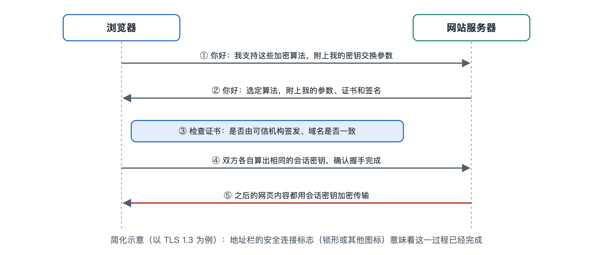

# 5.2 加密流：一次 HTTPS 连接怎样建立

回到序章那条可疑短信。假设你没有点开里面的链接，而是自己在浏览器里输入了银行的官方网址。地址栏左侧出现一个小图标（写作时多数主流浏览器已把过去的“小锁”换成一个更中性的设置图标），网址以“https://”开头。从按下回车到页面出现，通常不到一秒。在这段时间里，你的手机和银行的服务器之间已经完成了一轮协商：确认对方是谁，商定一把只有双方知道的钥匙，然后才开始传送真正的网页内容。本节就把这一秒拆开来看。

## 5.2.1 从“明信片”到“保险信封”

HTTP（超文本传输协议，HyperText Transfer Protocol）是浏览器与网站交换网页时使用的协议，它本身不加密。用 HTTP 传输数据，像寄一张明信片：途经的路由器、公共 Wi-Fi 热点、网络运营商的设备都能看到上面写了什么，也有机会改动内容。

HTTPS 是在 HTTP 下面垫了一层 TLS（传输层安全协议，Transport Layer Security）。TLS 的前身叫 SSL（安全套接层，Secure Sockets Layer），所以至今仍有人把网站证书叫作“SSL 证书”。TLS 要同时完成三件事，正好对应第一章讲的安全目标：

| TLS 要解决的问题 | 对应安全目标 | 主要依靠的技术 |
|---|---|---|
| 别人看不懂传输的内容 | 保密性 | 对称加密 |
| 内容在途中没被篡改 | 完整性 | 消息认证（带密钥的完整性校验） |
| 对面确实是银行，不是冒牌货 | 真实性 | 数字证书与数字签名 |

第二章讲过的加密、签名和证书，在这里第一次按顺序连成了一条流。

## 5.2.2 握手：开口说正事之前的四个动作

建立加密连接的过程叫“握手”（Handshake）。以写作时广泛使用的 TLS 1.3 为例，可以简化成下面几步：

1. **客户端问好（ClientHello）**。浏览器告诉服务器：我支持哪些加密算法；同时附上一份用来协商密钥的“半成品”，也就是自己临时生成的一个公开数值。
2. **服务器回应（ServerHello）**。服务器从浏览器列出的算法里挑一组，再送回它自己的那份“半成品”。到这一步，双方各自用“自己的秘密 + 对方公开的数值”算出同一个共享秘密。这个秘密从来没有在网上传送过，偷听者只看到两个公开数值，在现有计算条件下推不出它。这种方法属于密钥交换，最常用的是迪菲—赫尔曼（Diffie-Hellman）密钥交换的椭圆曲线版本，第八章会说明它为什么难以破解。
3. **服务器亮明身份**。服务器发来自己的数字证书，并用证书对应的私钥对握手过程签名。浏览器检查证书是否由可信的证书颁发机构（CA，Certificate Authority）签发、是否在有效期内、证书上的域名是否与你访问的网址一致，再用证书里的公钥验证签名。验证通过，才能确定对面就是证书上写的那个网站。
4. **双方确认，转入加密通信**。双方交换“握手完成”的消息，其中包含对之前全部握手内容的校验值。中途有人篡改了任何一步，校验就对不上，连接随即中断。

之后，网页、登录口令、账户余额都用刚才算出的会话密钥做对称加密传输，速度快，开销小。

用一个类比来概括：公钥技术负责“隔着人群安全地约定暗号”，对称加密负责“用暗号快速交谈”。前者慢但能解决陌生人之间的信任问题，后者快但需要事先共享钥匙，TLS 把两者组合起来使用。

## 5.2.3 为什么用“临时钥匙”

TLS 1.3 去掉了静态密钥交换方式，完整握手时都使用临时生成的密钥交换数值，用完即弃。这带来一种性质，叫前向保密（Forward Secrecy）：即使某天服务器的长期私钥泄露，攻击者也无法解密过去截获并保存下来的通信，因为每次会话的钥匙早已销毁，而长期私钥只用来签名证明身份，不参与生成会话密钥。

较早的 TLS 版本允许一些不具备这种性质的做法，也包含一些后来被证明不安全的算法。TLS 1.3 删去了这些选项，握手的往返次数也比 TLS 1.2 少。写作时，主流浏览器和大型网站普遍支持 TLS 1.3，早期的 SSL 以及 TLS 1.0、1.1 已被主流浏览器停用。

## 5.2.4 小锁不等于“这个网站可信”

理解了加密流，就能看清一个常见误区。HTTPS 证明的是：你和地址栏里这个域名之间的通道是加密的，对方确实拥有这个域名的证书。它**不**证明这个域名背后是好人。

钓鱼短信里的链接往往也是 HTTPS。自动化签发证书的服务（例如非营利机构运营的 Let's Encrypt）让任何控制某个域名的人都能免费、快速地拿到证书，这对普及加密是好事，但也意味着冒牌域名一样能有完整的加密连接。浏览器图标从“小锁”改为中性图标，原因之一就是不少用户把小锁误读成“网站安全可信”。

所以，防范的重点在两处：

- **看清域名本身**。银行官网与一个拼写相近、多了连字符或换了后缀的域名，在 TLS 看来都是“合法证书、加密通道”。核对域名是人的工作，TLS 替你做不了。
- **认真对待证书警告**。如果浏览器提示“您的连接不是私密连接”，说明第 3 步的证书验证失败了，可能是网站配置出错，也可能有人在中间冒充。在公共 Wi-Fi 下遇到这类提示，更不应点击“继续访问”。

## 5.2.5 小结：一条看不见的流

一次 HTTPS 连接里流动着两类东西：先是用于建立信任和协商钥匙的握手消息，再是被加密保护的业务数据。前者依靠证书、签名和密钥交换，后者依靠对称加密和完整性校验。它能防住途中的偷看和篡改，防不住你主动把口令交给一个冒牌网站。攻击流（5.1 节）常常绕开加密，直接从人下手，原因就在这里。

加密流保护的是“路上”，但服务器和终端上每时每刻都在发生大量事件：谁登录了、谁访问了什么、哪里出现了异常。这些记录怎样被收集、汇聚，最终变成值班人员屏幕上的一条告警，是下一节“日志与告警流”要讲的内容。
