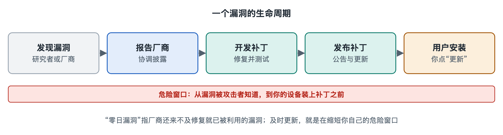

# 5.4 漏洞流：从发现、披露到打补丁

打开手机的“设置—系统更新”，你多半见过这样一行说明：“本次更新包含安全修复”，有时还附一个“安全补丁级别”的日期。电脑右下角也会不时提醒“需要重启以完成更新”。很多人习惯点“稍后提醒我”。可这条提醒的背后，往往是一条已经流动了几周甚至几个月的“漏洞流”：有人发现了缺陷，有人确认并编号，厂商写出修复，最后才推送到你的设备上。本节就沿着这条流，看一个漏洞怎样从“无人知晓”走到“被修补”。

## 5.4.1 漏洞是什么：设计与实现中的“裂缝”

漏洞（Vulnerability）指软件、硬件或配置中存在的缺陷，攻击者可以利用它做出系统本不允许的事，比如读取不该读的数据、执行不该执行的程序。它不一定是程序员粗心，复杂系统里代码动辄数百万行，组件之间相互调用，总会留下设计者没想到的情况。

可以把软件想成一栋大楼：门锁、窗户、通风管道都是设计好的出入口，而漏洞就像墙上一道没人注意的裂缝。裂缝本身不伤人，危险在于谁先发现它。如果维修工先发现，可以悄悄补上；如果小偷先发现，就成了入口。漏洞流的核心问题，正是“让防御者比攻击者更早知道、更快修好”。

## 5.4.2 漏洞的一生：五个阶段

一个漏洞从产生到消失，大致经过下面几个阶段：

| 阶段 | 发生了什么 | 主要参与者 |
|---|---|---|
| 引入 | 编写或配置时留下缺陷，此时无人察觉 | 开发者 |
| 发现 | 有人通过审计、测试或研究找到它 | 安全研究员、厂商内部团队，也可能是攻击者 |
| 报告与确认 | 发现者通知厂商，厂商复现、评估严重程度 | 研究员、厂商安全响应团队 |
| 修复与披露 | 厂商开发补丁，并发布安全公告 | 厂商、漏洞编号机构 |
| 部署 | 用户和组织安装补丁，风险真正消除 | 普通用户、企业运维 |

这里有两个关键时间窗口值得记住。其一，**零日漏洞**（Zero-day）：厂商尚不知道、或知道了但还没有补丁时就已被利用的漏洞，防御者手里“零天”的准备时间，因而最危险。其二，**补丁差距**：补丁发布以后，到用户实际装上之间的那段时间。公开资料中常见的说法是，许多真实入侵利用的并非零日漏洞，而是早已有补丁、只是没人安装的“旧”漏洞。也就是说，漏洞流常常不是卡在“修”，而是卡在“装”。

## 5.4.3 负责任披露：先告诉厂商，再告诉世界

发现漏洞的人面临一个选择：什么时候、向谁公开？

如果立刻公之于众，攻击者会和用户同时知道，而补丁还没写好；如果永远保密，厂商可能一直拖着不修。业界逐渐形成的折中做法叫**协调披露**（Coordinated Vulnerability Disclosure，CVD），也常被称为“负责任披露”：研究者先私下通知厂商，双方约定一个修复期限，补丁就绪后再公开细节。不少研究团队采用固定期限，例如谷歌的 Project Zero 团队公开的政策以 90 天为基本期限（写作时的情况，具体规则随政策调整），到期后无论是否修复都会披露，以此督促厂商。

为了让全世界在讨论同一个漏洞时“说的是同一件事”，还有一套编号与评分体系：

- **CVE**（Common Vulnerabilities and Exposures，通用漏洞披露）：给每个公开漏洞一个唯一编号，形如“CVE-年份-序号”，由美国 MITRE 公司运营的项目协调，许多厂商和机构被授权分配编号。
- **CVSS**（Common Vulnerability Scoring System，通用漏洞评分系统）：用 0 到 10 分描述严重程度，综合考虑能否远程利用、利用难度、影响范围等因素。分数越高，越应该优先修补。
- 我国也有国家信息安全漏洞共享平台（CNVD）、国家信息安全漏洞库（CNNVD）等机构收录和通报漏洞；按照《网络产品安全漏洞管理规定》，网络产品提供者发现或获知漏洞后需要及时修补并按规定报送。

编号和评分让漏洞从“某人的发现”变成可以被检索、比较、排序的公共信息，这也是它能在组织之间流动的前提。下一节讲的情报流，很大程度上就建立在这套公共语言之上。

## 5.4.4 从补丁到设备：最后一公里为什么最难

厂商发布补丁并不等于你安全了。补丁要真正“落地”，还要穿过几道关卡：

1. **供应链传递**：以安卓手机为例，系统底层修复由谷歌发布，再由各手机厂商整合进自己的系统版本，部分机型还要经过运营商环节，所以不同品牌、不同机型拿到同一修复的时间可能相差很久，老旧机型甚至停止更新。苹果设备由苹果统一推送，链条较短。这是两类生态结构上的差别，不是谁“更用心”的问题。
2. **组织的顾虑**：企业里一台服务器可能支撑着关键业务，贸然打补丁怕引发兼容问题，需要先测试、再安排维护窗口。这就把补丁差距从几天拉长到几周。
3. **人的习惯**：一再点击“稍后提醒”，或者为了省流量关掉自动更新，让最后一步迟迟不走。

微软等厂商采用固定的发布节奏，例如在每月第二个星期二集中发布安全更新（业界俗称“补丁星期二”），目的就是让企业能提前规划测试和部署。而对于正在被大规模利用的紧急漏洞，厂商通常会打破节奏，发布“带外更新”。

2017 年的 WannaCry 勒索软件事件是公开报道中反复引用的例子：它利用的 Windows 漏洞，微软在事件爆发前约两个月就已发布补丁，但大量未更新的电脑仍然中招。漏洞流在“部署”这一环断开，代价由全世界的医院、企业和个人来付。

## 5.4.5 你能做的：让漏洞流在你这里流到底

对普通读者来说，参与漏洞流最有效的动作非常朴素：

- 打开手机和电脑的自动更新，看到安全更新尽早安装、按提示重启；
- 定期查看手机的“安全补丁级别”，如果长期停留在一两年前，说明这台设备可能已不再获得修复，存放敏感信息时要格外谨慎；
- 浏览器、路由器、常用应用同样需要更新，路由器后台的固件升级最常被忽视；
- 不安装来路不明的“破解版”软件，它们往往无法获得正规补丁。

对组织管理者而言，则需要建立资产清单、按 CVSS 和实际暴露面确定修补优先级，并给补丁设定明确的完成时限。

## 5.4.6 小结

漏洞流是一条从“裂缝”到“补丁”的接力：发现者、厂商、编号机构、设备厂商、运维人员和每位用户各跑一棒。协调披露解决“何时公开”，CVE 与 CVSS 解决“怎样沟通”，自动更新解决“如何落地”。下次再看到“需要重启以完成更新”，你就知道，自己正握着这场接力的最后一棒。而漏洞信息一旦被编号、被评分，就会进一步汇入组织之间共享的威胁情报，这正是下一节要追踪的流动。
