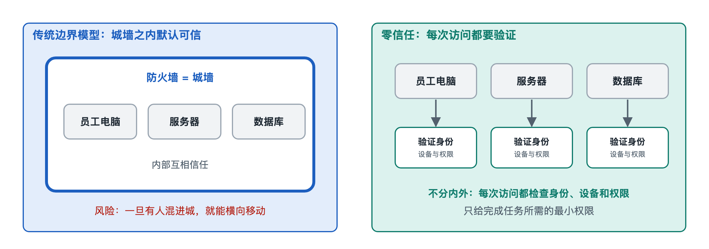

# 6.2 访问控制：最小权限与零信任

打开手机的“设置—隐私—权限管理”，你会看到一张清单：哪些应用能用相机，哪些能读通讯录，哪些能获取位置。一个手电筒应用居然申请了读取短信的权限，一个小游戏想要随时获取精确位置。这些都值得多想一下。这张清单背后，是网络安全系统里一个核心问题：**认证确认了“你是谁”之后，系统还要决定“你能做什么”。**这一步叫访问控制（Access Control）。

上一节讲的认证机制解决身份问题，本节讲授权问题。两者常被混为一谈。可以用酒店来对照：前台核对身份证、发给你房卡，这是认证；房卡只能刷开你那一间房和电梯里你住的楼层，打不开别人的房间和财务室，这是访问控制。

## 6.2.1 访问控制的三个基本要素

无论是手机系统、公司文件服务器还是云平台，访问控制都可以拆成三样东西：

| 要素 | 含义 | 手机上的例子 | 公司里的例子 |
|---|---|---|---|
| 主体（Subject） | 发起访问的一方 | 某个应用 | 员工账号、一段程序 |
| 客体（Object） | 被访问的资源 | 相册、麦克风、通讯录 | 客户数据库、财务报表 |
| 操作（Action） | 想做的动作 | 读取、录音 | 查看、修改、删除、导出 |

访问控制要回答的问题是：**这个主体，能不能对这个客体执行这个操作？**系统把答案写成规则，每次访问时检查一遍。负责检查的环节常被称作“策略执行点”，制定规则的地方叫“策略决策点”，后一个说法在零信任架构的文献里很常见。

围绕“规则怎么写”，形成了几种经典模型：

- **自主访问控制（DAC，Discretionary Access Control）**：资源的主人自己决定给谁权限。你在网盘里把一个文件夹“共享给张三”，用的就是这种模式。它很灵活，风险也在这里：主人一时疏忽，就可能把敏感文件公开给所有人。
- **强制访问控制（MAC，Mandatory Access Control）**：由系统按统一的安全等级强制执行，个人不能随意改动。它多见于对保密要求高的环境，比如按“秘密、机密”分级管理的信息系统。
- **基于角色的访问控制（RBAC，Role-Based Access Control）**：先定义“出纳”“人事专员”“实习生”等角色，再把权限赋予角色，人员归属于角色。员工调岗时换个角色就行，不必逐项修改。多数企业办公系统采用这种思路。
- **基于属性的访问控制（ABAC，Attribute-Based Access Control）**：综合多种属性做判断，例如“财务部员工、在工作时间、使用公司登记的设备、从境内网络访问，才能查看报表”。它更精细，规则也更复杂。

## 6.2.2 最小权限：只给刚好够用的那把钥匙

在各种模型之上，有一条更基本的原则：**最小权限原则（Principle of Least Privilege）**。每个主体只拥有完成任务所必需的最少权限，用完就收回。

道理并不复杂。假设攻击者通过一条钓鱼短信骗到了某位员工的账号，他能造成多大损失，取决于这个账号原本能做什么。如果一个普通客服账号能导出全部客户资料，一次失窃就可能变成一次大规模数据泄露。如果它只能查看当前接待客户的必要信息，损失就被限制在很小范围内。安全工程里把这种“被攻破后波及的范围”称为爆炸半径。最小权限的作用，就是缩小爆炸半径。

最小权限在日常中有几种常见形态：

1. **按需授权**：手机系统（写作时主流的 iOS 和安卓版本均如此）支持“仅在使用期间允许”和“仅本次允许”位置权限，应用退到后台就拿不到位置。
2. **管理员与日常账号分离**：家里的电脑最好用普通账号上网、办公，需要安装软件时再临时输入管理员密码。这样即使误运行了恶意程序，它默认也拿不到系统最高权限。
3. **权限定期回收**：员工调岗后，旧岗位的权限常常没有收回，日积月累，一个老员工可能攥着一大串早已用不上的权限，这种现象叫“权限蔓延”。组织需要定期做权限复核。
4. **临时提权**：运维人员平时只持有普通权限，需要做高风险操作时申请临时授权，限定时长并留下记录，到期自动失效。

最小权限的代价是麻烦：权限给少了，员工会抱怨办事要层层申请。好的设计要在安全与效率之间找平衡，靠清晰的角色划分和顺畅的申请流程来降低这种摩擦。

## 6.2.3 从“城堡护城河”到零信任

传统企业网络的思路像一座城堡：用防火墙筑起城墙，城墙外不可信，城墙内默认可信。员工只要进了公司内网，往往就能访问大量内部系统。

这个模型有两个越来越明显的问题。第一，边界变得模糊：员工在家用笔记本办公，数据放在云上，合作伙伴也要接入系统，“内网”已经很难划清。第二，一旦攻击者通过钓鱼或漏洞进入内网，就能在“可信区域”里横向移动，一台台机器摸过去。不少公开报道的重大入侵事件，都呈现出“先突破一点、再在内网扩散”的特征。

**零信任（Zero Trust）**正是针对这些问题提出的。它的核心口号是“永不信任，始终验证”（Never trust, always verify）。这个概念由研究机构 Forrester 的分析师在 2010 年前后系统提出，谷歌公司在内部推行的 BeyondCorp 项目是公开资料中常被引用的早期实践，美国国家标准与技术研究院（NIST）在 SP 800-207 文件中对零信任架构给出了较系统的描述。

零信任并不是某一款产品，而是一套设计原则，可以概括为：

| 传统边界模型 | 零信任模型 |
|---|---|
| 进入内网即被信任 | 网络位置不代表可信，内外一视同仁 |
| 登录一次，长期有效 | 每次访问资源都要重新评估 |
| 主要看账号密码 | 综合身份、设备状态、地点、行为等信号 |
| 权限按部门大块分配 | 按资源细粒度授权，贯彻最小权限 |
| 重点防外部入侵 | 默认假设已有入侵，限制横向移动 |

举个例子：在实行零信任的组织里，员工用手机访问报销系统时，系统会检查这部手机是否登记过、系统是否已打补丁、登录地点是否异常、本次行为是否偏离平时习惯。即使账号密码正确，只要设备状态可疑，也可能被要求再做一次多因素认证，或者只给只读权限。

## 6.2.4 零信任的落地难点

零信任听上去理所当然，落地却不容易。组织需要先摸清自己有哪些资源、哪些用户、哪些设备，这项盘点工作本身就很繁重。老旧系统可能根本不支持细粒度认证，只能靠网关代理来过渡。持续验证还会带来大量日志和策略管理工作。因此，公开资料中较一致的看法是：零信任是一个渐进迁移的过程，通常从身份管理和多因素认证起步，再逐步扩展到设备、网络和数据层面。

对个人来说，零信任的思路同样适用。收到“银行客服”的短信，不因为它显示了银行名称就相信；用自己保存的官方电话回拨核实，就是“始终验证”。给每个应用只开必需的权限，就是最小权限。

访问控制决定了钥匙能开哪扇门。门后的数据即使被拿走，如何保证别人也读不懂？这要靠下一节的加密机制。
