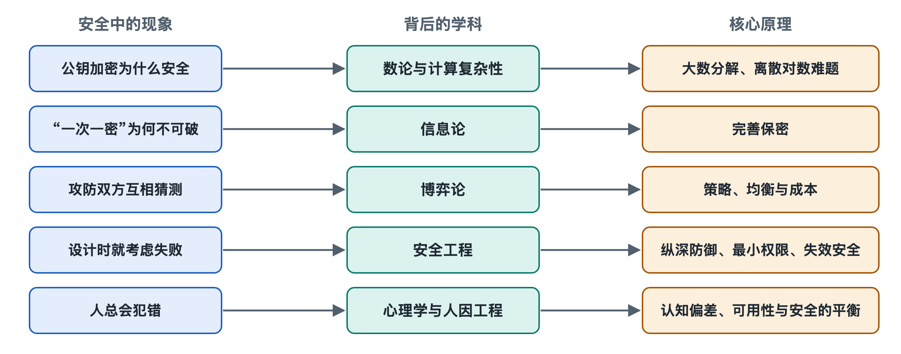

# 8.1 密码学的数学基础：数论与计算困难性

打开手机浏览器访问银行网站，地址栏旁会出现一把小锁。第五章讲过，这把锁背后是一次 HTTPS 握手，双方要在完全公开的网络上商量出一把只有彼此知道的密钥。旁边任何人都能看到这些往来数据，为什么就是算不出那把密钥？答案不在某种秘密的“技巧”里，而在几条公开的数学事实里：**有些计算正着做很容易，反着做却难到几乎不可能。**

## 8.1.1 时钟上的算术：模运算

先看墙上的时钟。现在是 10 点，再过 5 小时是 3 点，而不是 15 点，因为数到 12 就绕回起点。数学上把这种“绕圈计数”叫作**模运算**（modular arithmetic），写作 10 + 5 ≡ 3（mod 12），意思是“除以 12 后余数相同”。

模运算是现代密码学的基本场地。它有一个重要特点：数字被限制在一个固定范围里，结果看起来“乱跳”。比如在模 23 的世界里，把 5 反复相乘，余数依次是 5、2、10、4、20……几乎看不出规律。这种表面上的混乱，正是藏住秘密的地方。

## 8.1.2 单向函数：乘法容易，分解很难

再看一个小例子。3 × 5 = 15，心算即可；反过来问“15 是哪两个质数相乘”，也不难。但如果把两个各有数百位的质数相乘，计算机瞬间就能给出结果；反过来，只给你那个乘积，要求找出原来的两个质数，这就是**大整数分解问题**。按照目前公开已知的最好算法，所需计算量随数字位数增长得极快，对于足够大的数，用现有计算资源在可接受的时间内完不成。

这类“正向易、反向难”的运算叫作**单向函数**（one-way function）。密码学常用的有两类：

| 困难问题 | 正向（容易） | 反向（困难） | 典型用途 |
|---|---|---|---|
| 大整数分解 | 两个大质数相乘 | 由乘积找回两个质数 | RSA 加密与签名 |
| 离散对数 | 在模运算中计算 g 的 x 次方 | 已知结果，求指数 x | 迪菲–赫尔曼（DH）密钥交换 |
| 椭圆曲线离散对数 | 曲线上一个点“加自己”x 次 | 已知结果点，求 x | 椭圆曲线密码（ECC） |

需要强调：这些问题“难”，是指**人类至今没有找到高效解法**，并且经过几十年全球数学家的公开检验，而不是被严格证明不可能。密码学的安全性建立在这种“经得起长期公开攻击”的信心之上。

## 8.1.3 陷门：留给主人的一把后门钥匙

光有单向还不够，合法的接收者必须能把消息解开。于是密码学家设计了**陷门单向函数**（trapdoor one-way function）：对外人是单行道，对掌握某个秘密信息的人却能轻松反向。

RSA（以三位发明者 Rivest、Shamir、Adleman 姓氏命名，1977 年公开）就是这样：你把两个大质数的乘积连同一个指数公开，作为**公钥**；那两个质数本身就是陷门，由它们算出**私钥**。任何人都能用公钥加密，只有知道原始质数的人能解密。攻击者想冒充你，就必须分解那个乘积——这恰好是困难问题。

迪菲–赫尔曼密钥交换则利用离散对数：双方各自选一个秘密指数，只交换计算后的结果，最后各自得出同一个共享值。窃听者看到了全部交换内容，却要解离散对数才能得到它。这正是开头那把小锁能在公开网络上成立的原因。

## 8.1.4 密钥长度与“难”的保质期

“难”是相对于计算能力而言的，所以密钥长度要随时代调整。公开资料中常见的说法是：RSA 目前一般建议至少 2048 位；椭圆曲线密码用 256 位左右就能达到相近强度，因此手机等设备更偏爱 ECC。

对这些问题威胁最大的是未来的**量子计算机**。1994 年提出的肖尔算法（Shor's algorithm）在理论上能高效解决大整数分解和离散对数问题。写作时还没有公开的量子计算机能威胁实际使用的密钥长度，但“先截获、以后再解密”的风险已被认真对待。为此，美国国家标准与技术研究院（NIST）于 2024 年发布了首批**后量子密码**（post-quantum cryptography, PQC）标准，例如基于格（lattice）问题的 ML-KEM。它们换了一类目前认为连量子计算机也难以高效求解的数学问题作地基，部分浏览器和操作系统已开始试用。

## 8.1.5 小结：安全建立在公开的难题上

回到那把小锁：它背后不是保密的算法，而是公开的数学——模运算提供场地，单向函数提供不对称，陷门让合法主人保留捷径，密钥长度决定这份“难”能维持多久。这也解释了一条重要原则：好的密码系统可以把算法完全公开，只需保护密钥。

不过，计算困难性给出的是“算不动”的安全，而不是“绝对算不出”。有没有一种加密方式，即使攻击者拥有无限算力也毫无办法？这就要进入下一节的信息论与完善保密。
