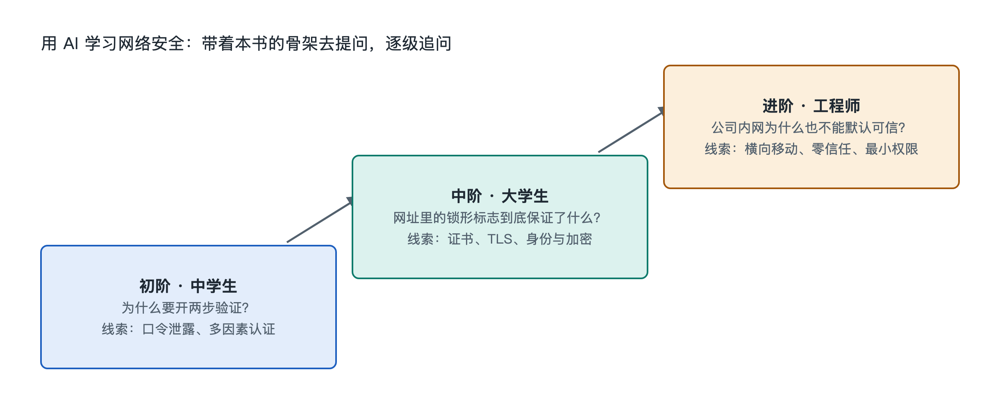

# 9.3 三阶提问阶梯：从中学生到工程师

还是那条短信：“您的快递因地址不详被退回，请点击链接重新填写。”同一条短信拿去问 AI，中学生、信息安全专业新生和企业安全工程师会问出完全不同的问题，得到的知识深度也不同。AI 能展开多深，很大程度上取决于提问的人。本节把提问分成三个台阶，每一阶对应本书九层阶梯中的不同层次，读者可以从自己所在的台阶出发，一级一级往上走。

## 9.3.1 第一阶：问“是什么”和“为什么”——建立概念

第一阶面向中学生和刚开始关心数字安全的普通读者，对应本书的“对象”和“结构”两层。这一阶的目标是把名词弄清楚，并把它和自己的生活连起来。典型问题如下：

- “钓鱼短信是什么？它为什么要冒充快递公司？”
- “多因素认证（MFA）是什么意思？我的手机验证码算不算？”
- “网址里的 https 和小锁图标代表什么？有了小锁就一定安全吗？”

这一阶的提问技巧是**让 AI 用类比讲，并且举身边的例子**。比如可以追加一句：“请用寄信和盖章来比喻数字签名。”问完之后，最好用一句话复述给 AI 听，请它指出哪里说得不准确。能用自己的话讲清楚，这一阶才算走完。

## 9.3.2 第二阶：问“怎样运行”——打通机制

第二阶面向大学生和安全专业入门者，对应“功能”“连接”“流动”“机制”几层。这一阶要追问部件之间怎样配合，信息怎样流动。典型问题如下：

- “浏览器打开一个 HTTPS 网站时，是怎样确认对方证书可信的？证书链的每一环各起什么作用？”
- “短信验证码和通行密钥（Passkey）都算第二因素，为什么后者更能抵抗钓鱼？”
- “一条可疑登录告警从产生到被分析师看到，要经过哪些环节？”

这一阶的提问技巧有两条。第一，**要求 AI 按步骤或画流程图**，例如“请按时间顺序列出每一步，并说明每一步防住了什么”。第二，**主动问反例和边界**，例如“在什么情况下这个机制会失效？”这类追问能逼出机制背后的假设。比如通行密钥抗钓鱼的关键在于凭据与网站域名绑定，假网站拿不到真网站的凭据，弄清这一点就从“知道”走到了“理解”。

## 9.3.3 第三阶：问“为什么这样设计”和“怎样权衡”——触及原理与工程

第三阶面向工程师、安全从业者和需要做决策的管理者，对应“关键技术”“原理”和“AI 协同”三层。这一阶的问题往往没有标准答案，需要比较和取舍。典型问题如下：

- “公钥加密的安全性依赖于哪些计算困难问题？量子计算会怎样影响它们？业界正在怎样迁移？”
- “一家五十人的公司，预算有限，应该先上终端检测与响应（EDR），还是先做账号的多因素认证和备份？请从攻击链角度说明理由。”
- “零信任架构落地时，用户体验和安全强度之间常见的冲突有哪些？”

这一阶的技巧是**给出约束条件，让 AI 做方案对比，并要求注明依据**，比如“请列出两到三种方案，用表格比较成本、风险降低程度和实施难度，并说明哪些结论来自公开标准，例如 NIST 的相关文件”。工程问题离不开具体场景，背景交代得越清楚，AI 给出的建议越有参考价值。

## 9.3.4 三阶对照与提问守则

| 台阶 | 典型读者 | 对应认知层 | 核心问法 | 检验标准 |
|---|---|---|---|---|
| 第一阶 | 中学生、普通用户 | 对象、结构 | 是什么？为什么？ | 能用自己的话复述 |
| 第二阶 | 大学生、入门者 | 功能、连接、流动、机制 | 怎样运行？何时失效？ | 能画出流程并指出薄弱点 |
| 第三阶 | 工程师、管理者 | 关键技术、原理、AI 协同 | 为何这样设计？怎样权衡？ | 能针对具体场景做取舍 |

无论站在哪一阶，都应遵守三条守则：

1. **站在防御一侧提问。** 问“怎样识别和防范”，不要问“怎样实施攻击”。正规 AI 服务通常会拒绝提供攻击步骤，这类内容也越出了学习的正当范围。
2. **不把敏感信息交给 AI。** 分析可疑短信时，先把手机号、姓名、验证码、内部系统地址等内容删掉或替换，再粘贴进对话框。
3. **交叉核实关键结论。** AI 可能编造标准编号、产品功能或事件细节，所以涉及数字、日期和厂商做法的内容，要回到官方文档、标准原文或可信媒体的公开报道去核对。产品功能以写作时和你查阅时的官方说明为准。

## 9.3.5 小结：让问题带着你爬阶梯

三阶提问阶梯的用法不限于“按身份对号入座”。一位中学生对 HTTPS 产生好奇时，完全可以沿着“小锁是什么”“证书怎样验证”“背后的数学为什么难以破解”一路问上去。一位工程师遇到新概念时，也不妨退回第一阶，先让 AI 讲个类比。每往上走一阶，问题就从名词转向流程，再转向取舍。本书的纸面骨架负责告诉你每层有什么，AI 负责陪你沿着阶梯往上走。下一节将回顾整章内容，并把这些提问方法落到具体的探索任务中。
