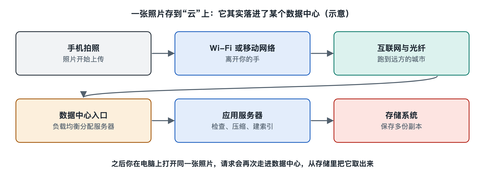

# 1.1 你的照片存在哪里：从手机到远方的机房

晚饭时你拍下一盘刚出锅的菜，手机相册右上角的小云朵转了几圈，显示“已备份”。第二天你换了一部新手机，登录同一个账号，这张照片又出现在了屏幕上。旧手机没有把照片“递”给新手机，那么这几秒钟里，照片去了哪里，又是从哪里回来的？

“存在云上”是最常见的回答，可“云”只是一个比喻。照片没有飘在天上。它被拆成数据包，经过基站、光纤和一连串网络设备，最后写进某座建筑里某台机器的硬盘或闪存。这座建筑就是数据中心（Data Center）。本节沿着照片的路线走一遍，先把“云落在哪里”这件事看清楚。

## 1.1.1 第一程：从手机到网络入口

点下快门后，手机先把照片压缩成一个文件，常见格式是 JPEG 或 HEIF，大小通常在一两兆字节到十几兆字节之间。相册应用发现有新文件需要备份，就把它切成许多小块，每块装进一个数据包。数据包上写着“寄件地址”和“收件地址”，就像快递单。

这些数据包经过 Wi-Fi 路由器或手机基站离开你的手边，进入运营商的网络。在家里，它们沿网线或光纤到达小区和街道的接入设备；在路上，它们通过无线电波到达附近的基站，再由基站接入运营商的光纤。Wi-Fi、移动通信和光纤各有一册专门讲解（第二十七、二十六、二十八册），这里只需记住一点：无论走哪条路，照片都很快离开空中，进入地下和管道里的光纤。

## 1.1.2 第二程：跨越城市与省份

运营商网络就像一张公路网。数据包从“乡道”进入“国道”，再上“高速公路”，即城市之间、省份之间的骨干光缆。沿途的路由器（Router）根据收件地址，一站一站地决定下一步往哪里转发。互联网怎样完成这种转发，第二十五册有完整的讲述。

那么收件地址写的是哪里？你的手机并不知道哪座机房离你最近、哪座机房今天比较空闲。云相册的服务商会通过域名解析等手段，把你引向它选好的某个入口。这个入口可能在你所在的城市，也可能在几百甚至上千公里外。光在光纤中每秒大约跑二十万公里，跨越一千公里单程约需五毫秒，再加上沿途设备的处理时间。所以你按下备份后几乎察觉不到“远”，但距离实实在在存在。

## 1.1.3 第三程：走进一座机房

数据包到达目的地后，会先穿过数据中心边缘的路由器和防火墙，再经过层层交换机（Switch），送到一台负责接收上传请求的服务器（Server）。这台服务器确认你的身份，检查文件是否完整，再决定把照片存到哪里。真正保存照片的，往往是另外一批专门负责存储的服务器，它们装满了硬盘或固态硬盘。

照片通常不会只存一份。为了防止某块硬盘损坏导致照片丢失，主流云存储系统会把同一份数据保存多个副本，或用纠删码（Erasure Coding）的方法拆块存放在不同机器、不同机柜，甚至不同的数据中心。具体怎样做因服务商而异，第六章会专门讲解。在这里可以先建立一个印象：你看到的“一张照片”，在机房里可能对应着分散在多处的几份数据。

下面把这趟旅程整理成一张表：

| 路段 | 主要经过的设施 | 大致距离尺度 | 本书相关章节 |
|---|---|---|---|
| 手边 | 手机、Wi-Fi 路由器或基站 | 几米到几公里 | 第二十六、二十七册 |
| 城市与骨干 | 接入网、骨干光缆、路由器 | 几十到上千公里 | 第二十五、二十八册 |
| 机房内部 | 防火墙、交换机、服务器、存储设备 | 几十米到几百米 | 本书第二至七章 |
| 多座机房之间 | 数据中心互联光纤 | 几十到数千公里 | 本书第七章 |

## 1.1.4 机房长什么样

如果你有机会走进一座数据中心，看到的不会是电影里闪烁的科幻场景，更像一座安静而嘈杂的工厂。一排排两米多高的金属柜子叫机柜（Rack），每个机柜里叠放着几十台扁平的服务器，正面闪着指示灯，背面是密密麻麻的线缆。风扇的轰鸣持续不断，冷风从一侧吹进机柜，热风从另一侧排出。

机房里的服务器只占这座建筑的一部分。另一部分空间里有变压器、不间断电源（UPS，Uninterruptible Power Supply）、成排的电池和备用柴油发电机，负责让服务器一刻也不断电；还有空调机组、水泵、管道和楼顶的冷却塔，负责把服务器发出的热量搬到室外。门口有门禁和监控，进入机房需要登记和多道身份核验。

照片的存储看起来只是写入几兆字节，背后却要依靠电力、制冷、网络和安全几套系统同时正常运转。这正是本书要拆开来看的内容。

## 1.1.5 为什么要先问“照片在哪”

数据中心这个话题很容易一上来就陷入术语：叶脊网络、PUE、Tier 等级、液冷……它们都重要，但如果没有一个具体的东西作为参照，就容易变成名词清单。一张照片恰好能把这些名词串起来：

- 照片要**存下来**，就需要服务器和存储设备；
- 照片要**传过来**，就需要网络和光纤；
- 设备要**不停机**，就需要供电和冗余；
- 设备会**发热**，就需要制冷，而制冷又要耗电；
- 照片要**不丢失**，就需要多副本和备份。

本书后面的每一章，都可以回到这张照片上检验：它此刻经过了哪个部件，依赖了哪种机制，背后是什么原理。

需要说明的是，具体某家云相册把你的照片存在哪座城市、哪座机房，服务商通常不会逐一公开，本书也不作猜测。但有些服务商会公开“数据存储地域”或在隐私政策中说明数据所在的国家或地区，你可以在自己的账号设置里找一找。

“云”有了落脚点之后，下一个问题自然出现：这座装满服务器的建筑，究竟算是什么样的设施？它和我们熟悉的工厂、电站有什么相似与不同？
