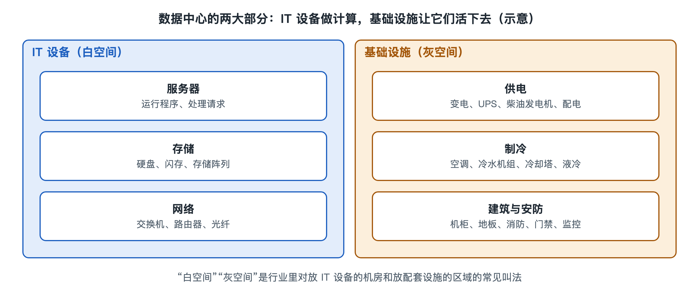

# 2.1 服务器：数据中心的基本单元

你在手机上点下“上传”，那张照片最终要落到某台机器里，被某个程序接收、校验、压缩成缩略图，再写进硬盘。完成这些动作的，就是服务器（Server）。如果把数据中心比作一座工厂，服务器就是流水线上的一台台机床。要看懂整座工厂，得先把一台“机床”拆开看清楚。

## 2.1.1 和你的电脑是亲戚，但不是同一种生活

打开一台家用台式机的机箱，你会看到主板、处理器、内存条、硬盘、电源和风扇。服务器的零件清单几乎一样，差别在于它们为不同的“生活方式”而设计：

| 对比项 | 家用电脑 | 数据中心服务器 |
|---|---|---|
| 工作时间 | 每天几小时，常关机 | 全年不停，常连续运行数年 |
| 使用者 | 一个人坐在面前 | 没有人坐在面前，靠网络远程管理 |
| 外形 | 立式机箱，随意摆放 | 扁平抽屉状，插进标准机架 |
| 出故障时 | 自己重启或送修 | 不停机更换部件，或由软件把任务转走 |
| 关注重点 | 价格、外观、游戏性能 | 可靠性、密度、能耗、可维护性 |

一句话概括：家用电脑为“人”服务，服务器为“成千上万个请求”服务，而且身边常常一个人都没有。

## 2.1.2 拆开一台服务器：五个核心部件

一台常见的通用服务器，内部可以按功能分成几块：

- **处理器（CPU，中央处理器）**：负责执行程序指令。服务器常装一到两颗处理器，每颗包含几十个乃至上百个核心（写作时主流产品的典型范围），能同时处理大量请求。
- **内存（RAM，随机存取存储器）**：程序运行时的“工作台”，速度快但断电即失。服务器内存容量常在数百 GB 量级，并普遍使用带纠错功能的 ECC 内存（Error-Correcting Code），能自动发现并修正偶发的比特错误，避免一个翻转的比特悄悄改坏数据。
- **本地存储**：机械硬盘（HDD）或固态硬盘（SSD），用于装操作系统和存放数据。专门的大容量存储设备留到下一节讲。
- **网卡（NIC，网络接口卡）**：服务器与外界交换业务数据的主要通道。数据中心服务器的网卡速率通常比家用宽带高出一两个数量级，写作时 25G、100G 乃至更高速率都很常见。
- **电源与风扇**：电源多为两个，可以互为备份；风扇成排安装，从前往后吹风带走热量。

此外，还有一个家用电脑没有的“小部件”：**基板管理控制器（BMC，Baseboard Management Controller）**。它是主板上一颗独立的小芯片，有自己的网口和供电。即使服务器的主系统死机甚至关机，运维人员也能通过 BMC 远程查看温度、风扇转速、报错记录，或者远程开关机。没有人坐在机器面前，这颗芯片就是运维人员的“远程眼睛和手”。常见的管理接口规范有 IPMI，以及较新的 Redfish。

## 2.1.3 为什么长成“扁平抽屉”：机架式与“U”

走进机房，你看不到一台台立式机箱，看到的是一排排两米多高的铁架子，里面像书架一样插满扁平的金属盒子。这种服务器叫**机架式服务器**，它的高度用“U”来衡量：1U 约为 4.45 厘米（1.75 英寸），这是机架行业通行的尺寸单位，标准机架宽 19 英寸。常见服务器有 1U、2U、4U 等规格，一个常见机架可容纳 42U 左右的设备。

做扁平是为了密度：同样大的机房面积，能塞进更多算力。除了机架式，还有几种形态：

- **刀片服务器**：把多台精简的“刀片”插进一个共享电源、风扇和网络的机箱，进一步提高密度。
- **整机柜服务器**：以整个机柜为单位设计供电和散热，服务器本身只保留必要部件。开放计算项目（OCP，Open Compute Project）就是由 Meta（原 Facebook）于 2011 年发起、后有多家企业参与的开放硬件社区，公开了这类设计。这是特定社区的方案，并非所有数据中心的标准做法。

## 2.1.4 不止一种服务器：按任务分工

数据中心里的服务器并非千篇一律，常按承担的任务配置成不同“型号”：

| 类型 | 配置侧重 | 典型任务 |
|---|---|---|
| 通用计算型 | 处理器与内存均衡 | 网站、应用程序、数据库 |
| 存储型 | 插满硬盘，容量大 | 保存照片、视频、备份 |
| 内存型 | 超大内存 | 缓存、实时分析 |
| 加速计算型 | 配多块 GPU（图形处理器）或其他加速芯片 | AI 训练与推理、科学计算 |

你的照片上传后，可能先由通用计算型服务器接收并生成缩略图，再写进存储型服务器；如果相册具备“识别人脸、按场景归类”的功能，这一步很可能交给加速计算型服务器完成。加速计算型服务器功耗比通用服务器高得多，第七章讨论 AI 算力中心和液冷时还会回到它。

## 2.1.5 单元的意义：坏一台不要紧

把服务器称作“基本单元”，不只因为它是最小的独立计算机，更因为大型数据中心的设计思路是：**单台服务器一定会坏，系统不能因此停摆**。几万台机器同时运行时，硬盘损坏、内存报错、电源失效每天都会在某处发生。因此，一方面服务器自身采用双电源、ECC 内存、可热插拔硬盘等措施，尽量“坏而不停”；另一方面，软件把数据和任务分散到多台机器上，一台下线，其他机器立刻接手。这两层手段如何配合，将在第六章“冗余与容错”中展开。

服务器负责“算”，但照片要长期保存、不能丢，还要靠更专门的存储系统。下一节，我们就从一块硬盘说起。
