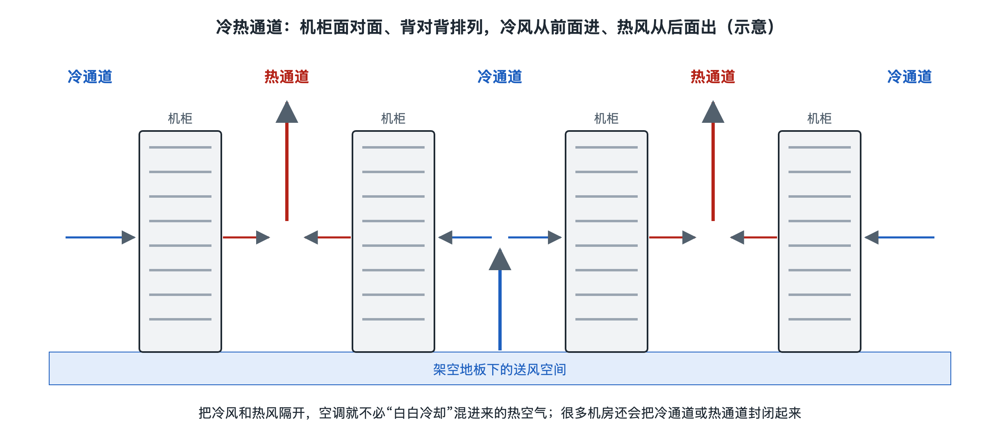

# 2.4 机柜与机房：机架、冷热通道与地板

如果你家里有一个书架，大概知道它的妙处：书竖着排，同样一面墙能放下几百本，找起来也方便。数据中心面对的是同一个问题，只是“书”换成了服务器、存储和交换机，数量从几百变成了几万甚至更多。上一节我们认识了交换机和光纤，本节把视角拉远一步，看看这些设备被装进什么样的“书架”，又摆在什么样的“房间”里。你那张存到云端的照片，就躺在某个机柜里某台服务器的某块硬盘上。

## 2.4.1 机架：数据中心的标准“书架”

数据中心里最常见的家具，是一排排约两米高的金属柜子，叫**机柜**（Rack Cabinet），里面的安装框架叫**机架**（Rack）。日常说话时两个词常常混用。

机架的核心是一套统一尺寸。业界普遍采用的是 **19 英寸机架**：可安装设备的前面板（含安装耳）宽度为 19 英寸（约 48 厘米）。这个规格源自早期电话交换设备，后来由美国电子工业协会的 EIA-310 等标准固定下来。高度用“**U**”（Rack Unit，机架单位）计量，1U 约等于 1.75 英寸（约 4.45 厘米）。常见的薄型服务器高 1U 或 2U，一台大型存储设备可能占 4U 以上。数据中心里常见的机柜是 42U 左右，也有 45U、48U 等更高的规格。

统一尺寸带来的好处，和标准集装箱类似：

- **不同厂商的设备都能装进同一个柜子**，采购和更换不受某一家绑定；
- **容量好算**：一个 42U 机柜扣掉交换机、配电单元和理线空间，还能放多少台 1U 服务器，一目了然；
- **便于规划**：机房设计者可以按“多少个机柜、每柜多少千瓦”来估算供电和制冷。

除了 19 英寸标准，还有一些大型互联网公司自行设计的机架。例如由 Meta（原 Facebook）发起的开放计算项目（OCP，Open Compute Project）提出了 21 英寸宽的 Open Rack 规格，并采用集中供电母排。这是特定组织推动的开放设计，并不是所有数据中心的通用做法。

机柜里除了设备，还有两样常被忽视的东西：一是**配电单元**（PDU，Power Distribution Unit），相当于一条加强版的插线板，竖着装在机柜背面，给每台设备供电；二是**理线架**，把成百上千根网线和电源线整理整齐。线缆杂乱不只难看，还会挡住风道、增加误拔的风险。

## 2.4.2 冷热通道：让冷风不白吹

把机柜排成行之后，最重要的问题就是怎么排。

服务器的风扇有固定方向：从正面吸入冷空气，经过芯片和硬盘，再从背面吹出热空气。如果所有机柜都朝同一个方向，后一排吸进去的就是前一排吹出的热风，越往后越热，就像教室里一排排人背对背呼气。

于是行业形成了**冷热通道**（Hot Aisle / Cold Aisle）布局：相邻两排机柜“面对面、背靠背”。两排正面相对的过道送入冷风，叫冷通道；两排背面相对的过道汇集热风，叫热通道。这种布局在 ASHRAE（美国采暖、制冷与空调工程师学会）的数据中心技术资料和 TIA-942 等标准中都有描述，已成为常规做法。

但仅仅分开还不够，冷热空气会从机柜顶部、行尾和空槽位“串门”。于是又有了**通道封闭**（Containment）：

| 做法 | 怎么做 | 特点 |
|---|---|---|
| 冷通道封闭 | 在冷通道顶部加盖板、两端装门，把冷风“关”在通道里 | 改造相对容易，机房其余空间偏热 |
| 热通道封闭 | 把热通道围起来，热风直接引回空调或天花板回风 | 机房大部分空间较凉爽，对结构要求更高 |
| 盲板封堵 | 用挡板封住机柜里没装设备的空槽位 | 成本很低，防止热风从背面绕回正面 |

这些措施看起来朴素，却直接影响后面第六章要讲的能效指标 PUE。冷风如果有一半没经过芯片就回到了空调，空调就等于在为空气“做无用功”。

## 2.4.3 地板：架空还是不架空

走进传统机房，脚下常常是一块块约 60 厘米见方的方砖，踩上去略有空响，这是**架空地板**（Raised Floor）。地板下面是几十厘米高的空间，过去用来走电缆，也用作送风的“风道”：空调把冷风压进地板下面，再从冷通道里开孔的**通风地板**冒出来，正好被机柜正面吸入。

架空地板的优点是送风均匀、布局灵活，但也有局限：地板下线缆一多就堵风；地板承重有限，越来越重的高密度机柜对它是考验。因此近年不少新建数据中心改用**水泥地面 + 上走线**的方式：电缆和光纤走在机柜顶上的桥架里，冷风从侧面或顶部送入，或者由行间空调就近供冷。两种方式各有适用场景，在写作时的行业实践中并存，并没有哪一种是唯一正确答案。

## 2.4.4 机房：一个被分区保护的空间

把视野再放大，机柜所在的区域叫**主机房**或**白区**（White Space），意思是摆放 IT 设备的空间；而变配电室、UPS 电池间、空调机房等支撑设施所在的区域常被称为**灰区**（Gray Space）。下一节要讲的供电与制冷设备，大多就在灰区。

机房设计还要考虑几件“看不见”的事：

- **分区与门禁**：进出大楼、进入机房、靠近某一排机柜，往往是逐层授权的，就像机场从值机到登机口要过多道检查；
- **消防**：IT 设备不宜用水灭火，许多机房采用气体灭火系统，并配合早期烟雾探测；
- **环境监测**：温湿度、漏水、烟感传感器遍布各处，数据汇总到监控平台。ASHRAE 对 IT 设备进风口温度给出了推荐范围，常被引用的推荐区间大约在 18–27 ℃。

## 2.4.5 小结：从“一台机器”到“一个空间”

机柜把零散的设备变成标准化的单元，冷热通道把气流变成有方向的“河道”，地板和走线决定了电、网、风各走哪条路，分区则让这个空间既能运转又受到保护。到这里，你的照片所在的“房间”已经清楚了。但房间里的每台设备都要用电、都在发热，电从哪里来、热往哪里去？下一节我们走进灰区，看看变电站、UPS、柴油发电机和冷却塔如何撑起这一切。
