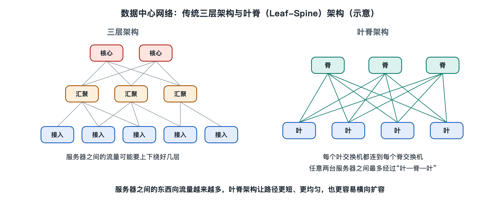

# 4.1 网络拓扑：从三层架构到叶脊网络

你在手机上点开云盘里的一张照片，几百毫秒后它就出现在屏幕上。这一路上，请求要先穿过运营商网络进入数据中心，再在机房内部的交换机之间转几道手，才到达保存照片的那台服务器。机房内部转多少道手、每道手会不会堵车，取决于交换机之间怎样连接。这种“谁和谁相连”的整体形状，叫作网络拓扑（Network Topology）。第二章已经认识了交换机、路由器和光纤这些零件，本节要看的是它们拼起来的形状，以及这个形状为什么在过去十几年里换了一种。

## 4.1.1 像一座城市的道路网

可以把数据中心网络想象成一座城市的道路。服务器是住户，交换机是路口，光纤和网线是道路。道路网的规划决定了两件事：一是从任意一户到任意另一户要经过几个路口，二是高峰期哪条路最容易堵。

早期的数据中心像一座“放射状”的老城：住户先汇到小路，小路汇到干道，干道再汇到市中心的大环路。这种规划适合“大家都往市中心去”的交通，却不适合“邻居之间频繁串门”的交通。数据中心的流量恰好经历了从前者到后者的转变，拓扑也随之改变。

## 4.1.2 经典三层架构：接入、汇聚、核心

2000 年代到 2010 年代初，企业机房和早期互联网数据中心普遍采用三层架构（Three-Tier Architecture），这也是当时网络设备厂商设计指南中常见的推荐形态：

| 层级 | 英文 | 位置与作用 |
|------|------|-----------|
| 接入层 | Access | 通常放在机柜顶部，直接连接本柜服务器 |
| 汇聚层 | Aggregation / Distribution | 把多台接入交换机的流量汇集起来，常在这里做访问控制、负载均衡等策略 |
| 核心层 | Core | 少数几台大容量设备，连接各汇聚区域，并通往数据中心出口 |

整体看去像一棵倒置的树：树根是核心，枝干是汇聚，叶子是接入。为了防止单台设备故障断网，每一层通常成对部署，形成冗余链路。

这种结构在当时有它的道理。那时的主要流量是“用户访问服务器”，请求从外面进来、结果再送出去，路线从树叶直达树根，层次清楚、便于管理。

## 4.1.3 三层架构遇到的三个麻烦

当应用变成“一个请求背后要几十上百台服务器协作”的分布式系统（第五章会详细讲东西向流量），树形结构的短板就显露出来：

1. **路径长短不一。** 同一接入交换机下的两台服务器通信只需一跳；分属不同汇聚区域的两台服务器，则要一路爬到核心层再下来。延迟因此忽高忽低，难以预测。
2. **越往上越拥挤。** 下层大量链路的流量汇到上层少数几条链路上，上层链路容量远小于下层总和，这个比例叫收敛比（Oversubscription Ratio）。服务器之间互访一多，上层就成了瓶颈。
3. **冗余链路被“闲置”。** 传统二层网络为了防止数据帧在环路里无限打转，使用生成树协议（Spanning Tree Protocol，STP），它会主动阻断一部分冗余链路，只留一条路可走。备用的路修好了，平时却不让车走。

## 4.1.4 叶脊网络：每片叶子都连到每根脊

为解决这些问题，大型数据中心在 2010 年代逐渐转向叶脊架构（Leaf-Spine Architecture）。它的思想可以追溯到 1950 年代贝尔实验室工程师 Charles Clos 为电话交换设计的多级交换网络，因此也被称为 Clos 网络。

叶脊网络只有两层：

- **叶交换机（Leaf）**：相当于原来的接入层，放在机柜顶部，下连服务器。
- **脊交换机（Spine）**：骨干层，只负责在叶交换机之间转发。

关键规则只有一条：**每台叶交换机都连到每台脊交换机，叶与叶之间、脊与脊之间不直接相连。** 于是任意两台不在同一叶下的服务器，路径永远是“叶—脊—叶”，固定三跳。

回到城市的比喻：这像是给每个社区都修了通往所有高架桥的匝道。去任何社区都只需“上高架、下高架”，而且有多座高架可选。

叶脊网络通常在交换机之间运行三层路由，并使用等价多路径（Equal-Cost Multi-Path，ECMP）技术：既然经过每根脊的路径一样长，就把不同的数据流分散到所有脊上同时传输。原先被生成树阻断的冗余链路，现在全部投入使用。

| 对比项 | 三层架构 | 叶脊架构 |
|-------|---------|---------|
| 层数 | 三层 | 两层（可扩展为多级） |
| 服务器间跳数 | 不固定 | 跨叶固定为三跳 |
| 冗余链路 | 常被 STP 阻断 | 经 ECMP 全部使用 |
| 扩容方式 | 换更大的核心设备 | 增加叶或脊的台数 |
| 某台上层设备故障 | 影响较大 | 只损失一部分带宽 |

## 4.1.5 横向扩展与它的代价

叶脊网络的扩容方式值得多看一眼。服务器多了，就加叶交换机；跨叶的带宽不够了，就加脊交换机。这叫横向扩展（Scale-out），与“换一台更大的核心设备”的纵向扩展（Scale-up）相对。它让网络可以用大量规格相同、价格相对低的交换机搭建，而不必依赖少数昂贵的大型设备。

当规模大到一层脊也连不过来时，可以在上面再加一层“超级脊”，形成三级甚至更多级的 Clos 结构。一些超大规模云服务商公开发表的论文和技术博客，描述过各自基于这一思路的多级网络设计，例如谷歌介绍过其 Jupiter 网络、Meta（原 Facebook）介绍过其 F16 等数据中心网络架构；这些属于各公司自己的方案，细节并不相同，不应视为统一的行业标准。

叶脊网络也有代价：每片叶都要连每根脊，线缆数量随规模迅速增长，对光纤布线和端口数量要求很高；同时由于设备多，需要依靠自动化工具配置和管理，这一点会在第七章“软件定义”一节展开。另外，一台叶交换机仍是其下服务器的单点，所以服务器常常双上联到两台叶交换机。

从树到网，变化的不是零件，而是连接的规则。理解了这条规则，就能明白为什么你的照片无论存在机房哪个角落，取回的速度都相差不大。下一节，我们沿着另一张同样决定成败的“网”往前走：电力从电网一路流到每台服务器电源的链路。
