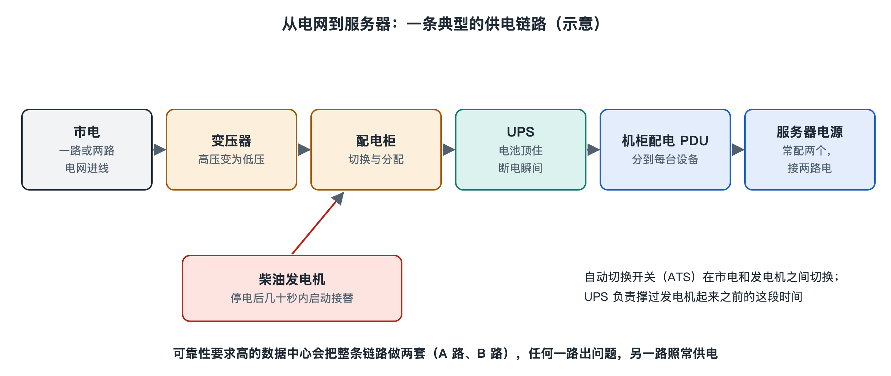

# 4.2 电力链路：从电网到每台服务器的电源

晚上你把手机插上充电器，墙上的插座、手里的充电头、手机里的电池，构成了一条最短的电力链路：交流电进来，充电头把它变成低压直流，电池存起一部分，再供给芯片。你上传的那张照片所在的服务器，也在做同样的事，只是它前面的链路长得多，而且每一段都要回答同一个问题：如果这一段断了，服务器还能不能继续运转？

第二章已经认识了变电站、UPS、柴油发电机这些设备，第三章讲了“不间断与冗余”的目标。这一节把它们按电流经过的顺序串起来，看清各段之间的连接关系。

## 4.2.1 一条链路，五个环节

从电网到服务器芯片，典型的数据中心电力链路可以分成下面几段。不同规模、不同厂商的设计会有差别，但主干结构大体一致：

| 环节 | 主要设备 | 做什么 | 类比 |
|---|---|---|---|
| ① 市电引入 | 高压进线、变电站/开关站 | 从电网接入中压或高压电（常见 10kV 及以上），降到园区内使用的电压 | 自来水总管进小区 |
| ② 低压配电 | 变压器、低压配电柜、自动转换开关（ATS） | 降到 380V/400V 一类低压，并在市电与发电机之间切换 | 小区里的分水阀 |
| ③ 不间断电源 | UPS 与蓄电池（或锂电池） | 在市电中断到发电机接上的空档里顶住供电，同时滤掉电网波动 | 楼顶的水箱 |
| ④ 末端分配 | 列头柜、机柜配电单元（PDU） | 把电分到每一列、每一个机柜、每一个插口 | 各家的水龙头 |
| ⑤ 服务器电源 | 服务器电源模块（PSU） | 把交流电转成主板需要的 12V 等低压直流 | 净水器出水口 |

这张表里有一个容易忽略的关键：柴油发电机并不在主链路上“串着”，而是像一条备用支路，通过 ATS（Automatic Transfer Switch，自动转换开关）挂在第②段。平时电从市电走，市电失效时开关切到发电机。

## 4.2.2 停电那几十秒：UPS 和发电机的接力

假设园区外的电网突然中断，链路会按顺序发生下面的事：

1. **第 0 秒**：市电消失。UPS 检测到后立即改由电池供电。对常见的在线式（双变换）UPS 来说，负载本来就一直由它的逆变器供电，所以服务器几乎感受不到任何变化。
2. **几秒到十几秒**：控制系统确认市电确实中断，发出启动指令，柴油发电机开始起动、升速、稳定电压和频率。
3. **数十秒左右**：发电机输出合格，ATS 把低压母线切换到发电机，UPS 由发电机重新供电并给电池充电。
4. **市电恢复后**：系统再按设定流程切回市电，发电机降载、冷却、停机。

所以 UPS 电池的设计后备时间并不需要很长，公开资料中常见的设计在几分钟到十几分钟量级，只要足够覆盖发电机启动并留出余量即可；真正支撑长时间停电的是发电机和现场储存的燃油。至于燃油要储备多少小时，取决于所追求的等级和当地补给条件，在下一节谈 Uptime 等级时还会遇到。

这就是“接力”的思路：电池反应快但存量小，发电机存量大但起步慢，两者组合起来，覆盖从毫秒到数天的时间尺度。

## 4.2.3 双路供电：从 A 路、B 路到两个电源模块

只解决“电网停电”还不够。链路中间的任何一个设备——一台变压器、一台 UPS、一个配电柜——也可能故障或需要检修。常见的办法是把整条链路复制一份，形成 **A 路** 和 **B 路** 两条相互独立的通路。

这条复制会一直延伸到服务器本身。打开一台数据中心服务器的背面，常能看到两个电源模块，各插一根电源线，分别接到机柜里的 A 路 PDU 和 B 路 PDU 上。两个模块同时分担负载，任何一路断电，另一路仍能独自带起整台服务器。

由此可以理解冗余的一个基本规律：**冗余只有在“从头到尾都分开”时才有效**。如果 A、B 两路在中途汇合到同一个开关或同一根母线，那个汇合点就成了单点故障（SPOF，Single Point of Failure），整条备份链路的意义会大打折扣。工程上把“N+1”“2N”这类配置写进设计，正是为了说清楚每一段复制了多少份；它们的严格含义和可靠性计算，留到第六章和第八章展开。

## 4.2.4 每次转换都有代价

电每经过一次变压或交直流转换，都会损失一部分变成热。一条典型链路要经历：高压降到低压、UPS 内部的交流转直流再转交流、服务器电源再转成低压直流。单个环节的效率可能都在九成以上，但多个环节相乘，损耗就积累起来，而且这些热还得靠空调再搬出去。

为此，行业里出现了几类缩短链路的做法：

- **高效或旁路模式的 UPS**：在电网质量良好时让电流绕开双变换环节，减少转换损耗。
- **高压直流（HVDC）供电**：在部分数据中心（国内一些运营商和互联网公司有公开的应用案例）中，用直流配电替代传统 UPS 的“直流再逆变成交流”一段。
- **机柜级电池**：一些大型互联网公司公开过把电池直接放在机柜或服务器电源旁的设计，例如开放计算项目（OCP，Open Compute Project）社区中的相关规范。这是特定公司和社区的做法，并非通用标准。

这些方案各有取舍：省掉一次转换往往意味着改变设备形态、运维习惯或兼容性。写作时它们仍在演进，但“转换越少、损耗越少”这个原理不会过时。

## 4.2.5 小结：电力链路的三个关键词

回到那张照片：它所在的硬盘之所以能日夜转动，是因为背后有一条层层降压、处处有备份的电力链路。可以用三个词记住它：

- **串联**：电从电网到芯片要依次经过五个环节，任何一环中断都会影响下游；
- **接力**：UPS 负责瞬间，发电机负责长时，两者在时间上无缝衔接；
- **复制**：A、B 两路从源头一直分到服务器的两个电源模块。

电送进服务器之后，几乎全部变成了热量。下一节我们沿着反方向，看热量怎样从芯片出发，一路被搬到室外。
