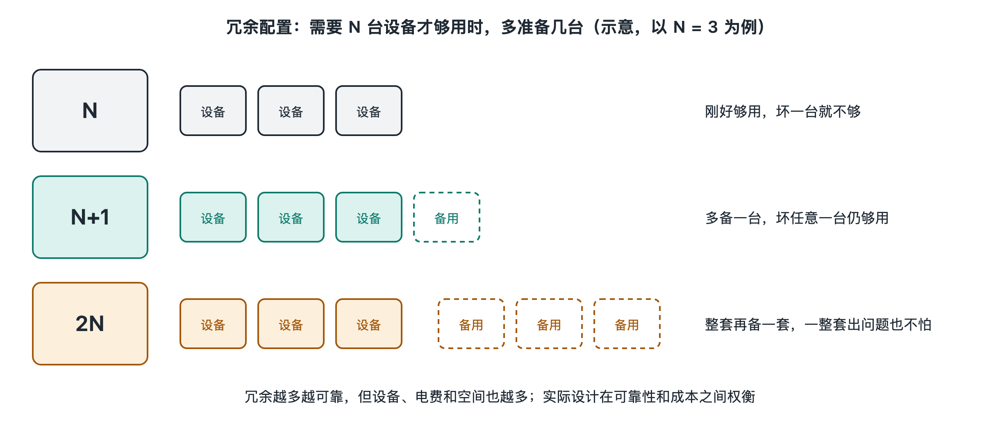

# 6.3 冗余与容错：N+1、2N 与故障域

家里的备用钥匙、手机里多绑的一张银行卡、出门时多带的一个充电宝，都是为“万一”准备的。数据中心对“万一”的准备要系统得多。你的照片今晚上传，明早还能打开，并不是因为机房里没有东西坏掉。设备一直在坏，只是坏掉的那一部分没有影响到你。这背后有两个概念：**冗余**（Redundancy），指多准备一份能力；**容错**（Fault Tolerance），指部件出了故障，系统仍能继续工作。本节讲数据中心怎样计算“多准备多少”，又怎样划定“坏掉时影响多大”。

## 6.3.1 先认清现实：大规模系统里，故障是常态

单块硬盘的年故障率通常在百分之一上下，这是公开的大规模硬盘统计报告中常见的量级。对一台家用电脑来说，这个概率不算高。可一座机房里可能有数万块硬盘，按这个量级推算，几乎每天都会有盘坏掉。风扇、电源模块、内存条、光模块和交换机端口也是这样，数量一大，“偶尔”就变成了“天天”。

因此，大型数据中心的设计思路是承认零件会坏，再让系统扛得住，而不是指望零件永不出错。工程上常把冗余分成两层：

| 层次 | 冗余对象 | 典型做法 |
|---|---|---|
| 设施层 | 电力、制冷 | 多台 UPS、多台冷水机组、双路市电 |
| IT 层 | 服务器、网络、数据 | 双电源、双上联、多副本、多实例 |

两层之间互相配合。设施层负责“机器不断电、不过热”，IT 层负责“机器真坏了，服务照样在”。

## 6.3.2 N、N+1、2N：用字母描述“多准备多少”

工程师用一套简洁的记号来描述冗余程度。**N** 指满足负载正好需要的设备数量。假设一个机房的制冷需求正好要 4 台空调，那么 N=4。

- **N**：只配 4 台。任何一台坏了或停机检修，制冷能力就不够。
- **N+1**：配 5 台。其中任意 1 台坏掉，剩下 4 台仍能扛住全部负载，这是最常见的做法。
- **N+2**：配 6 台，可以同时容忍 2 台失效，适合维护频繁或设备故障率较高的场合。
- **2N**：配两套完全独立的系统，每套都能单独承担 100% 负载，比如 A、B 两路供电，从上游一直到服务器电源各自成链。
- **2(N+1)**：两套独立系统，每套内部再做 N+1，冗余度更高，成本也最高。

N+1 和 2N 的差别,可以用一个对比说明。N+1 好比一个 5 人搬家队，有一人请假，活照样干完，但 5 个人共用同一辆卡车，卡车一坏，全队都停。2N 好比两支完整的搬家队，各开各的车，一支队整体出问题，另一支独立接手。也就是说，N+1 防的是“单个部件坏”，2N 还能防“整条路径坏”，包括配电柜、母线、开关这类单一的共用环节。

不过，冗余不是越多越好。2N 意味着设备数量和占地接近翻倍，而且平时每套只带一半负载，设备效率往往偏低。在第四章介绍的 Uptime Institute 等级体系中，较高等级通常要求关键路径具备多条独立分配路径，并支持“在线维护”和“容错”，所以这些概念与等级划分是直接对应的。等级越高，可用性越好，投资和运营成本也越高，需要按业务的重要程度来权衡。

## 6.3.3 单点故障与故障域：坏掉时能波及多远

冗余配得再多，只要链路上还有一个“独此一家”的环节，它坏了就会拖垮全局。这样的环节叫**单点故障**（SPOF，Single Point of Failure）。审视一座机房的设计，很大一部分工作就是逐条追踪电力、冷却和网络路径，找出这些隐蔽的独木桥。常见的例子有两路供电汇进同一个开关、两根光纤走同一条管道、两台服务器的电源插在同一个排插上。

比单点故障更进一步的概念是**故障域**（Failure Domain），指“一个故障发生时，会一起受影响的范围”。故障域可以从小到大排成一串：

> 一块硬盘 → 一台服务器 → 一个机柜（共用排插和柜顶交换机）→ 一排机柜或一个包间（共用配电和空调）→ 一栋楼 → 一个园区 → 一个城市或地区

一个故障域里的部件“同生共死”，所以冗余的关键在于让备份分散到不同的故障域中，而不只是多放几份。如果把同一张照片的三份副本放进同一个机柜，排插一跳闸，三份会一起离线。规范的做法是把副本分散到不同机柜，甚至不同的楼和园区。许多云服务商把一个地区划分为若干相互隔离的“可用区”（Availability Zone），每个可用区有独立的电力、制冷和网络。这是写作时主流公有云普遍采用的设计思路，具体划分方式各家不同，详见《云计算系统》一册。

## 6.3.4 容错的关键：检测、切换与隔离

有了冗余，还需要机制把它用起来，容错一般包括三个动作：

1. **检测**：持续监测部件状态，比如心跳信号、电压和温度传感器、磁盘自检信息，以便尽早发现异常。
2. **切换**：把负载转移到备份上。转移可以发生在硬件层，比如服务器双电源中一路断了，另一路无缝接手；也可以发生在网络层，叶脊网络中一条链路断了，流量改走其余路径；还可以发生在软件层，下一节要讲的数据复制会让其他副本继续提供读写。
3. **隔离**：阻止故障扩散，比如电路中的断路器分级保护、软件里的“熔断”机制，都是为了让坏掉的部分不至于拖累邻居。

还有一个常被忽视的风险，叫**共模故障**（Common-Mode Failure），指看似独立的备份因为共同原因而一起失效。例如两台设备装了同一个有缺陷的固件版本，或者同一批次的硬盘在相近的时间集中老化，或者一次错误的配置变更被同时推送到所有节点。应对办法包括分批升级、混用批次，以及在变更前先做小范围灰度验证。这也说明，容错不只是硬件问题，同样涉及运维流程。

## 6.3.5 小结

冗余回答的是“多准备多少”，可以用 N+1、2N 等记号描述；故障域回答的是“坏了会波及多远”，决定了备份应该放在哪里；容错机制则通过检测、切换和隔离，把冗余真正转化为服务的连续性。你的照片能够安然无恙，靠的是这几层设计叠加在一起。在这些办法里，数据的多份保存最关键，而怎样存才既安全又不浪费空间，正是下一节“多副本、纠删码与异地容灾”要讨论的内容。
