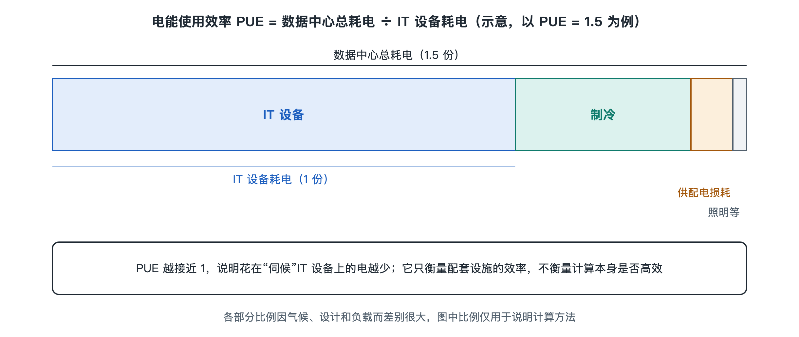

# 6.5 能效管理：PUE 与制冷优化

夏天开空调时，很多人会把温度调到 26℃，再把门窗关严。电费账单告诉我们：温度设得越低、冷气漏得越多，用电就越多。数据中心面对的是同一个问题，只是规模大得多。机房里每一台服务器都在发热，制冷系统要日夜不停地把热量搬走。在不少数据中心里，花在“搬热量”上的电，是一笔与计算本身相当可观的开销。能效管理关心的就是一个朴素的问题：每送进机房一度电，有多少真正用在了计算上？

## 6.5.1 一把尺子：PUE 衡量的是什么

第四章介绍过电能使用效率（Power Usage Effectiveness，PUE）。这一指标由行业组织 The Green Grid 提出，后来被纳入国际标准（ISO/IEC 30134-2）。它的算法很简单：

> PUE = 数据中心总耗电 ÷ IT 设备耗电

IT 设备指服务器、存储和网络设备。总耗电还要再加上制冷、供电损耗（变压器、UPS 的转换损失）、照明等。PUE 的理论下限是 1.0，意思是所有电都给了 IT 设备，没有任何额外开销。现实中这做不到。

| PUE 数值 | 含义 | 粗略对应的情况 |
|---|---|---|
| 2.0 | 每 1 度电用于计算，另有 1 度用于“配套” | 较老的小型机房较常见 |
| 1.5 左右 | 配套开销约为 IT 用电的一半 | Uptime Institute 近年年度调查中行业平均大致在此附近 |
| 1.1–1.2 | 配套开销很小 | 部分超大规模数据中心公开报告的水平 |

上表数值是公开资料中的常见范围，具体到某家公司、某座机房，要看它自己发布的报告和测量口径。

PUE 也有局限，至少有三点要注意：

- **它只看“比例”，不看“总量”。** 服务器本身效率低下、空转浪费，PUE 并不会变差。
- **口径会影响结果。** 测量点设在哪里、取瞬时值还是全年平均，都会让数字不同。比较不同机房时要先问清口径。
- **它不管水和碳。** 为此 The Green Grid 又提出了水利用效率（Water Usage Effectiveness，WUE）和碳利用效率（Carbon Usage Effectiveness，CUE），用来补上用水和排放两个维度。

## 6.5.2 制冷为什么是第一大头

在 IT 设备之外，制冷通常是耗电最大的部分。第八章会从热力学上解释：服务器消耗的电几乎全部变成热，制冷系统只能把热量从机房“搬”到室外，而搬运本身也要耗电。所以，降低 PUE 的主战场就是制冷。常见的思路可以归成四类。

**1. 不让冷热空气混在一起。** 第二章讲过冷热通道：服务器从冷通道吸入冷风，向热通道排出热风。如果冷风绕过服务器直接回到空调，或者热风回流到服务器进风口，空调就做了无用功。用挡板、门和顶棚把冷通道或热通道封闭起来，叫作“通道封闭”（containment）。机柜里的空槽位装上盲板，也是同样的道理。这类措施成本低、见效快，相当于家里开空调时关好门窗。

**2. 别把机房冷得太过头。** 早年机房常被维持在二十度出头甚至更低。美国采暖、制冷与空调工程师学会（ASHRAE）发布的数据处理环境热指南给出了服务器进风温度的推荐范围，大致为 18–27℃，并为不同等级的设备规定了更宽的允许范围。进风温度提高后，冷水机组可以用温度更高的冷冻水，压缩机做的功就少了。这和夏天空调从 22℃ 调到 26℃ 省电是同一个原理。

**3. 借用大自然的冷。** 室外气温低时，可以少开或不开压缩机，直接利用室外冷空气或冷却塔里的低温水来带走热量，这叫“自然冷却”（free cooling，也称免费冷却）。这也是许多大型数据中心选在气候凉爽地区的原因之一，第八章讲选址时还会提到。

**4. 让设备按需运转。** 风扇和水泵使用变频驱动后，转速可以随负载调节。按照风机的相似规律，功率大致与转速的三次方成正比，转速降到八成，功率只剩一半左右。很多机房夜间负载较低，按需降速能省下不少电。

## 6.5.3 从“定时调”到“看数据调”

制冷系统里有冷水机组、冷却塔、水泵、空调末端等许多设备，它们相互牵连：提高冷冻水温度能让冷水机组省电，却可能需要风机转得更快。哪一组设定最省电，凭经验很难找准。

因此，许多数据中心在机房里布设大量温度、湿度、压力和电力传感器，接入第五章提到的监控系统，用数据驱动调节。较早引起广泛关注的公开案例来自谷歌：该公司在 2016 年前后公开介绍，与 DeepMind 合作用机器学习模型优化数据中心制冷，在其报告的测试中，制冷用电明显下降，后来又让系统在人工设定的安全边界内自动调节。这是谷歌自己的做法和自己公布的结果，不同机房的效果会不一样，但“用模型预测、在安全约束内寻优”的思路已经被不少运营方借鉴。

需要注意的是，优化永远要让位于安全。进风温度提得过高、余量压得过低，一旦某台空调故障，温度可能很快冲出允许范围。第六章前面讲的冗余设计，在能效优化时同样不能丢。

## 6.5.4 省电不只在机房里

完整的能效管理还要往两头延伸：

- **往上游：** 选用转换效率更高的 UPS 和电源，减少变压次数，降低配电损耗。
- **往 IT 设备：** 用第 6.1 节的虚拟化和第 6.2 节的调度，把零散负载合并起来，让空闲服务器进入低功耗状态。这部分节省不体现在 PUE 上，却实实在在减少了总用电。

## 6.5.5 小结

PUE 是一把简单好用的尺子，回答的是“配套开销占多大比例”。降低它的主要办法集中在制冷：隔开冷热气流、适当提高温度、借用自然冷源、让设备按需运转，再用数据和模型去寻找最优设定。但也要记住，PUE 低不等于整体节能，还要同时看总用电、用水和碳排放。随着 AI 算力把单个机柜的功率推得越来越高，靠风扇吹风逐渐吃力，液冷等新技术登场，这正是第七章要讲的内容。
