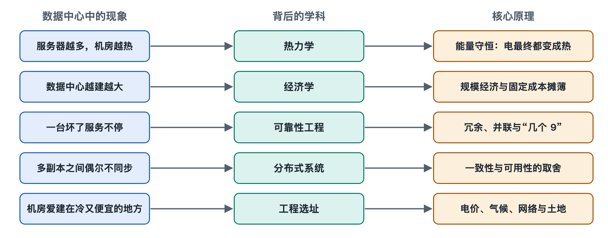

# 8.1 热力学：每一瓦电最终都变成热

把手机连续拍几分钟 4K 视频，机身会明显发烫；笔记本跑大型游戏时，风扇呼呼作响，出风口吹出热风。这些热从哪里来？答案很直接：从电来。手机和电脑消耗的电能，几乎全部在机身里变成了热。数据中心不过是把这件事放大了成千上万倍。你那张存到云端的照片，每被读取、压缩、传输一次，都对应着一份很小的电能，而这份电能最后几乎都化作了机房里的热量。本节回到物理学，解释为什么数据中心必须花那么大力气“搬热”。

## 8.1.1 能量守恒：电不会消失，只会换个样子

热力学第一定律说的是能量守恒：能量既不会凭空产生，也不会凭空消失，只能从一种形式转化为另一种形式。电流流进服务器，能量去了哪里？

- **大部分在芯片和电路中变成热**：CPU、GPU 里数以十亿计的晶体管不断开关，电流流过导线和晶体管时遇到电阻，电能转化为热，这叫焦耳热。
- **一小部分暂时变成别的形式**：风扇转动的动能、硬盘盘片的旋转、指示灯的光、网卡发出的光信号和电信号。
- **这些“别的形式”最终也变成热**：风扇推动的空气因摩擦减速而变暖，灯光被墙壁吸收，光信号在线缆另一端被接收器吸收。

所以工程上有一个可靠的近似：**IT 设备消耗多少电，就向机房释放多少热**。一台功率 500 瓦的服务器，就相当于一台 500 瓦的电暖器持续工作。一个功率 10 千瓦的机柜，散发的热量和十来台家用小太阳取暖器相当；如今 AI 训练用的高密度机柜，功率可达几十甚至上百千瓦（公开资料中的常见范围，写作时的情况）。

有人会问：计算不是“做了有用的事”吗，有用的部分去哪了？计算产生的“结果”是信息，比如照片被压缩成更小的文件。信息本身并不携带可观的能量，存进硬盘的比特排列方式变了，但这不会把多少能量“锁”在里面。因此，从能量账本上看，数据中心本质上是一台把电变成热的机器，只是在变的过程中顺带完成了计算。

## 8.1.2 计算的物理下限：兰道尔原理

物理学对“计算需要多少能量”确有一个理论讨论。1961 年，IBM 研究员罗尔夫·兰道尔（Rolf Landauer）提出：擦除 1 比特信息，至少要向环境释放 kT·ln2 的热量（k 是玻尔兹曼常数，T 是绝对温度）。在室温下，这个数值约为 3×10⁻²¹ 焦耳，小得惊人。

| 对照项 | 量级 |
|---|---|
| 兰道尔极限（室温擦除 1 比特） | 约 3×10⁻²¹ 焦耳 |
| 当今芯片完成一次基本逻辑操作的实际能耗 | 远高于该极限，通常差好几个数量级 |

这张对照表说明两件事：第一，芯片离物理极限还很远，能效仍有改进空间，这也是芯片工艺不断进步的动力；第二，现实中的能耗几乎全部来自工程上的损耗，而不是物理定律强制要求的那一点点。无论如何，这些能耗的终点都是热。

## 8.1.3 热往哪里走：第二定律与温差

热力学第二定律告诉我们：热量会自发地从高温物体流向低温物体，反过来则不会自发发生。这决定了散热的基本逻辑。

1. **芯片必须比周围更热，热才会流出去。** 芯片表面温度、散热器、空气或冷却液之间要保持温差，热才能一级级传递出去。
2. **温差越大、接触面越大，传热越快。** 这就是散热器做成密密麻麻鳍片的原因，也是液冷效率高的原因：水的比热容约为空气的 4 倍，按体积算能携带的热量约是空气的 3000 多倍。
3. **想把热“逆着”送到更热的地方，必须额外做功。** 夏天室外 35℃，如果要把二十几摄氏度的空气冷却下来，热量无法自己流向更热的室外，就得靠压缩机制冷，像水泵把水抽上高处一样把热“泵”出去；回水温度越高，这部分额外做功就越少。这正是空调耗电的来源。

这一点直接解释了第五章讲过的现象：冷却系统本身也耗电，而它耗的电最终同样变成热，一并排到室外。

## 8.1.4 从定律看工程选择

理解了这两条定律，许多工程做法就有了统一的解释：

- **PUE 为什么不可能小于 1。** 电能使用效率（Power Usage Effectiveness，PUE）是总耗电除以 IT 设备耗电。IT 设备的电全部变成热，搬走这些热又要额外耗电，所以 PUE 只能大于 1，工程努力的方向是尽量接近 1。
- **为什么提高机房温度能省电。** ASHRAE（美国采暖、制冷与空调工程师学会）的推荐范围中，服务器进风温度上限为 27℃ 左右。进风温度允许高一些，机房和室外的温差就更小，甚至可以直接利用室外冷空气或冷水散热，也就是“自然冷却”，压缩机工作时间随之减少。
- **为什么要隔离冷热通道。** 冷热空气一旦混合，温差就被白白抹平，等于浪费了制冷系统辛苦造出的“冷”。
- **为什么有人回收废热。** 第二定律并没说热就是废物。服务器排出的几十摄氏度的热水或热风，在北欧等地已有被用于区域供暖的公开案例，让热量再做一次贡献。

## 8.1.5 小结：数据中心是一台“电变热”的机器

把热力学放到数据中心身上，可以得到一句简单的话：**进来多少电，最终就要搬走多少热**。计算只是电能变成热能途中的“副产品”，而散热系统的规模、能耗和设计，都被这条定律牢牢约束。下一节我们换一个角度，看看经济规律如何让数据中心越建越大。
