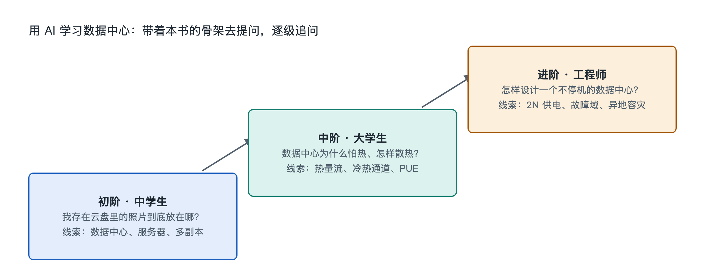

# 9.3 三阶提问阶梯：从中学生到工程师

同一张照片，三个人会问出完全不同的问题。上初中的妹妹看着手机相册问：“我删了照片，它在机房里真的没了吗？”读大学计算机专业的哥哥会问：“对象存储用三副本还是纠删码？删除是立刻生效还是先打标记？”在云服务商做运维的表姐则会问：“这个存储集群的硬盘年故障率是多少？重建一块盘要多久，重建期间再坏一块会不会丢数据？”

三个问题指向同一个系统，深度却差了好几层。用 AI 学习数据中心，最大的门槛往往不在 AI 会不会答，而在我们会不会问。本节给出一把“三阶提问阶梯”，帮助不同起点的读者把问题一级一级往上搭。

## 9.3.1 第一阶：看得见的“是什么”与“为什么”

第一阶面向中学生和普通读者，起点是手边的实物和日常体验。这一阶的问题有三个特征：从具体现象出发，只问一件事，追问“为什么”。

| 日常现象 | 第一阶提问示例 | 对应本书章节 |
|---|---|---|
| 照片几秒钟就上传完 | 我的照片上传后，第一站到了哪里？ | 1.1、5.1 |
| 手机发热、充电器发热 | 机房里成千上万台电脑，热量去哪了？ | 3.5、8.1 |
| 视频网站偶尔打不开 | 一个机房停电了，网站为什么还能用？ | 3.4、6.3 |
| AI 助手回答要“想一会儿” | 回答我问题的电脑长什么样，和我的电脑有什么不同？ | 2.1、7.2 |

这一阶有一个实用技巧：**让 AI 先用类比解释，再请它指出类比哪里不准确。**比如请 AI 把数据中心比作“城市”，接着追问“这个比喻在哪些地方会误导人”。类比帮你入门，指出类比的局限则帮你避免带着错误印象往上走。

## 9.3.2 第二阶：拆开系统的“怎样连”与“怎样运转”

第二阶面向大学生和专业入门者，问题从单个现象转向部件之间的关系和机制，对应本书第四到第六章。这一阶的问题通常带着结构词：链路、拓扑、冗余、流向、权衡。

把第一阶的问题升级，大致是这样：

- “热量去哪了” → “热量从 CPU 到室外依次经过哪些环节？每个环节靠什么方式传热，哪一环最容易成为瓶颈？”
- “停电为什么还能用” → “从市电中断到柴油发电机带载，中间的几十秒乃至更长时间靠什么维持？UPS 的 N+1 和 2N 配置在这个过程中有什么区别？”
- “照片在哪” → “一张照片写入对象存储后，副本是怎样分布到不同机柜或不同可用区的？为什么要考虑故障域？”

第二阶的关键技巧是**要求 AI 画出链条，并标注每一环的失效后果。**例如：“请按顺序列出从电网到服务器电源的每一级设备，用表格写出每一级的作用，以及这一级故障时会发生什么。”这样的提问逼着答案呈现结构，而不是一段笼统的描述。读者可以拿结果去对照第四章的电力链路图，检查有没有漏项或顺序错误。

## 9.3.3 第三阶：带着约束的“值不值”与“怎么取舍”

第三阶面向工程师和在相关行业工作的职场人士。这一阶的问题不再问“是什么”，而是在具体约束下做判断，对应本书第七、第八章的关键技术与原理。它的标志是问题里出现数字、条件和目标。

示例：

- “一个机柜功率从约 10 千瓦提高到数十千瓦以上，风冷还够不够？改冷板液冷需要在冷却链路上增加哪些设备，对 PUE 可能有什么影响？请列出需要哪些输入参数才能估算。”
- “两个数据中心相距约几百公里，做同步复制还是异步复制？请结合光纤传播时延和业务对数据丢失的容忍度分析。”
- “在气候凉爽、电价低但网络时延较高的地方建机房，适合承载哪类业务，不适合哪类？”

第三阶最重要的技巧是**让 AI 说明假设和数据来源。**工程判断依赖前提，AI 很容易给出一个看似精确的数字。合格的追问是：“这个数字基于什么假设？出自哪类公开资料，比如 ASHRAE 指南、The Green Grid 白皮书还是 Uptime Institute 的调查？如果假设变化，结论会怎样变？”对于具体公司的机房规模、能耗或 PUE，要特别警惕 AI 编造，应以该公司公开披露的报告为准。

## 9.3.4 三阶之间怎样爬升

三个台阶不是身份标签，而是提问方式。中学生也可以问第三阶的问题，工程师遇到陌生领域时也应该退回第一阶。下面这张表概括了爬升路径：

| 维度 | 第一阶 | 第二阶 | 第三阶 |
|---|---|---|---|
| 关注点 | 单个现象 | 部件关系与机制 | 约束下的取舍 |
| 典型句式 | 是什么？为什么？ | 怎样连接？怎样运转？ | 值不值？如果……会怎样？ |
| 对 AI 的要求 | 类比 + 指出局限 | 画链条 + 标失效后果 | 列假设 + 注明来源 |
| 自我检验 | 能讲给家人听 | 能画出示意图 | 能说出结论成立的条件 |

爬升的方法很简单：每得到一个答案，就从中挑出一个你不太懂的词，把它变成下一个问题。“UPS”引出“电池能撑多久”，“电池能撑多久”引出“为什么不直接多配电池”，后者就已经站在规模经济和可靠性数学的门口了。

还要记住一条底线：AI 的回答是展开的线索，不是最终的结论。用本书的骨架去校对它，用公开标准和机构资料去核实它，用手边的实物去验证它。问题问得越清楚，AI 的回答越可用；骨架搭得越牢，你越能分辨哪些回答靠得住。

接下来回顾本章骨架，并给出可以直接动手和直接提问的探索任务。
