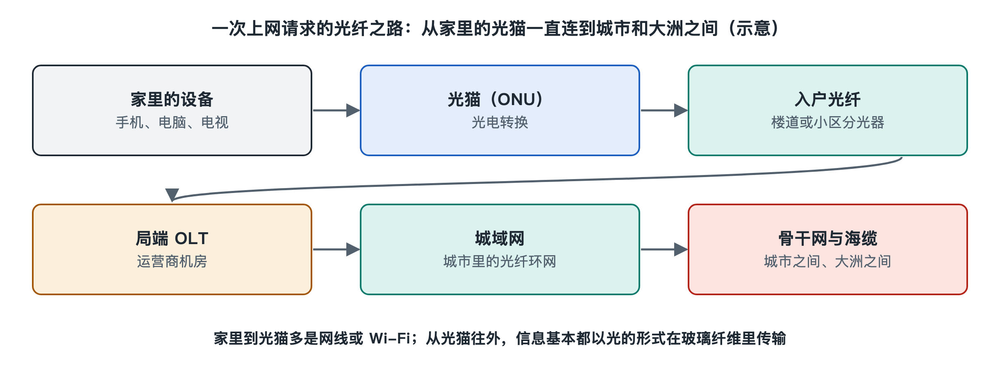

# 1.1 光纤入户：一根细玻璃丝怎样把网络送进家门

装宽带那天，安装师傅从楼道的弱电箱里拉出一根比耳机线还细的线缆，顺着墙角钉好卡子，穿进墙上的信息面板或者直接接到一个巴掌大的白色盒子上。几分钟后，盒子上的指示灯一个个亮起，手机连上 Wi-Fi，视频开始播放。这根细线就是入户光纤，那个盒子就是大家常说的“光猫”。本书的旅程就从这两件东西出发：先看清它们的样子，再顺着光纤一路往外走，走到城市机房，最后走到海底。

## 1.1.1 看得见的部分：墙上的线与桌上的盒子

先找一找你家里的这几样东西。不同城市、不同运营商的安装方式略有差异，但大体离不开下面几类：

| 你看到的东西 | 常见位置 | 它是什么 |
|---|---|---|
| 细而扁或细而圆的白色、黑色线缆 | 沿墙角、门框走线 | 入户光缆（俗称“皮线光缆”） |
| 墙上的光纤面板或小型终端盒 | 弱电箱内、电视墙旁 | 光纤的固定与转接点 |
| 线头上的小方形插头，常见蓝色或绿色外壳 | 插在光猫背面 | 光纤连接器 |
| 带若干指示灯和网口的盒子 | 弱电箱或桌面 | 光猫，正式名称为光网络终端 |

入户光缆看起来和普通电线差不多，里面却大不一样。剖开外皮，中间通常只有一根直径约 0.25 毫米的带涂覆光纤，两侧各有一根加强件，用来承受拉力。真正传信号的玻璃部分更细，外径一般是 125 微米，大约相当于一根头发的粗细。这就是标题里说的“细玻璃丝”。

光纤插头的颜色也有讲究。行业里常见的做法是：蓝色外壳表示端面磨成平面的 PC 型（物理接触，Physical Contact）或 UPC 型连接器，绿色外壳表示端面磨成斜面的 APC 型（斜面物理接触，Angled Physical Contact）。斜面可以减少反射回去的光，在入户场景里很常见。两种插头不能混插，否则会增加损耗甚至损伤端面。连接器的细节留到第二章 2.5 节再展开。

## 1.1.2 光猫在做什么：一位“光电翻译”

光猫的正式名称是光网络终端（Optical Network Terminal，ONT），有时也叫光网络单元（Optical Network Unit，ONU），二者在家庭场景中基本指同一类设备。之所以叫“猫”，是沿用了拨号上网时代“调制解调器”（Modem）的谐音俗称。

它最核心的工作是翻译：

- **下行方向**：把光纤里传来的光信号变成电信号，再整理成你的电脑、路由器能读懂的以太网数据；
- **上行方向**：把你发出的数据变成光信号，送回光纤里。

在家用的光纤到户系统中，一根光纤同时承担来去两个方向。它靠的是给两个方向分配不同的光波长，就像同一条马路上划出两条颜色不同的车道。按照 ITU-T（国际电信联盟电信标准化部门）的 GPON 系列建议，常见做法是下行使用 1490 纳米左右的波长，上行使用 1310 纳米左右的波长。这些都是人眼看不见的红外光。

很多光猫还集成了路由和 Wi-Fi 功能，所以你常把它当成“路由器”。但从光纤通信的角度看，它最本质的部分只有一小块：光收发组件和配套的芯片。Wi-Fi 那部分属于本系列第二十七册《Wi-Fi 与无线网络》的内容。

## 1.1.3 看不见的部分：光纤并不直通机房

你也许会以为，家里这根光纤直接连到运营商的机房。实际上，大多数光纤到户网络采用的是无源光网络（Passive Optical Network，PON）结构：

1. 运营商机房里有一台光线路终端（Optical Line Terminal，OLT），一个端口发出一束光；
2. 这束光沿主干光纤到达小区或楼道，进入一个叫分光器（Splitter）的无源器件；
3. 分光器把一束光平均分成多份，常见的分路比是 1:8、1:16、1:32、1:64 等；
4. 每一份光再通过入户光缆送到一户人家的光猫。

“无源”的意思是，从机房到你家这一路，中间的分光器不需要插电。它利用光在玻璃里的分路原理工作，像水管上的分水阀一样只分配，不加工。这让户外设备少了供电和维护的麻烦，也是光纤到户能大规模铺开的重要原因。

这样一来，同一楼道或同一片区域的几十户人家，往往共享机房里同一个端口。下行时，光猫会收到发给所有人的信号，只挑出属于自己的那部分，其余数据都经过加密，邻居的光猫无法读取。上行时，各家光猫按照 OLT 分配的时间片轮流发光，避免互相碰撞。共享与分配的机制会在第四章 4.1 节和第七章 7.1 节详细讲。

## 1.1.4 为什么偏偏是玻璃和光

把网络送进家门，过去也曾用电话铜线（ADSL）和同轴电缆。光纤后来居上，主要有三个原因：

- **损耗低**：用于通信的高纯度石英光纤，在 1550 纳米附近每千米的损耗约 0.2 分贝量级（这是公开资料和厂商规格中的典型值）。也就是说，光走上几十千米仍能被可靠接收；铜线上的高速信号则衰减得快得多。
- **带宽大**：光的频率极高，同一根光纤可以承载远超铜线的信息量，还能通过升级两端设备提速，而不必重新布线。
- **抗干扰**：玻璃不导电，光信号不受电磁干扰，也不怕雷击感应。

这里也要说一句安全常识：光猫背面和光纤端面发出的是看不见的红外光，有的功率不低。**不要对着光纤插头或光猫接口往里看**，也不要随意拔插、弯折入户光缆。光纤过度弯折会让光“漏”出去，信号变差，严重时还会断纤。

## 1.1.5 小结：从一个指示灯看整个系统

光猫上有两盏常被忽视的灯，分别标为 “PON” 和 “LOS”。PON 灯常亮，说明光猫已经和机房的 OLT 完成注册；LOS（Loss of Signal，信号丢失）灯亮红，往往意味着光纤断了或光功率太低。不同厂商的标识略有差别，以设备说明书为准。这盏小灯背后，连着楼道里的分光器、街道下的光缆、机房里的设备，乃至更远处的城域网、骨干网和跨洋海缆。

一根细玻璃丝把网络送进家门，靠的不只是这根丝本身，还有光源、探测器、分光器和一整套规则。下一节，我们暂时离开光猫，先回答一个更基础的问题：用光在玻璃里传信息，到底是怎么一回事。
