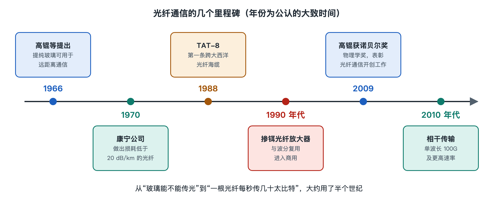

# 1.4 从铜线到光纤：光通信的几次飞跃

如果你家里还留着一台老式座机，或者翻出过一只落满灰的 ADSL 调制解调器（俗称“猫”），可以把它和现在的光猫放在一起对比：老设备背面插的是电话线那种细细的水晶头，靠的是两根绞在一起的铜线；新设备插的是一根带蓝色或绿色接头的光纤跳线。从“铜猫”到“光猫”，表面上只是换了一根线，背后却是半个多世纪里几次关键突破的累积。

## 1.4.1 铜线的天花板：为什么不能一直用电线

电话网诞生后的一百年里，信息主要靠铜线传送。双绞线便宜、好铺，同轴电缆能传更宽的频带，有线电视和早期长途干线都用过它。但铜线有个绕不开的问题：信号频率越高，衰减越快，还更容易受到电磁干扰。想传更多数据就要用更高频率，而频率一高，信号走不了多远就得放大一次。

ADSL 时代的经验很直观：家离电话局越远，网速越慢，几公里外就很难达到标称速率。这不是运营商偷工减料，而是铜线本身的物理特性决定的。人们需要一种频带极宽、衰减很低、又不怕电磁干扰的介质，光自然进入视野——光的频率比无线电高出好几个数量级，理论上能承载的信息多得多。

## 1.4.2 第一次飞跃：玻璃能不能足够透明

1960 年激光器问世，人们有了稳定的光源，但缺一条合适的“路”。在空气中传光，雾、雨、遮挡都会让信号中断；而当时的玻璃杂质多，光走几米就损失大半。

转折点来自 1966 年。华裔科学家高锟（Charles K. Kao）与合作者发表论文指出：玻璃的高损耗主要来自杂质，而不是玻璃本身；只要把杂质降下去，光纤损耗可以低到每公里 20 分贝（dB/km）以下，足以用于通信。这个判断在当时很大胆，后来被证明是对的，高锟也因此获得 2009 年诺贝尔物理学奖。

1970 年，美国康宁公司的研究人员首次做出损耗低于 20 dB/km 的石英光纤，把设想变成了实物。此后制造工艺不断改进，到 20 世纪 70 年代末，实验室中的光纤损耗已降到每公里零点几分贝的量级。玻璃从“几米就暗”变成“几十公里仍清晰”，光纤通信有了坚实的物质基础。

## 1.4.3 第二次飞跃：换波长、换光纤，越传越远

早期商用系统在 20 世纪 70 年代后期出现，使用约 850 纳米（nm）的波长和多模光纤，传输距离和速率都有限。随后的发展大致沿着“找损耗更低的窗口、减少脉冲展宽”的方向推进：

| 阶段（大致） | 典型波长 | 主要特点 |
|---|---|---|
| 第一代 | 约 850 nm | 多模光纤，距离较短，常见于早期试验和局内链路 |
| 第二代 | 约 1310 nm | 普通单模光纤在此波长色散接近零，脉冲不易展宽 |
| 第三代 | 约 1550 nm | 石英光纤损耗最低的窗口，适合长距离 |
| 第四代 | 1550 nm 附近多波长 | 光放大器加波分复用，容量成倍增长 |
| 当前阶段 | C 波段为主并向外扩展 | 相干检测与数字信号处理，单波长速率大幅提升 |

表中的“代”是教科书和公开综述里常见的归纳方式，不同资料划分略有差异。单模光纤（Single-Mode Fiber，SMF）只让光以一种模式传播，避免了多模光纤里不同路径“赛跑”造成的脉冲展宽，这是长途通信能够大规模铺开的关键之一。1988 年投入运营的 TAT-8 是第一条横跨大西洋的光纤海缆，标志着光纤开始接管洲际干线。

## 1.4.4 第三次飞跃：光放大与波分复用

即使光纤再透明，跑上百公里后信号也会变弱。早期做法是“光—电—光”中继：把光变回电，整形放大后再变成光发出去。这种中继设备复杂，而且一套设备只能处理一种速率和一个波长。

20 世纪 80 年代末到 90 年代，掺铒光纤放大器（Erbium-Doped Fiber Amplifier，EDFA）走向实用。它能在光的状态下直接放大 1550 nm 附近的信号，而且对一整段波长范围同时起作用。这为波分复用（Wavelength Division Multiplexing，WDM）铺平了道路：一根光纤里同时传几十路不同“颜色”的光，一个放大器一起放大。容量不再靠一根光纤“提速”，而是靠“多开车道”成倍增长。这两项技术在第二章和第七章还会细讲。

## 1.4.5 第四次飞跃：相干与数字信号处理，再到入户

进入 21 世纪第二个十年，长途系统普遍转向相干检测（Coherent Detection）配合数字信号处理（Digital Signal Processing，DSP）：不只看光的亮暗，还利用光的相位和偏振携带信息，再用芯片算法补偿传输中的失真。单个波长的速率因此从 10 Gbit/s 量级提升到数百 Gbit/s，近年的商用系统已达到 800 Gbit/s 以上。

与此同时，光纤从干线一路向下延伸，经过城域、小区，最终通过无源光网络进入家庭，这才有了你墙上那根入户光纤。从这个角度看，光猫是半个多世纪技术积累的最后一米。

回头看这几次飞跃，可以抓住一条主线：**先让玻璃足够透明，再让脉冲不被拉宽，然后让光不必变回电就能放大，最后让每一束光承载更多信息。**材料、器件、系统和算法依次接力，共同推高了“带宽 × 距离”的上限。下一节我们将把本章内容收拢成一副骨架，并带你在家里找到这些历史留下的痕迹。
