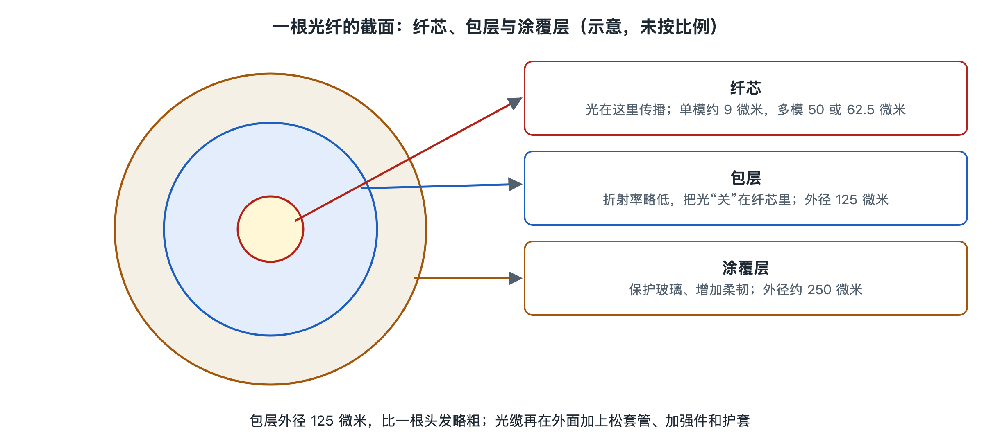

# 2.1 光纤与光缆：纤芯、包层、涂覆与护套

如果你家装的是光纤宽带，可以去光猫背后看一看：插在光猫上的那根线，外面通常是一层白色或黑色的扁平塑料皮，宽度只有几毫米，末端是一个蓝色或绿色的方形小插头。这根线就是入户光缆，俗称“皮线光缆”。真正传光的玻璃丝藏在里面，比头发丝粗不了多少。本节就从这根线入手，像剥洋葱一样一层层拆开，看看一根光纤和一条光缆各由什么组成，每一层为什么要那样设计。

> 安全提示：拆看光缆时不要拔下插头去看光纤端面。光猫和局端设备可能正在发光，所用波长多为人眼看不见的红外光，直视端面可能伤眼。本节的观察只针对外皮和插头外观。

## 2.1.1 由内到外：一根光纤的三层结构

一根裸光纤从里到外分三层：

- **纤芯（core）**：位于正中心，是光真正行走的通道，由高纯度的石英玻璃（二氧化硅）制成，通常掺入少量锗等元素，让它的折射率略高一点。
- **包层（cladding）**：紧紧包住纤芯，也是石英玻璃，但折射率比纤芯稍低。纤芯和包层是在同一次拉丝中一起成形的玻璃整体，不是两根东西套在一起。
- **涂覆层（coating）**：包在玻璃外面的一层或两层紫外固化树脂。玻璃本身很怕表面划伤和潮气，涂覆层负责缓冲和保护。拉丝时刚出炉的玻璃丝要马上涂上它。

纤芯和包层的折射率只差约百分之零点几到一，这一点差别就足以把光“关”在纤芯里。光以较斜的角度射向纤芯与包层的分界面时会发生全反射，只能沿着纤芯一路向前。全反射怎样起作用，第三章和第六章会详细讲，这里先记住一句话：**包层不是包装，而是光路的一部分，没有包层就没有导光。**

## 2.1.2 几个关键尺寸：比头发还细的精密结构

光纤的尺寸在国际上高度统一，所以不同厂家的光纤能互相熔接、互相连接。下表列出常见的标称值，依据的是 ITU-T G.652、G.657 等建议和行业通用规格：

| 层次 | 典型直径 | 材料 | 主要作用 |
|---|---|---|---|
| 纤芯（单模） | 约 8–10 微米 | 掺杂石英玻璃 | 传输光信号 |
| 纤芯（多模） | 50 或 62.5 微米 | 掺杂石英玻璃 | 传输光信号（短距离） |
| 包层 | 125 微米 | 石英玻璃 | 与纤芯配合形成全反射 |
| 涂覆层 | 约 250 微米（也有约 200 微米的细径规格） | 紫外固化树脂 | 机械保护、防潮 |

作个对比：人的头发直径一般在几十到一百微米左右。也就是说，单模光纤的纤芯只有头发的十分之一左右，连包层算进去也只和一根较粗的头发差不多。光纤看上去像一根“线”，大多是因为外面还有好几层保护。

## 2.1.3 单模与多模：两种“跑道”

纤芯粗细不同，光的走法也不同。

- **单模光纤（single-mode fiber，SMF）**：纤芯很细，在常用波长下只允许一种传输模式通过，可以把它想成只有一条车道的高速公路，车不会因为走不同的道而前后错开。它适合长距离、大容量传输。入户光纤、城域网、骨干网和海底光缆用的基本都是单模光纤。ITU-T G.652 是最常用的普通单模光纤标准；G.657 是“弯曲不敏感”单模光纤，即使在室内拐角、配线盒里弯得较紧，光也不容易泄漏，所以常用在入户光缆里。
- **多模光纤（multimode fiber，MMF）**：纤芯较粗，光可以沿许多条不同路径传播，像一条很宽、可以斜着走的马路。不同路径的长短不同，到达时间有先有后，信号会被“拉宽”，所以传输距离通常在几百米量级。它主要用在机房、数据中心内部的短距离连接，对应的类别在 ISO/IEC 等标准中称为 OM1 到 OM5。

在机房里，常可以用跳线外皮的颜色大致分辨两者：按常见行业习惯，单模跳线多为黄色，多模跳线多为橙色或浅绿色（水绿色）。这只是惯例，不是强制规定，确认时要看线上的印字。

## 2.1.4 从光纤到光缆：给玻璃丝穿上“铠甲”

只有 250 微米粗的光纤一拉就断、一压就伤，不能直接埋进地里或架在电杆上。把一根或许多根光纤加上保护层、加强件和外护套，做成能承受施工和环境考验的成品，就是**光缆（optical cable）**。一条光缆从内到外一般有：

1. **缓冲层或松套管**：有的做法是在光纤外再紧紧包一层塑料，做成约 0.9 毫米的“紧套光纤”，常见于室内；有的做法是把多根光纤松松地放进一根塑料管，管内充油膏防水，叫“松套管”，常见于室外。松套的好处是光缆受热胀冷缩或拉伸时，光纤在管里有活动余量，不容易受力。
2. **加强件**：用钢丝、钢绞线或芳纶纱、玻璃纤维增强塑料（FRP）等承受拉力。光缆被拉动时，主要是加强件在受力，而不是光纤本身。
3. **阻水材料**：阻水油膏或遇水膨胀的阻水带、阻水纱，防止水沿缆芯纵向渗透。
4. **外护套**：通常是聚乙烯等塑料，抵抗紫外线、磨损和潮湿；室内光缆多用低烟无卤材料，起火时少冒烟、少产生有毒气体。
5. **铠装（视场景而定）**：直埋或易受鼠咬的地方会加钢带等铠装层。

你家的皮线光缆正是一个简化版：中间一两根光纤，两侧各有一根细加强件（钢丝或非金属 FRP），外面一层扁平护套。它之所以做成扁的、容易剥开，是为了方便装维人员在楼道和室内施工。

## 2.1.5 不同场景，不同光缆

| 场景 | 常见光缆类型 | 设计重点 |
|---|---|---|
| 入户、室内 | 皮线光缆、室内紧套光缆 | 柔软、耐弯、阻燃、易施工 |
| 楼道、小区 | 室外蝶形光缆、小芯数配线光缆 | 防潮、抗拉、便于分支 |
| 城域管道 | 层绞式、中心束管式光缆 | 芯数多、抗压、阻水 |
| 架空 | 自承式光缆、电力系统中的特种光缆 | 承受自重、风雪和温度变化 |
| 海底 | 海底光缆 | 耐高水压、防磨损、供电导体 |

芯数也差别很大：入户线多为 1 到 2 芯，干线光缆常见几十到几百芯。数据中心和城域网为了在有限的管道里放更多光纤，采用光纤带等高密度结构，公开资料中常见上千芯的规格。海底光缆的结构更特别，第七章再专门讲。

## 2.1.6 小结

一根光纤的“三层结构”各有分工：纤芯走光，包层和纤芯一起把光关住，涂覆层保护玻璃。光缆则在此基础上加上松套、加强件、阻水材料和护套，让娇嫩的玻璃丝能在楼道、管道、电杆和海底长期工作。弄清了这条“玻璃跑道”，下一节就该看看是谁在跑道起点发出光：光源与光发射机。
