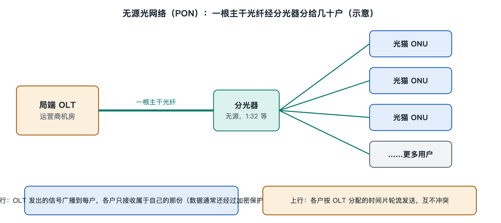

# 4.1 无源光网络：一根光纤分给几十户

傍晚七点，整栋楼的人几乎同时打开视频、刷短视频、开网课。如果你顺着自家光猫后面那根黄色或白色的细线往外找，会发现它穿过墙孔，进了楼道里一个灰色的小箱子。打开箱子（物业或装维师傅开箱时你可以看一眼），里面常常是一排排插着光纤跳线的小接口，旁边有一个巴掌大小、一根进、多根出的小盒子。那个小盒子就是分光器。整栋楼几十户人家的光纤，往上走到机房，可能只汇成了一根。

第二章已经介绍过分光器这个器件，这一节把视角拉高，看它和光猫、局端设备怎样连成一张网，也就是“无源光网络”。

## 4.1.1 一棵倒过来的树：PON 的基本结构

无源光网络（Passive Optical Network，PON）是今天光纤到户的主流组网方式。它的结构可以想象成一棵倒置的树：

| 位置 | 设备 | 英文缩写 | 通俗理解 |
|---|---|---|---|
| 运营商机房（局端） | 光线路终端 | OLT（Optical Line Terminal） | 树根，一个端口管一整棵树 |
| 光缆线路中间 | 光分配网络（光纤 + 分光器） | ODN（Optical Distribution Network） | 树干和树枝 |
| 用户家里 | 光网络单元 / 光网络终端 | ONU / ONT（Optical Network Unit / Terminal） | 树叶，也就是你家的光猫 |

OLT 的一个 PON 口发出一根光纤，经过一级或两级分光器，被分成 1:16、1:32、1:64 等若干路，分别送到各家的光猫。常见的分光比在公开资料和运营商工程规范中多为 1:32 或 1:64，具体取决于距离、光功率预算和所用的 PON 标准。

“无源”二字是这棵树最关键的特征：从机房出来直到你家光猫之间，分光器、光纤、连接器都不需要插电。分光器只靠玻璃波导的几何结构把光“分开”，没有芯片，没有电源，也不会死机。

## 4.1.2 为什么要“无源”：省掉的是什么

对照一下另一种思路就明白了。如果给每户拉一根独立光纤直达机房（称为点到点，P2P），机房里就要为每户准备一个光口，干线光缆的纤芯数也成倍增加。如果在小区里放一台有源交换机来分路，又需要供电、散热、防盗和定期维护。

| 对比项 | 点到点光纤 | 有源分路 | 无源光网络 |
|---|---|---|---|
| 机房光口 | 每户一个 | 较少 | 几十户共用一个 |
| 干线纤芯 | 多 | 少 | 少 |
| 野外设备供电 | 不需要 | 需要 | 不需要 |
| 故障点 | 少 | 有源设备易故障 | 少 |

PON 的取舍很清楚：牺牲一部分“独享”，换来纤芯、机房端口和野外运维成本的大幅下降。这正是光纤能够大规模铺进千家万户的经济基础，第八章讨论“带宽、距离与成本”时还会回到这一点。

代价也有。光每被一分为二，功率大约减少一半，也就是约 3 dB；分成 32 路，理想情况下就损失约 15 dB，再加上器件本身的附加损耗，实际还要更多。所以分光比越大，能覆盖的距离越短。PON 标准中常见的物理覆盖距离（光纤长度）是 20 千米量级，这是在一定分光比和光功率等级下的标称设计值。

## 4.1.3 下行广播、上行排队：几十户怎样共用一根纤

一根光纤给几十户用，最直接的问题是：信号会不会串？

**下行方向（机房到你家）**：OLT 发出的光经分光器后，会原样到达每一个光猫。也就是说，同一个 PON 口下的所有光猫都“听得到”全部下行数据。每个光猫只取出标着自己身份的那部分，其余丢弃。为了防止邻居家的光猫读取不属于它的内容，标准里规定了下行数据加密机制，例如 GPON 采用 AES 加密。

**上行方向（你家到机房）**：如果几十个光猫同时向上发光，光信号在分光器里汇合就会互相叠加、撞成一团。解决办法是时分多址（TDMA，Time Division Multiple Access）：由 OLT 统一分配时间片，每个光猫只在轮到自己的极短时隙内开启激光器发一小段突发信号，然后关掉。上行和下行则使用不同波长，互不干扰。

可以把它类比成一间教室：老师（OLT）讲课时，全班同学都听得见，但每人只记写给自己的那句话；同学发言则必须举手、等老师点名，一个一个来。OLT 还会测量每个光猫离机房的远近，即“测距”，提前补偿时间差，避免近处和远处的发言撞车。

这也解释了一个日常现象：同一个 PON 口下的总带宽是几十户共享的，晚高峰时 OLT 的动态带宽分配机制会在各户之间调度。你办的“千兆宽带”，指的是你这一户可以达到的签约速率上限，而不是独占一个 PON 口的全部容量。

## 4.1.4 PON 家族：从 EPON、GPON 到 10G PON

PON 不是一种标准，而是一个家族，主要来自两条标准线：

- **IEEE 802.3 系列**：EPON（以太网无源光网络），以及其升级版 10G-EPON；思路是直接沿用以太网帧格式。
- **ITU-T G 系列**：GPON（G.984 系列），以及 XG-PON、XGS-PON 等 10G 级别的后续标准（G.987、G.9807 系列）；更高速率的 50G PON 也已由 ITU-T 发布相关建议。

这些标准中的速率都是标称线路速率，例如 GPON 下行约 2.5 Gbit/s、XGS-PON 上下行约 10 Gbit/s，扣除开销并被多户共享之后，单户实际可用带宽会明显低于这个数字。不同代际的 PON 常使用不同波长，因此可以在同一张光分配网上共存，运营商升级时往往只需更换两端设备，楼道里的光纤和分光器可以保留。各代标准的细节与演进，放在第七章 7.1 节展开。

截至写作时，国内家庭宽带新装多为 GPON 或 10G 级 PON，光猫背面的标签上通常会写明类型，读者可以自己翻过来看看。

## 4.1.5 小结：一棵树连起整栋楼

无源光网络用“局端一个口、中间无源分光、末端各家光猫”的树形结构，把一根光纤分给几十户；靠下行广播加密、上行分时排队来解决共享问题；用不供电的分光器换来低成本和高可靠。你家的光猫，就是这棵树上的一片叶子。

不过，树根所在的机房只是起点。OLT 收拢的成千上万户流量，还要继续汇入覆盖整座城市、乃至连通全国的更大光网络。下一节，我们沿着这根光纤离开小区，走进城域与骨干网中的环网、网状网和光交换节点。
