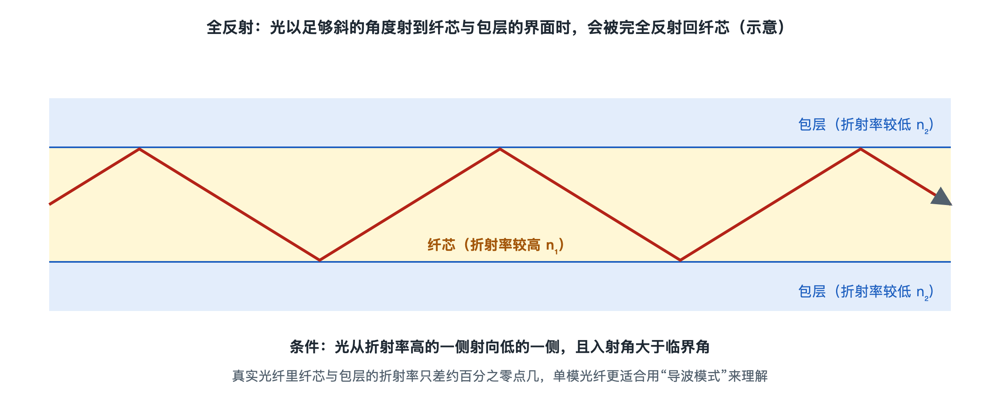

# 6.1 全反射与导波：光为什么拐弯也不跑出去

装宽带时，师傅把一根白色的皮线光缆顺着门框钉好，在墙角处绕了个弯，再接进光猫。你或许会好奇：光不是走直线的吗？线拐了弯，光怎么没从拐角处“冲”出去？第三章讲过，光纤的功能是把光“关”在里面。这一节往下深挖一层，看看这件事靠什么机制完成。原理层面的折射定律推导留到第八章，这里只讲光在光纤里是怎样“走路”的。

## 6.1.1 从泳池水面说起：全反射是什么

夏天潜在泳池里抬头看，正上方能透过水面看到天空和灯光。视线越斜，水面越亮，到了某个角度，水面像一面银色的镜子，映出的是池底的瓷砖。这就是**全反射**（Total Internal Reflection，TIR）。

全反射要同时满足两个条件：

- **光从“光密”介质射向“光疏”介质**。折射率（Refractive Index，用 n 表示）衡量光在材料中走得多慢。水的折射率约 1.33，空气约 1.0，所以光从水射向空气时才可能发生全反射，反过来不行。
- **入射角大于临界角**。入射角指光线与界面法线（垂直于界面的线）的夹角。角度小时，光大部分穿出去，一小部分被反射回来；角度增大，穿出的光越来越“贴着”界面走；超过临界角，就没有光能穿出去，几乎全部被弹回。

“全”字值得注意。普通镜子每反射一次都要吸收掉一部分光，全反射在理想界面上则几乎没有反射损失。光在光纤里每公里可能要反射成千上万次，靠的正是这一点。

## 6.1.2 把泳池搬进玻璃丝：纤芯与包层

第二章拆解过光纤的结构：中间是**纤芯**（Core），外面裹着**包层**（Cladding），两者都是高纯石英玻璃。工程上的做法是在纤芯里掺入少量锗等元素，让纤芯折射率比包层略高。两者的差别很小，常见单模光纤的相对折射率差只有百分之零点几，但足以构成“光密在内、光疏在外”的界面。

光以足够斜的角度沿光纤前进时，碰到纤芯与包层的分界面就被全反射弹回，再碰到对面的分界面又被弹回，一路呈“之”字形向前。这种被结构约束、沿着固定路径传播的波，叫**导波**（Guided Wave），能导光的结构则叫**光波导**（Optical Waveguide）。

有个问题常被问到：既然靠全反射，为什么不直接用玻璃和空气做界面，非要多加一层包层？对照一下就清楚了：

| 方案 | 界面 | 问题 |
|---|---|---|
| 裸玻璃丝 | 玻璃—空气 | 表面的灰尘、划痕、手指油污都会破坏界面，光从缺陷处漏掉 |
| 纤芯+包层 | 玻璃—玻璃 | 反射界面藏在玻璃内部，不受外界污染；外面再加涂覆层防护 |

包层的作用就是把反射界面保护起来，同时为后面要讲的单模传输创造条件。

## 6.1.3 光怎样才能进得去：接收角与数值孔径

全反射对角度有要求，所以并非所有射向光纤端面的光都能被“收编”。光线与光纤轴线的夹角太大，进入纤芯后打到界面上的入射角就会小于临界角，第一次碰壁就漏进包层，再逐渐散失。

能被光纤接住的入射光线范围构成一个圆锥，锥的半角叫**接收角**。工程上常用**数值孔径**（Numerical Aperture，NA）描述这个“收光喇叭”的开口大小，它只由纤芯和包层的折射率决定。公开资料中常见的典型值是：标准单模光纤约 0.1 量级，多模光纤约 0.2 量级。

这能解释第二章的一个细节：发光二极管发出的光向四面八方散开，只能配合纤芯较粗、数值孔径较大的多模光纤做短距离传输；激光器发出的光方向集中，才能有效耦合进纤芯只有约 9 微米的单模光纤。光源和光纤要匹配，在机制上就是角度和口径的匹配。

## 6.1.4 拐弯为什么不漏：以及弯太狠为什么会漏

回到墙角那个弯。光纤轻轻弯曲时，光线打在外侧界面上的角度会变小，但只要仍大于临界角，光照样被反射回去，于是光“跟着”玻璃一起拐弯。这就是光纤可以随管道和墙面走线的原因。

弯得太急，情况就变了。外侧的入射角减小到临界角以下，一部分光就会穿透界面泄漏出去，这叫**弯曲损耗**。下一节会把它和吸收、散射放在一起讲。施工中的“最小弯曲半径”规范就是为此而定；ITU-T G.657 建议规定的“抗弯曲”单模光纤，就是为入户场景中的墙角、线槽急弯设计的，写作时它已是光纤到户中常见的入户光纤类型。

如果光猫显示的光功率偏低，排查清单里常有一条：检查入户线是否被门缝夹住或打了死弯。这条常识背后的道理就是全反射条件被破坏了。

## 6.1.5 光线图之外：模式的概念

“之”字形光线图便于理解，但还不完整。光本质上是波（第八章展开），在纤芯这样窄的空间里，只有某些特定的传播形态能稳定存在，这些形态叫**模式**（Mode）。可以把它类比成吉他弦：弦长固定，能稳定振动的只有基音和若干泛音。

- **多模光纤**纤芯较粗，常见为 50 或 62.5 微米，能容纳许多模式。不同模式走的路径长短不一，同时出发的光到达时间有先有后。
- **单模光纤**纤芯细到只允许一个基本模式传播，从根源上消除了“模式间赛跑”的问题，因此成为城域网、骨干网和海缆的主力，ITU-T G.652 规定的就是最常用的标准单模光纤。

“到达时间有先有后”会让光脉冲变宽，这就是**色散**的一种。这也说明，把光关在纤芯里只是第一步，关住之后还有能量的损失和脉冲的变形需要应对。

## 6.1.6 小结

光纤不跑光，靠的是三件事配合：纤芯折射率略高于包层，构成可以发生全反射的界面；光以合适的角度进入，在界面上反复反射，以导波形式前进；弯曲不超过限度，全反射条件就一直成立。墙角那道平缓的弯能正常通光，被门缝夹出的死弯就会漏光。接下来两节分别讨论光在路上怎样变弱，以及光脉冲怎样被拉宽，也就是损耗和色散。
