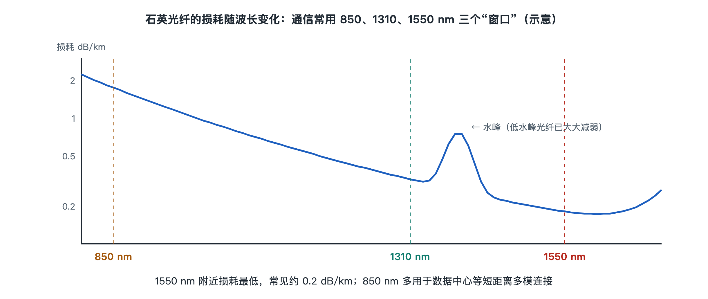

# 6.2 损耗：吸收、散射与弯曲

打开光猫的管理页面（不少运营商的光猫在“状态”或“网络信息”一栏里能看到），常会看到一行“接收光功率”，数值大约是 −15 dBm 到 −25 dBm 之间的负数。局端设备发出的光通常在几 dBm 量级，到你家时却往往只剩下几十分之一到几百分之一。光跑了几公里，能量去了哪里？这就是本节要讲的“损耗”（Attenuation，也叫衰减）。弄清损耗从哪里来，就能明白为什么光纤要用特定的波长、为什么施工师傅反复叮嘱“别把光纤折死”，也能看懂光猫页面上那个负数的意义。

## 6.2.1 用分贝记账：损耗的量法

光在光纤里传播，功率随距离按比例减小，就像存款按固定比例“缩水”。工程上用分贝（dB）记账：损失 3 dB 约等于功率减半，损失 10 dB 是剩十分之一，20 dB 是剩百分之一。分贝的好处是可以直接相加，一段链路的总损耗等于光纤损耗、接头损耗、分光器损耗之和。

光纤本身的损耗用“每公里多少分贝”（dB/km）表示。按公开资料中常见的说法，普通单模光纤（ITU-T G.652 类）在 1550 nm 波长附近的损耗典型值约为 0.2 dB/km，在 1310 nm 附近约为 0.3–0.35 dB/km。换句话说，光在优质光纤里走 15 公里左右才损失一半功率。作为对照，普通窗玻璃厚几毫米就会让光明显变暗，若用它做“光纤”，光走不了几米就没了。

dBm 则是以 1 毫瓦为基准的绝对功率单位：0 dBm 是 1 毫瓦，−20 dBm 是 0.01 毫瓦。光猫显示的接收光功率就是用 dBm 表示的。

## 6.2.2 吸收：玻璃把光“吃掉”了一部分

损耗的第一类来源是吸收（Absorption），即光的能量被材料转化成热。

- **本征吸收**：石英玻璃本身的分子结构会吸收某些波长的光。在紫外一侧，电子跃迁吸收较强；在红外一侧，硅氧键的分子振动吸收越来越强，波长超过约 1.6–1.7 μm 后损耗迅速上升。这两侧夹出一个“透明窗口”。
- **杂质吸收**：玻璃中混入的金属离子和氢氧根（OH⁻，俗称“水峰”）会在特定波长吸收光。早期光纤在 1383 nm 附近有明显的水峰。制造工艺进步后，杂质含量降到极低，ITU-T G.652.D 等光纤把水峰压得很低，使 1260–1625 nm 的宽阔区域都可以使用。

20 世纪 60 年代，高锟等人指出，玻璃损耗之所以高，主要是杂质造成的，若能提纯到足够程度，损耗可降到 20 dB/km 以下，光纤通信便可行。此后制造工艺的进步验证了这一判断，这也是光纤通信得以起步的关键。

## 6.2.3 散射：光被“撞”离了原来的路线

第二类来源是散射（Scattering）。玻璃在冷却凝固时，内部密度和成分存在极细微的起伏，尺度远小于光的波长。光遇到这些起伏，就有一小部分被向四面八方散开，不再沿纤芯前进。

其中最主要的是瑞利散射（Rayleigh Scattering），其强度与波长的四次方成反比：波长越短，散射越强。天空呈蓝色也是同样的道理，阳光里的蓝光比红光更容易被空气分子散射。对光纤来说，这意味着选用较长的波长能显著降低散射损耗。

把吸收和散射放在一起看：短波长一侧瑞利散射占主导，长波长一侧红外吸收迅速上升，两者之间在 1550 nm 附近形成损耗最低点。这正是长途光纤通信集中在 1550 nm 附近（C 波段）的根本原因。瑞利散射还有一个“副产品”：少量散射光会沿光纤反向传回起点，第七章介绍的 OTDR（光时域反射仪）正是靠分析这部分回传光来“看见”光纤沿线的情况。

| 损耗来源 | 发生原因 | 对波长的依赖 | 能否通过工艺降低 |
|---|---|---|---|
| 本征吸收 | 石英材料本身的电子跃迁与分子振动 | 紫外、红外两端增强 | 基本是材料极限 |
| 杂质吸收 | 金属离子、OH⁻ 等杂质 | 集中在特定波长（如水峰） | 可以，靠提纯和脱水 |
| 瑞利散射 | 玻璃内部微小密度起伏 | 与波长四次方成反比 | 只能有限改善 |
| 弯曲损耗 | 光纤弯曲破坏导光条件 | 长波长更敏感 | 靠规范施工与抗弯光纤 |

## 6.2.4 弯曲：光纤“拐太急”会漏光

前两类损耗属于光纤材料本身，第三类则与使用方式密切相关，那就是弯曲损耗（Bending Loss）。

上一节讲过，光靠全反射被约束在纤芯里，前提是光射到纤芯与包层交界面的角度足够“斜”。光纤弯曲时，弯道外侧的光入射角变小，一部分光不再满足全反射条件，便从包层漏出去。弯曲分两种：

- **宏弯**（Macrobending）：肉眼可见的弯曲，如把入户光纤绕在钉子上、在门缝处折成直角、盘线时圈太小。
- **微弯**（Microbending）：肉眼看不见的微小形变，如光缆受侧压、被扎带勒得太紧、涂覆层受热收缩不均。

弯曲损耗对长波长更敏感，因此同一根被折弯的光纤，1550 nm 的信号可能比 1310 nm 下降得更明显。为适应楼道和室内狭窄的走线，ITU-T G.657 定义了“弯曲不敏感”单模光纤，允许的最小弯曲半径比普通光纤小得多。写作时，入户皮线光缆普遍采用这类光纤。但“不敏感”不等于“不怕折”：折得过死，玻璃仍可能出现裂纹乃至断裂。

## 6.2.5 回到光猫：损耗预算怎样决定你的网速

把各项损耗累加起来，就是工程上的“损耗预算”（Power Budget）：发射功率减去所有损耗，必须高于接收机能可靠工作的最低功率（接收灵敏度）。在家庭 PON 网络中，光纤本身几公里只占几个 dB，真正的大头是分光器，1 分 32 的分光器就会带来十几 dB 的损耗，再加上活动连接器和熔接点的零点几 dB。

所以，如果光猫页面显示接收光功率明显偏低（例如逼近 −27 dBm 或更低，具体门限以设备说明为准），或者 LOS（信号丢失）灯闪红，常见的原因并不神秘：墙角光纤被压、跳线被折弯、连接器端面脏污。排查时请注意：不要直视光纤端面或光口，其中可能有不可见的红外激光；拔插和清洁交给装维人员处理更稳妥。

损耗决定了光能走多远，但光“到了”并不等于信号“清楚”。即使功率够用，脉冲在传播中还会被拉宽变形，这便是下一节要讲的色散。
