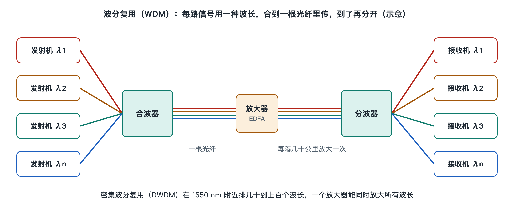

# 6.4 波分复用：给每路信号分一种颜色

拿起家里光猫背面的那根黄色尾纤，你会发现它只有一根纤芯，却能同时“下载”和“上传”。下行的光往你家走，上行的光往局端走，两者在同一根玻璃丝里迎面相遇，却互不干扰。原因是它们用的不是同一种“颜色”。按照 ITU-T G.984 系列对 GPON 的规定，下行波长在 1490 纳米附近，上行在 1310 纳米附近。这就是最朴素的波分复用。

波分复用（Wavelength Division Multiplexing，WDM）的意思是：在一根光纤里同时传输多种不同波长的光，每种波长各自承载一路独立的信号。第五章讲过波长流在网络中怎样流动，这一节要回答一个更深的问题：**为什么不同颜色的光挤在一起不会搅成一团？又靠什么把它们合起来、再分开？**

## 6.4.1 各走各的路：光的叠加原理

先想一个日常场景。在一间屋子里，有人在低声说话，有人在拉小提琴，你仍然能分辨出两种声音。空气同时承载了多种频率的振动，它们在空间中叠加，却不会把彼此改造成别的东西。

光也是这样。光是电磁波，不同波长对应不同频率。在光纤这类介质中，当光功率不太高时，介质对光的响应是“线性”的。也就是说，两束光叠加在一起，各自的振动仍然保持原样，只是简单相加。1550 纳米的光不会因为旁边有一束 1551 纳米的光，就改变自己携带的 0 和 1。这正是波分复用能够成立的物理前提。

不过，“线性”是有条件的。当每个波长的功率很大、波长数量很多时，玻璃会表现出微弱的非线性效应，不同波长之间开始相互影响，例如四波混频会“凭空”产生新的频率成分，造成串扰。这也是长途系统不能无限提高发射功率的原因之一，第八章讨论容量极限时还会回到这一点。

## 6.4.2 合与分：复用器和解复用器

叠加原理说明了光可以“共存”，但还需要器件把多路光合进一根光纤，并在另一端精确地拆开。负责合的叫复用器（Multiplexer，MUX），负责分的叫解复用器（Demultiplexer，DEMUX）。原理上两者往往是同一种器件，只是把光的方向反过来用。

最直观的类比是三棱镜：白光射进去，彩虹散出来；反过来，把几种颜色从对应方向射进去，又能合成一束。实际工程中常见的有以下几类器件：

| 器件类型 | 基本思路 | 常见用途 |
|---|---|---|
| 薄膜滤波器（TFF） | 在玻璃上镀几十到上百层介质膜，只让特定波长透过，其余反射 | 波长数较少的系统、PON 中的上下行分离 |
| 阵列波导光栅（AWG） | 光分成许多路，经过长度逐级不同的波导后再汇合，不同波长在不同出口处干涉加强 | 几十个波长的密集系统 |
| 光纤光栅（FBG） | 在纤芯里刻出周期性折射率变化，反射某一特定波长 | 滤波、上下单个波长 |
| 波长选择开关（WSS） | 借助光栅加可控偏转元件，把任意波长导向任意端口 | 可重构光分插复用（ROADM）节点 |

这些器件的共同目标是做到“该过的过、该挡的挡”。如果相邻波长有一部分能量漏进了不该去的端口，就会形成串扰，接收端会把邻居的信号当成噪声。所以通道之间必须留出一定间隔，滤波器的边沿也要尽量陡峭。

## 6.4.3 颜色怎样排座次：粗波分与密集波分

既然要给每路信号分配一种颜色，就需要一份大家都认可的“座位表”，否则不同厂家的设备无法对接。ITU-T 为此制定了两套波长栅格。

| 对比项 | 粗波分复用（CWDM） | 密集波分复用（DWDM） |
|---|---|---|
| 依据标准 | ITU-T G.694.2 | ITU-T G.694.1 |
| 通道间隔 | 20 纳米 | 以频率计，常见 100 GHz、50 GHz，以及更细粒度的灵活栅格 |
| 通道数量 | 1271–1611 纳米范围内最多 18 个 | 常见几十个到上百个，具体取决于系统设计 |
| 对激光器的要求 | 波长可略有漂移，通常无需精确温控 | 波长必须稳定，激光器一般需要温控 |
| 典型场景 | 城域边缘、移动前传、园区 | 城域核心、骨干网、海底光缆 |

DWDM 的栅格以 193.1 THz（约 1552.52 纳米）为参考点，按固定的频率间隔向两侧排开。用频率而不用波长作标尺，是因为频率间隔相等时，各通道在频谱上的占位才真正均匀。随着单波速率提高，信号占用的频谱变宽，固定的 50 GHz“座位”有时不够坐，G.694.1 因此引入了灵活栅格（flexible grid）：中心频率以 6.25 GHz 为步进，频谱宽度以 12.5 GHz 为粒度，按需给每路信号分配宽度不同的频谱块。

两者的差别可以类比成停车场：CWDM 车位宽敞，停车不必精准，但车位数量少；DWDM 车位窄而密，对驾驶技术要求高，却能停下多得多的车。

## 6.4.4 为什么集中在 1550 纳米附近

DWDM 的波长主要集中在 C 波段（约 1530–1565 纳米），部分系统还会扩展到 L 波段（约 1565–1625 纳米）。原因有两个：一是普通单模光纤在 1550 纳米附近损耗最低（6.2 节已经讲过）；二是掺铒光纤放大器（EDFA）正好在这个波段工作，能够一次性放大所有波长，而不必为每种颜色各配一台放大器。“一台放大器同时放大几十路信号”，这正是 DWDM 在长途传输中省钱的关键，第七章 7.2 节会展开说明。

## 6.4.5 小结：从一根光纤到一束彩虹

波分复用的机制可以概括为三句话：光在线性介质中可以叠加而互不干扰；滤波和色散类器件能按波长把光合起来、再拆开；标准化的波长栅格让不同设备说同一种“颜色语言”。正因如此，一根光纤的容量可以随着波长数量成倍增长，铺好的光缆不必重挖，只需在两端更换设备就能扩容。

当然，波长越密、单波速率越高，接收端面对的信号就越脆弱，色散、噪声和非线性都会逼近极限。现代长途系统靠什么从这些失真中把数据“救”回来？下一节要讲的相干检测与数字信号处理，就是答案。
