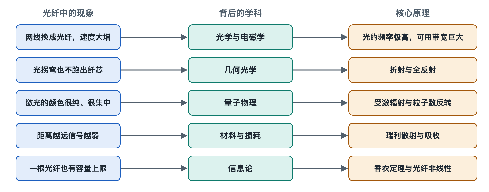

# 8.1 光的本质：电磁波、波长与频率

晚上关灯后，光猫上的指示灯亮着绿光，旁边那根黄色入户光纤的接头里却看不到任何亮光。可它里面确实有光在跑，而且一刻不停。这引出本章第一个问题：既然光纤里的光人眼看不见，我们说的“光”到底是什么？本节从这根“看不见光”的光纤说起，回到光的本质。

## 8.1.1 光是一种电磁波

19 世纪 60 年代，麦克斯韦（James Clerk Maxwell）用一组方程统一了电和磁，并推算出电磁扰动在真空中的传播速度。这个速度与当时测得的光速几乎一致，他由此推断：光就是电磁波。二十多年后，赫兹（Heinrich Hertz）在实验室里产生并检测到了电磁波，证实了这个判断。

“电磁波”可以理解为电场和磁场相互激发、交替变化、向前推进的振动。它不需要空气或水这样的介质，在真空中也能传播，这也是阳光能穿过太空到达地球的原因。手机信号、Wi-Fi、微波炉里的微波、医院的 X 光，和光纤里的光属于同一家族，区别只在振动的快慢。

## 8.1.2 波长与频率：一把尺子的两种刻度

描述电磁波有两个最常用的量：

- **频率（frequency，f）**：每秒振动多少次，单位是赫兹（Hz）。
- **波长（wavelength，λ）**：相邻两个波峰之间的距离，单位常用纳米（nm，十亿分之一米）。

两者由一个简单关系相连：**波长 × 频率 = 光速**。真空中的光速约为每秒 30 万千米（约 3×10⁸ m/s）。所以频率越高，波长越短，它们就像同一把尺子上的两种刻度。

把这个关系套到光纤通信的常用波长上，结果如下（数值为按公式估算的近似值）：

| 波长 | 对应频率 | 典型用途 |
|---|---|---|
| 约 380–780 nm | 约 380–790 THz | 可见光，人眼能感知 |
| 850 nm | 约 353 THz | 数据中心内短距离多模光纤 |
| 1310 nm | 约 229 THz | 中短距离单模传输；GPON 上行 |
| 1490 nm | 约 201 THz | GPON 下行 |
| 1550 nm | 约 193 THz | 长途、波分复用系统主力波段 |

1 THz（太赫兹）是每秒一万亿次。光纤里的光每秒振动约两百万亿次，比手机信号（GHz 量级，即每秒十亿次量级）快了约十万倍。正是这极高的频率，给光纤留下了巨大的带宽空间，这一点到 8.4 节和 8.5 节还会展开。

这也解释了开头的现象：光猫用的 1310 nm 和 1490 nm 都在可见光范围之外，属于**近红外光**。眼睛不会觉得刺眼，但能量照样会进入眼睛。所以**任何时候都不要直视光纤端面或光模块接口**，维护人员要用专用检测工具或功率计判断有无光信号，而不是凭肉眼。

## 8.1.3 为什么工程师有时说波长，有时说频率

翻看设备说明书，会发现两种说法混用：光模块写“1310 nm”，波分系统却写“193.1 THz”。这不是习惯不统一，而是各有用处。

- **说波长**，方便对应材料特性。石英光纤的损耗、色散都随波长变化，1310 nm 附近色散很小，1550 nm 附近损耗最低，所以早期就把这两个区域定为主力“窗口”（详见 6.2、6.3 节）。
- **说频率**，方便精确排布信道。ITU-T G.694.1 建议为密集波分复用（DWDM）规定的频率栅格以 193.1 THz 为参考点，信道按 100 GHz、50 GHz 等固定间隔排开。用频率划分，间隔是整齐的等差数列；换成波长，间隔就不完全均匀。在 1550 nm 附近，100 GHz 大约相当于 0.8 nm。

可以把它类比为收音机：我们说“调到 FM 98.7”，用的是频率，因为电台按频率分配；而讲天线长短时，人们更关心波长。

还有一点需要注意：光进入玻璃后，频率不变，速度和波长会变小。石英的折射率约为 1.45，光在光纤中的速度大约是每秒 20 万千米，粗略地说每千米要走约 5 微秒。这就是跨洋通信总会存在几十毫秒量级时延的物理底线，再好的设备也绕不过去。

## 8.1.4 光也是一颗颗“光子”

如果光只是波，有些现象就解释不了。1905 年，爱因斯坦（Albert Einstein）用“光量子”解释光电效应：光的能量是一份一份的，每一份叫一个**光子（photon）**，能量与频率成正比（E = h·f，h 为普朗克常数）。

这条看似抽象的原理，直接决定了光纤系统的器件设计：

- **发光**：激光器里的电子从高能级跃迁到低能级，放出的光子能量由半导体材料决定，所以材料决定了激光器发什么波长（8.3 节详述）。
- **收光**：光探测器里的材料必须“吃得下”这么大能量的光子才能产生电流。1550 nm 光子的能量约 0.8 电子伏特，硅吃不下，所以长波长接收器常用铟镓砷（InGaAs）等材料。
- **噪声**：光子到达是随机的，接收到的光越弱，这种随机起伏越明显，形成“散粒噪声”，它是接收灵敏度的一道物理底线。

所以，光具有**波粒二象性**：讨论传播、干涉、色散、波分复用时，把它当波；讨论发光、探测和噪声时，把它当粒子。工程师按问题需要选择视角，并不矛盾。

## 8.1.5 小结：从一个公式看懂全书的“光”

回到光猫旁那根安静的黄色光纤。它里面跑的是频率约两百万亿赫兹、肉眼看不见的近红外电磁波，也是一串串携带着信息的光子。波长决定它在玻璃中损耗多少、拉宽多少；频率决定它能分出多少信道、承载多大带宽；光子能量决定用什么材料来发光和收光。

有了“光是电磁波”这块基石，下一节我们就看这道波遇到玻璃界面时如何折射、为何会全反射，以及它怎样被“关”进细细的纤芯里一路前行。
