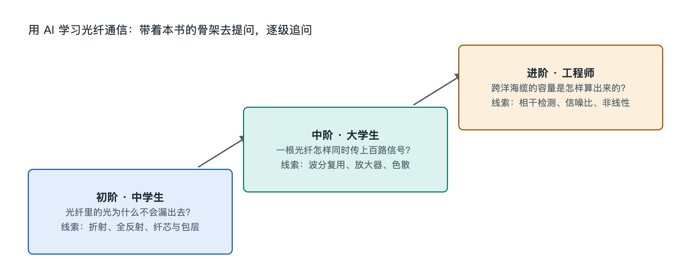

# 9.3 三阶提问阶梯：从中学生到工程师

同样盯着光猫上那盏绿色的 PON 灯，一个初二学生、一位通信专业大一新生和一名在运营商做传输维护的工程师，想问的问题完全不同。学生可能问：“这盏灯亮着说明什么？”大学生可能问：“它和隔壁楼的用户是怎么共用一根光纤的？”工程师则可能问：“这个分光比下，上行突发接收的功率预算还剩多少余量？”三个问题都对，只是站在不同的台阶上。

把问题交给 AI 时也一样：问法决定答案的深度。本节给出一套“三阶提问阶梯”，让不同背景的读者都能找到自己的起点，再一级一级往上走。

## 9.3.1 第一阶：是什么——把实物和名字对上号

第一阶面向零基础读者，目标是**认得出、叫得出、说得清用途**。这一阶的问题通常以“这是什么”“它有什么用”“为什么要这样”开头，锚点永远是手边看得见的东西。

可以直接拿去问 AI 的例子：

- “我家光猫上有 PON、LOS、LAN 几个灯，分别是什么意思？LOS 灯红了通常说明什么？”
- “墙上那根细细的黄色线是光纤吗？为什么施工师傅说不能把它折成直角？”
- “光纤里传的是光，为什么我手机连的是 Wi-Fi 无线信号？中间发生了什么转换？”

这一阶的提问技巧有两条：第一，**描述你看到的实物**，比如颜色、标签上的文字、接头形状，AI 才能对号入座；第二，**要求用类比解释**，例如“请用水管或快递来打比方”。读者可以把 AI 的回答和本书第一、二章对照，看它是否把光纤、光猫、分光器的位置讲对了。

## 9.3.2 第二阶：怎么连、怎么流——把零件串成系统

第二阶面向已经读完本书前五章、或者正在学通信与光电课程的读者，目标是**理解部件之间的关系和信号的流向**。问题从“是什么”转向“怎么连接”“怎么分工”“数据怎么走”。

| 关注点 | 示例提问 | 对应本书章节 |
|---|---|---|
| 连接关系 | “GPON 系统里，OLT、分光器、ONU 的连接拓扑是怎样的？下行广播、上行时分是什么意思？” | 第四章 4.1 |
| 信号流动 | “从我在视频网站点播，到数据经过城域网、骨干网进入光猫，大致经过哪些设备？” | 第五章 |
| 功能分工 | “放大器和再生中继有什么区别？为什么长途系统大多用光放大而不是每段都做光电光转换？” | 第三章 3.4 |
| 标准归属 | “GPON 和 EPON 分别由哪个组织制定？主要差别在哪里？” | 第四章 4.4 |

这一阶的关键技巧是**要求 AI 画出流程或列出步骤**，例如“请按从发送端到接收端的顺序，分步骤说明信号形态的变化”。如果 AI 的流程中出现了本书没提到的环节，正好可以追问“这一步是标准规定的，还是某些厂商设备的做法？”——这能帮你区分通用结构与个别产品特性。

## 9.3.3 第三阶：为什么、算多少——触到机制与原理

第三阶面向通信专业高年级学生和行业从业者，目标是**追到机制、原理和工程取舍**。问题往往带着条件和数量：“在什么条件下”“受什么限制”“如何权衡”。

示例提问：

- “单模光纤在 1550 nm 窗口损耗最低，但色散并不是零，为什么长途系统仍然选择这个波段？请结合 EDFA 的工作波段说明。”
- “相干接收机中的数字信号处理大致补偿哪些损伤？色散补偿和偏振解复用分别靠什么思路实现？”
- “香农定理给出了信道容量上限，光纤为什么不能靠无限提高入纤功率来提升信噪比？非线性效应在其中起什么作用？”
- “一个 PON 链路的光功率预算通常包括哪些项？分光器、熔接点、连接器损耗如何计入？”

这一阶的提问技巧是**给出约束条件，并要求注明依据**。比如加上“请说明这是 ITU-T 哪类建议中的规定，还是工程上的经验范围”。对于数字，应要求 AI 给出典型范围并说明来源类型，再自行查阅原始标准核对——AI 在具体参数上可能记错或混淆不同版本，这正是工程师必须保留的核查习惯。

## 9.3.4 爬阶梯的方法：追问、对照与核实

三个台阶不是彼此隔开的，最有效的学习往往是**从一个实物出发，连续爬三级**。以光猫上的“光功率”读数为例：

1. 第一阶：“光猫管理页面显示接收光功率是负二十多 dBm，这是什么意思？”
2. 第二阶：“这个光从哪里来，中途经过了哪些会损耗功率的器件？”
3. 第三阶：“为什么光功率用 dBm 这种对数单位表示？接收灵敏度和过载点分别受什么物理因素限制？”

爬阶梯时有三个习惯值得保持：

- **追问一层**：每得到一个答案，就问一句“为什么会这样”，直到触及本书第六、八章讲到的机制与原理。
- **用书对照**：把 AI 的说法放回本书的九层骨架中，看它属于结构、功能、流动还是原理层，避免知识碎片化。
- **核实关键事实**：涉及标准编号、速率、距离等数字时，以 ITU-T G 系列建议、IEEE 802.3 等原始文件和权威公开资料为准；AI 给出的产品信息可能只反映某一时期的情况。

另外需要提醒：提问应限于理解原理与正常使用、维护。不要尝试让 AI 指导拆改运营商设备或接触在用光纤线路，更不要直视光纤端面或光模块接口。

## 9.3.5 小结：台阶在你脚下

三阶提问阶梯的本质，是把本书的认知骨架转化为一套提问路径：第一阶对应“对象与结构”，第二阶对应“连接与流动”，第三阶对应“机制与原理”。中学生可以停在第一阶，也可以试着迈上第二阶；工程师可以直接从第三阶出发，再回到第一阶，用通俗语言检验自己是否真的讲得清楚。无论从哪一级开始，手边的光猫和墙上的光纤都是同一个起点——书给出骨架，实物提供锚点，AI 帮你沿着台阶一直往下挖。下一节将把本章的方法收拢成骨架，并给出可以动手完成的探索任务。
