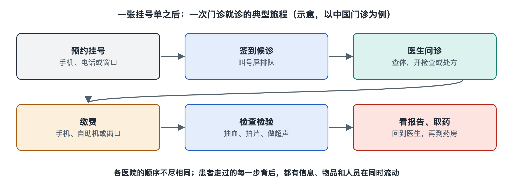

# 1.1 一张挂号单背后：一次看病要经过多少环节

手机上的预约记录显示“上午、呼吸内科、某诊区”。到了医院，叫号屏却还没有出现自己的号码。挂号已经成功，为什么还要等？因为挂号单解决的主要是“谁、在什么时段、到哪里接受接诊”的问题，并没有把一次看病的其余工作全部做完。它更像一张进入医院工作流程的车票：患者拿着它向前走，信息、人员和物品也要在看不见的地方配合移动。

以下以一位来看咳嗽的中年人为虚构例子。不同医院的入口、支付方式和环节顺序会有差别，但沿着这张挂号记录，可以看见门诊流程的基本骨架。

## 1.1.1 从预约到接诊：挂号只是确定入口

在写作时中国医院常见的门诊流程中，患者先通过医院窗口、自助设备或线上渠道预约、挂号；到院后，按院内提示完成报到，再前往相应诊区候诊。有的医院把预约与报到合为一步，有的还要求在诊区签到。预约时段也不等于医生开始问诊的准确时刻：前一位患者的病情复杂程度、医生是否需要处理紧急事务，都会影响实际进度。

叫号屏背后，系统要把挂号记录与诊室、医生排班和候诊队列对应起来。护士或导诊人员也可能协助确认患者是否到了正确诊区。这里至少有两条线同时前进：**患者流**是人从入口走向诊室；**信息流**是预约、报到和叫号状态在系统及工作人员之间传递。两条线若没有对上，人就可能到了门口，却仍需确认自己的报到状态。

急诊则不能简单套用“先挂号、按号等”的图景。在中国，急诊通常有预检分诊：工作人员根据紧急程度安排就诊优先级，而不是只按到达先后排序。门诊预约、急诊分诊服务于不同情境；遇到具体健康问题，应以现场医护人员的判断和指引为准。

## 1.1.2 从问诊到检查：一次接诊可能分出几条支路

轮到这位患者后，医生会询问情况、查看已有资料，进行必要的体格检查，并形成下一步判断。有时接诊后就可以说明处理安排；有时还需要检验或影像检查。这里不预设这位患者需要做什么检查，因为检查是否必要，应由医生结合实际情况决定。

假如医生开出一项检验申请，屏幕上的“申请”还不是最终“结果”。患者可能需要按指引缴费或完成医保结算、前往采样地点；标本随后要经过身份核对、采集、运送、检测和报告审核，结果才能回到医生可查看的系统。若是影像检查，还涉及预约或排队、检查实施、图像处理及报告出具。患者看到的是几次地点转换；医院内部处理的，则是一串有先后关系的任务。

这也解释了为什么“检查做完”与“医生已经拿到可用于判断的报告”不一定是同一时刻。检验和影像部门提供的是相应检查结果，医生还要把它与问诊、查体及既往资料放在一起理解。报告上的数字或文字不宜脱离这些信息单独下结论；涉及个人健康，应以医生意见为准。

## 1.1.3 从结果到离院：让医嘱真正落地

拿到结果后，患者可能回到诊室复诊，医生据此解释判断和后续安排；也可能按医院当时的流程，通过指定渠道查看结果并完成后续沟通。如果产生药品处方，药房还要接收处方、进行审核与调配，并在发药时核对；如果需要进一步诊疗，则可能转向其他科室或住院流程。不是每次门诊都要经历检查、取药或住院，流程会在不同节点分叉。

收费票据和药袋，是患者容易看见的另外两个“交接点”。票据记录费用与结算，药袋或取药凭证把处方与实际发放的药品关联起来。以写作时中国的做法为例，医保结算还取决于参保地政策、就医地规则和项目支付范围，不能从一张挂号单推断整次就医的费用。患者离院后，病历记录、报告和处方信息仍需按规定保存，供后续诊疗及管理使用；部分患者还会进入预约复诊或随访环节。

## 1.1.4 把环节连起来：为什么医院不是几间诊室的拼接

如果只数患者走过的窗口，可能会列出“挂号—候诊—看诊—检查—复诊—取药”六步；如果从医院运作看，每一步都包含人员与信息的交接。下面这张简表把两种视角放在一起：

| 患者看见的动作 | 同时需要完成的衔接 |
| --- | --- |
| 出示挂号记录、等待叫号 | 确认身份、排班、报到和候诊状态 |
| 到诊室交流 | 调取资料、记录接诊信息 |
| 按申请做检查 | 传递申请、核对身份、形成并审核报告 |
| 取药或办理后续手续 | 传递医嘱、审核执行、记录结算与去向 |

一次看病因此不是沿着走廊走完几个房间，而是许多任务依次接力。患者、医护人员、检验与影像人员、药师、收费与信息系统，各自完成一段工作；身份核对、任务传递和结果返回把这些工作连成一条链。挂号单是这条链的可见起点，却不是整条链本身。下一节，我们就把视线从这一趟就诊拉远，看看承载这条链的“医院”究竟是什么。
