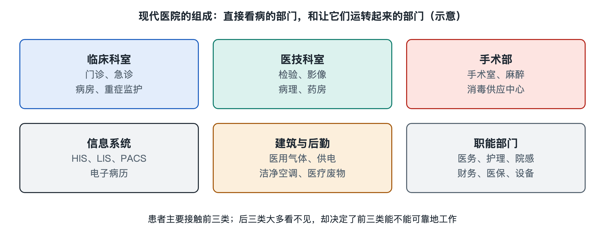

# 2.1 临床科室：门诊、急诊、病房与重症监护

手机上的预约记录写着“呼吸内科门诊，上午”。走进医院后，你可能先看导诊图，再到候诊区等待叫号。可是同一栋楼里，还有人从急诊入口进入，有人在病房接受持续照护，也有人需要在重症监护病房接受密切观察。“临床科室”并不只是门牌上的专科名称：它还意味着医院用不同的工作场所和团队，承接不同紧迫程度、不同照护强度的患者。

## 2.1.1 门诊：围绕一次次就诊组织工作

门诊通常是按预约时段或出诊安排接诊的场所。以一位来看咳嗽的中年人为例——这只是虚构的典型场景——挂号记录把他引向某个诊室。医生通过询问、查体和已有资料了解情况；如果需要检查，患者可能离开诊室，拿到结果后再返回，或按安排复诊。

门诊的工作单位可以理解为“一次就诊”：在有限的接诊时间里，医生判断目前掌握的信息是否足够，决定下一步由谁、在何处继续处理。因此，候诊屏显示的顺序只是患者看得见的一部分；诊室里还有病历记录、检查申请和结果回看等工作。不同中国医院的预约、报到、复诊安排并不完全一样，挂号时间也不等于医生能够开始诊察的精确时刻。

专科门诊按专业领域分工，但患者的问题未必恰好落在一个科室的边界内。门诊医生需要判断：事情能否在门诊继续处理，是否需要其他专科参与，或是否需要更连续的观察。**挂号单确定的是进入医院的一个入口，不是后续流程的全部路线。**

## 2.1.2 急诊：先判断紧迫程度，再安排资源

急诊入口常能看到“预检分诊”标识。与按预约安排为主的普通门诊不同，急诊要面对随时到来的患者。预检分诊是医护人员依据症状、生命体征等信息，初步判断病情紧迫程度并安排就诊优先级的过程。先到的人不一定先接受诊治，因为急诊首先要识别可能需要立即处理的情况。分诊也不是一次定终身：等待期间情况变化，工作人员需要重新评估。

急诊内部并非只有一排诊室。接诊、观察、抢救等区域承担着不同强度的工作；患者可能在处理后离院，也可能继续留观、住院，或转到具备相应能力的机构。把急诊想成医院的“全天候入口”比较直观，但它更重要的系统作用，是在到达时间无法预先安排、需求又可能突然增加的条件下，持续调整优先级和人员、空间等资源。

急诊中的“快”因而不是让每个人按同样速度通过，而是把有限资源优先用于最紧迫的情况。至于某个人的症状属于什么情况，应由现场医护人员评估，不能仅凭叫号顺序自行判断。

## 2.1.3 病房：把一次诊察延长为连续照护

如果患者需要住院，工作重点就从“一次接诊”转为“连续照护”。病房里能看到床旁的腕带、护理记录和交接班安排。医生负责诊疗计划及其调整，护士持续执行照护、观察变化并记录，其他专业人员按需要参与。这里的“连续”不表示同一个人始终守在床边，而是依靠排班、记录和交接，让接班者知道已经做了什么、还要关注什么。

病房通常也按专业设置，但一位住院患者的需求可能跨越多个专业。主管团队需要汇集检查结果和其他科室的意见，解释给患者，并形成下一步安排。与门诊相比，住院还多了床位这一约束：有住院需要，不等于当下就有合适床位；接收入院要兼顾病情、专业能力和床位安排。

出院同样不是简单地“腾出一张床”。团队需要完成病情评估、记录和后续安排，使患者离开病房后仍能接上必要的照护。这说明病房既是一个地点，也是一段有起点、交接和终点的工作过程。

## 2.1.4 重症监护：把观察与响应组织得更密集

重症监护病房通常称为 ICU，即 *Intensive Care Unit*。它接收需要密切监测和较高强度支持的患者。与普通病房相比，ICU 的关键区别不只是设备更多，而是人员配置、观察频率、响应方式和环境安排围绕重症照护组织起来。监护设备提供连续信息，医护人员还要结合床旁观察，判断变化是否需要处理；屏幕上的数值不能替代专业判断。

进入或离开 ICU，也不是按照某一个数字机械决定。团队要综合患者状态、所需支持和后续病区能否承接等因素评估。病情相对稳定后转入普通病房，意味着照护强度改变，并不意味着信息可以中断；清楚的转科交接尤其重要。

沿着一张挂号单往里看，门诊、急诊、病房和 ICU 并非四个互不相干的盒子。它们分别适应可预约的接诊、不可预测的紧急需求、持续住院照护和高强度重症照护；患者在其中转换时，责任与信息也必须随之转移。下一步再看医院的其他组成部分，就能理解：临床团队作出判断之后，还需要哪些部门帮助它落实。
