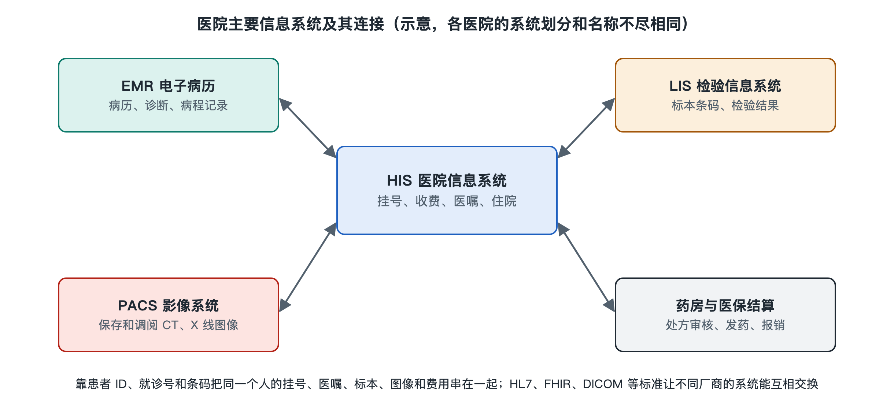

# 2.4 医疗设备与信息系统：从监护仪到 HIS、LIS、PACS

一位虚构的住院患者戴着腕带，床旁监护仪显示心率等数值；护士站的电脑里有医嘱，检验科收到一份标本，医生稍后还能在屏幕上查看影像。它们看起来都是“医院里的机器”，做的事却不同：有的接触患者、产生测量结果，有的保存记录、传递任务。现代医院要把两者连接起来，但连接并不等于让电脑代替医护人员判断。

## 2.4.1 设备：把身体状况变成可观察的信息

医疗设备种类很多。床旁监护仪连续显示某些生理信号，并可在数值越过设定范围时发出提示；检验仪器分析送来的标本；影像设备形成供医生阅读的图像。设备还包括输注设备、呼吸支持设备等，它们的作用并不都是“采集数据”。

以监护仪为例，屏幕上的数字不是患者状况的全部。传感器是否贴好、患者是否活动、报警阈值如何设置，都会影响提示的意义。报警首先是在提醒工作人员查看现场，而不是自动给出诊断。医护人员需要结合患者表现和其他信息作判断；涉及个人健康问题，应以医生意见为准。

设备也需要一套看不见的支持：采购验收、日常检查、维护校准、故障报修以及使用培训。设备能开机，不代表读数一定可靠；设备性能良好，也不代表它产生的信息已经准确进入了对应患者的记录。因此，医院既要管理机器本身，也要管理机器与人、标本和病历之间的关系。

## 2.4.2 信息系统：各管一段，却要认同一个患者

如果把医院比作一座繁忙的车站，设备像测量和作业工具，信息系统则像时刻表、任务单和记录簿。中国医院常见的几类系统如下；具体名称、覆盖范围和分工因医院建设情况而异。

| 系统 | 名称 | 主要承担的工作 |
|---|---|---|
| HIS | 医院信息系统（Hospital Information System） | 支持挂号、收费、住院等业务，部分医院也用它承载医嘱等功能 |
| LIS | 实验室信息系统（Laboratory Information System） | 管理检验申请、标本、分析结果与检验报告 |
| PACS | 医学影像存档与通信系统（Picture Archiving and Communication System） | 保存、调取和传送医学影像 |

医生在工作站看到的病程记录、医嘱和报告，还可能由电子病历系统（Electronic Medical Record，EMR）及其他专用系统共同提供。它们并非天然装在同一套软件里。“医院信息系统”有时也被宽泛地用来称呼全院的信息化体系，因此只看系统名称，未必能知道一家医院的实际分工。

这些系统必须回答同一个基础问题：**这项操作、这份标本、这张图像属于谁？** 挂号记录帮助建立就诊身份，腕带和标本条码帮助工作人员在后续环节核对。姓名相同的人可能不止一位，仅凭姓名匹配是不够的。信息连接的第一步，不是把数据传得更快，而是把人和事对应准确。

## 2.4.3 一张检查申请怎样跨过系统边界

设想医生为这位虚构患者开出一项检验申请。相关信息从临床工作站传到检验环节；采样后，标本上的条码把标本与申请关联起来；检验科处理并审核结果，报告再返回供临床查看。如果是影像检查，还会涉及检查安排、图像生成、存储和报告回传。医生看到“报告已出”，背后是一串有人参与的交接。

交接处最值得留意。设备产生的数据，可能自动进入系统，也可能需要工作人员确认或录入，取决于设备接口与医院配置。即使实现自动传输，仍须核对患者身份、检查项目和数据是否完整。报告的审核也不能简单理解为“机器算完就发布”：设备负责测量或生成图像，专业人员负责把结果放回临床问题中解释。

不同厂商的设备和软件要交换信息，还需要约定数据的表达方式。医学数字成像和通信标准（Digital Imaging and Communications in Medicine，DICOM）常用于医学影像的存储与交换；其他医疗信息也有相应的互联标准。标准像共同填写的表格格式，能减少“读不懂”的问题，却不能替医院解决所有身份匹配、流程衔接和责任划分问题。这些连接方式将在第四章进一步展开。

## 2.4.4 可靠运行，不只是“联网成功”

系统故障或网络中断时，医院仍需维持必要的诊疗秩序。因此，信息化建设不仅要考虑正常情况下的速度，还要考虑权限控制、操作留痕、数据备份和应急流程。患者信息包含敏感的个人健康资料，并不是谁在医院工作，谁就应当查看全部病历；访问范围应与工作职责相符。

同样，屏幕提示也需要人来处理。监护仪报警、系统弹窗、检验结果提示各有用途；提示过多、含义不清，会增加工作人员辨认重要信息的负担。好的设计应让关键信息在恰当的时间到达恰当的人，同时保留核对和纠正的机会。

从床旁的一根监护导线，到检验报告和影像画面，医院的信息链并非一条无人照看的自动流水线。设备负责观察或执行，系统负责记录与传递，医护人员负责核对、解释和行动。下一步再看医院建筑与后勤，就会发现：这些屏幕和机器能够持续工作，还依赖供电、医用气体等更基础的支撑。
