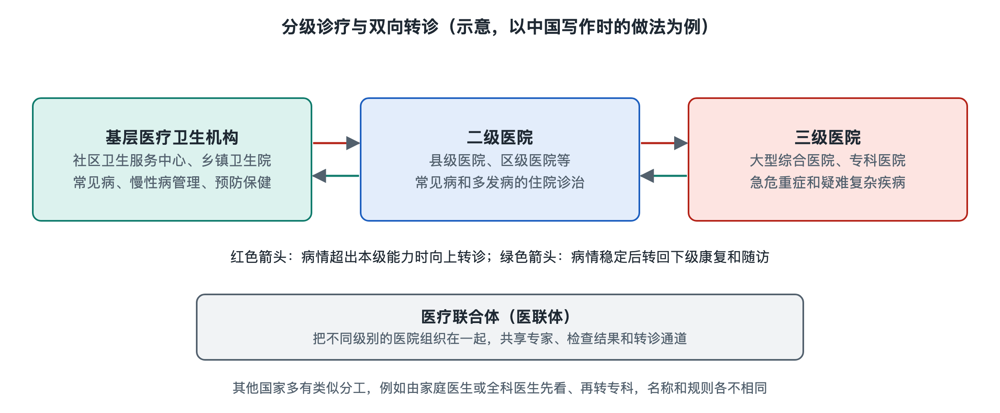

# 4.4 院内与院外：分级诊疗、转诊、医联体与公共卫生

一张挂号单通常只印着一家医院、一个科室和一个就诊时段。但对患者而言，这次就诊可能始于社区卫生服务中心，检查在另一家医院完成，病情稳定后又回到家附近继续照护。挂号单上的地址是一处入口，医疗服务的边界却不止于医院围墙。

## 4.4.1 从一家医院，看到一张服务网络

在中国，**分级诊疗**是让不同层级、不同功能的医疗卫生机构相互分工、衔接服务的制度方向。基层医疗卫生机构承担常见健康问题的诊疗、慢性病管理等工作；医院提供相应的专科诊疗、住院和急危重症救治。这里的“分级”不是给患者的重要性分级，也不能简单理解为“先去小医院，再去大医院”。机构能处理什么问题，取决于人员、设备和服务能力；某位患者需要什么服务，则要由专业人员结合具体情况判断。

不同国家的衔接方式并不相同。例如，英国的全科医生通常在非急诊专科服务的转介中承担重要角色；中国各地的预约、转诊和医保规则，则可能因地区及机构而异。不能把某一地区的就诊路径当作所有医院通用的流程。

## 4.4.2 转诊：移动的不只是患者

设想一位虚构的中年患者在基层机构就诊。接诊医生认为需要上级医院进一步评估，于是开具转诊材料。患者换了地点，医疗团队也换了人；如果只有一句“请进一步检查”，接手团队仍需从头了解情况。因此，**转诊**的核心是一场有责任交接的信息传递：已知的症状与病史、做过的检查及结果、已经采取的处理、转诊目的，以及需要注意的问题，都应按规定提供给接诊方。

转诊也可能向相反方向发生。上级医院或专科医院完成某阶段诊疗后，患者回到基层接受后续照护，常被称为“下转”或“回转”。理想的衔接不是“上去之后就失去联系”，而是让后续机构知道接下来要关注什么、何时需要再次联系专科。急危重症则有不同的时间要求，通常由急救网络和接诊医院按相应流程协同，不能机械套用普通预约转诊。

转诊材料和电子病历都涉及个人隐私。信息应在合法合规、满足诊疗需要的范围内共享；技术上能够传输，并不等于任何机构、任何工作人员都可以查看。

## 4.4.3 医联体：让分工变成可执行的协作

如果医院与基层机构平时互不熟悉，每次转诊都像临时寻找接力队友。中国推进的**医疗联合体**，简称“医联体”，试图在机构之间建立较稳定的协作关系。写作时，中国常见的组织形式包括城市医疗集团、县域医疗卫生共同体等；各地的组织方式、管理权限和落实程度并不完全一样。

医联体可以协作开展人员培训、远程会诊、检查结果共享和双向转诊。但挂上“联合”名称，不代表这些环节自然畅通。真正需要回答的是：谁发起转诊，谁接收并反馈？检查结果能否被接诊机构读取和使用？患者回到基层后，后续照护由谁负责？这些问题涉及组织关系、信息系统、人员时间，也涉及医疗质量和责任边界。

可以把医联体看成一座桥：协议是桥面，明确的工作流程是桥墩，能够安全传递的信息是道路。少了其中一项，患者仍可能带着纸质报告，在不同机构之间重复解释自己的经历。

## 4.4.4 公共卫生：医院与人群之间的接口

医院主要面对前来就诊的个人，**公共卫生**则关注人群的健康风险。两者在传染病监测、预防接种、健康教育和突发公共卫生事件应对等工作上相接。中国的医院、基层医疗卫生机构与疾病预防控制机构等各有职责，并按现行法律法规和工作规范协作。

例如，医生在诊疗中发现依法需要报告的传染病相关情况时，医院要通过规定渠道报告；公共卫生机构汇集、分析信息，并开展相应的风险评估与防控工作。诊室里的一条信息，经过规范报告和分析，才可能成为理解人群风险的一部分。报告制度同时要求保护个人信息，不能把公开疫情信息等同于公开患者身份。

回头再看挂号单，它指向的既是一间诊室，也是服务网络中的一个节点。院内科室把诊疗任务接续起来，院外机构则让不同阶段的服务有机会衔接。下一步观察医院运转，除了问“患者去了哪里”，还要问：信息由谁传递，责任怎样交接，哪些联系能在需要时真正发挥作用。涉及个人健康和就诊安排，仍应以接诊医生及当地机构的意见为准。
