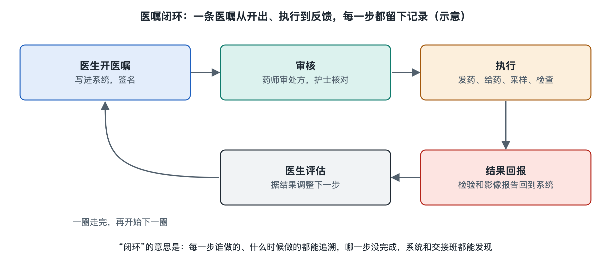

# 5.2 信息流：医嘱、检查申请、报告与病历

挂完号后，手机上出现了候诊序号；看诊结束，又多了一张检查申请单。过一会儿，页面显示“报告已出”，医生也能在工作界面看到结果。这些信息并不是从一部手机直接“跳”到另一部手机：它们经过登记、发送、接收、确认和保存，牵动着不同岗位的工作。如果说患者流回答“人到了哪里”，信息流回答的就是“下一位工作人员知道什么、该做什么，以及依据是什么”。

## 5.2.1 从一次诊疗决定到一条医嘱

设想一位虚构的患者因咳嗽来到门诊。医生询问情况、查看既往记录后，认为需要做一项检查。在中国医院常见的电子化流程中，医生会在具有相应权限的系统里开具医嘱：它是医疗人员作出的诊疗安排及其记录。检查申请是医嘱向执行科室传递的一种具体形式，通常要说明检查项目、申请科室、患者身份，以及执行所需的相关信息。

医嘱不是“点一下发送”便算完成。系统可能检查必填项目，申请还可能经过收费确认、预约或排队，随后由执行科室接收。患者在手机上看到的“已申请”“待检查”等状态，只是这个过程的一扇窗口；不同医院的页面名称和步骤并不完全相同。

这里有一道重要的转换：医生提出的是一个诊疗问题，检查科室需要把它变成能够执行的工作任务。申请信息若不完整，就可能需要沟通补充；如果医生改变决定，也要按规定修改或撤销原有安排。信息流因此不仅要传得快，还要让接收者看得懂、查得清当前哪一条有效。

## 5.2.2 检查做完，为什么还要等报告

检查申请到达检验或影像等医技科室后，会与具体工作相连。以检验为例，工作人员需要把采集的标本与正确的患者、正确的项目对应起来；以影像检查为例，检查完成后还要形成供医生阅读的图像，并经过专业人员分析，才能出具报告。检查完成和报告可供临床使用，是两个不同的节点。

一份报告通常包含患者与检查项目的标识、结果或所见、出具时间，以及按规定记录的审核信息。它要沿着信息系统返回临床医生，同时也可能在医院提供的患者端显示。**报告“已出”不等于诊疗“已完成”**：医生还需结合症状、体征、既往情况和其他资料解释结果。有些结果需要按医院制度及时通知相关临床人员，不能只等待对方自行打开页面查看。

患者端显示得晚一些，不一定意味着信息丢失；检查、分析、审核、发布本来就有先后。反过来，页面显示“已完成”，也不宜据此自行判断健康状况。涉及个人检查结果，应以负责诊疗的医生解释为准。

## 5.2.3 病历不是报告的文件夹

如果把医嘱看作“要做什么”，报告看作“发现了什么”，病历还要记录“为什么这样判断、随后怎样处理”。电子病历（Electronic Medical Record，EMR）是医疗机构在诊疗活动中形成并管理的电子化医疗记录。它可以包含病史、诊疗记录、医嘱、检查检验结果等内容，但并非把所有报告简单堆在一起。

病历中的时间和记录者同样重要。医生作出决定时掌握了哪些信息？报告是在决定之前还是之后出具的？后来为什么调整安排？这些问题需要靠有顺序、可追溯的记录回答。记录也服务于交接：接手的医护人员不必只凭患者复述，便能了解此前做过什么、还有什么待完成。当然，病历仍需由专业人员结合当时情境阅读，不能把某一句记录孤立地当作全部结论。

信息共享也有边界。为完成诊疗，相关岗位需要取得必要信息；患者隐私则应受到保护。账号权限、操作记录和规范的信息调阅，目的都是让“该知道的人能及时知道”，而不是让任何人都能查看。

## 5.2.4 一条信息，怎样形成闭环

沿着这位虚构患者的就诊过程，可以画出一条简化的链：

| 环节 | 传递的主要信息 | 接下来要确认什么 |
| --- | --- | --- |
| 医生开具医嘱 | 诊疗安排与检查申请 | 执行科室是否收到、内容是否可执行 |
| 检查科室执行 | 患者、项目与检查过程记录 | 工作是否完成、对应关系是否正确 |
| 报告返回 | 结果、所见与审核信息 | 临床是否能取得并处理结果 |
| 病历记录 | 判断依据与后续安排 | 接续诊疗的人能否读懂过程 |

这张表是一张理解信息流的地图，不代表每家医院都采用完全相同的软件或步骤。信息系统帮助工作人员传递和保存资料，但身份核对、专业判断、必要的沟通与记录，仍由人按职责完成。遇到系统暂时不可用等情况，医院也需要依据自身制度维持必要工作，并在恢复后妥善衔接记录。

因此，信息流不是越快越好的“消息接力”。它更像一条带有回执的工作链：发出安排，确认接收，完成任务，返回结果，再由临床人员结合患者情况作出下一步判断。下一节我们将看另一条与它并行的链——药品、耗材、标本和血液等实物，怎样在医院里流动。
