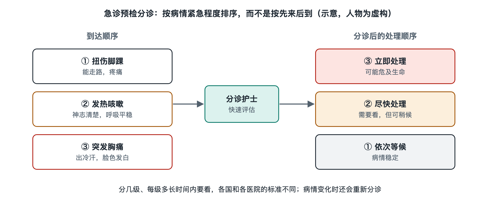

# 6.1 分诊与优先级：急诊预检分诊与绿色通道

## 6.1.1 叫号屏为什么不总按先来后到

你拿着挂号记录走进医院，门诊叫号屏上的号码通常依次向前；到了急诊，顺序却可能不同。一位比你晚到的人，被工作人员直接带进抢救区域。这不一定是漏叫了号，而可能是急诊正在执行另一套排序规则：**先处理等待可能带来更大危险的人**。

门诊导诊主要帮助患者找到合适的科室和地点；急诊预检分诊则要在患者进入诊疗流程时，迅速判断病情的紧急程度，决定先到哪里、由谁接手、需要多快得到评估。它不是给疾病下最终诊断，而是医院在信息尚不完整时，为有限的人员、诊室和设备安排优先级。挂号时间记录的是“何时进入队列”，分诊结果回答的是“能否安全地等候”。

## 6.1.2 分诊台做的不是一次简单排队

以中国医院的急诊为例，患者可能自行走入，也可能由急救车送达。分诊人员会结合患者所述症状、外观表现和必要的生命体征测量，识别是否需要立即进入抢救流程。病史和检查结果此时往往还不齐全，因此分诊首先关注的是危险信号，而不是把病因一次查清。

原卫生部 2011 年就急诊病人病情分级指导原则公开征求意见，其中按紧急程度把急诊病人分为濒危、危重、急症和非急症四级；这一分法后来成为国内许多医院急诊分级的重要参考。实际执行时，医院还会依据本院制度、人员配置和现场情况制定操作流程；分级名称也不应被理解为患者能够自行套用的诊断标签。

可以把分诊看成一座交通枢纽的道岔。同样是进入医院，有人需要直接接入抢救区域，有人需要尽快由急诊医生评估，也有人可以在候诊区等待。道岔的作用不是给人贴上“重要”或“不重要”的标签，而是让不同紧急程度的患者进入相应路径。分类之后，接诊、检查和处置仍要由医护团队继续完成。

分诊也不是一锤定音。患者等候期间的情况可能变化，急诊需要能够重新评估并调整优先级。一位虚构的、因不适来到急诊的患者，初次评估后在候诊区等待；如果随后出现明显变化，工作人员就需要再次判断，而不能只沿用最初的队列位置。对患者和陪同者来说，准确告知变化很重要；涉及个人健康状况，仍应以现场医护人员的判断和意见为准。

## 6.1.3 “绿色通道”连接了哪些环节

在中国医院的急诊语境中，“绿色通道”通常指为需要紧急救治的患者建立的快速协作路径，并不是一张可以跳过所有规则的“优先卡”。对时间敏感的情况，急诊可能需要同时联系相关专科、检验、影像、手术部或重症监护等部门，使评估、检查和后续接收尽量衔接。不同医院的启动条件和具体流程，以其公开制度和现场规范为准。

例如，一位由急救车送来的虚构患者，经现场评估需要紧急处理。急诊团队要做的不只是把他排到普通候诊队伍前面，还可能包括提前通知接收人员、准备检查与处置空间，并把已知信息交接清楚。这里的“快”，来自多个岗位并行准备，而不只是某一位医生动作更快。

快速也不等于省略安全步骤。身份识别、信息交接、必要的核对和记录，仍然是后续团队正确接手的基础。绿色通道涉及的收费、结算与急救保障安排，在中国还受具体政策和医院流程约束，不能把它概括为“所有费用都不用处理”。它的核心目的，是避免非临床环节造成不必要的救治延误。

## 6.1.4 优先级如何兼顾效率与公平

“先来后到”容易理解，却不适合直接用于所有急诊患者；“病情越急越先处理”更符合急诊任务，但也要求判断准确、过程可调整。分诊人员面对的是有限信息，既要识别需要立即救治者，也要为其他患者安排持续观察与后续接诊。候诊人数、诊室容量和突发到院的危重患者，都会改变现场等待情况，因此叫号顺序不能单独说明医院是否运转有序。

从系统角度看，急诊优先级依靠三件事共同维持：入口处的初次判断，等待中的重新评估，以及各部门接到紧急需求后的协作。清楚告知患者目前应在哪里等候、情况变化时如何联系工作人员，也能减少信息断点。

所以，急诊分诊不是在“公平”与“效率”之间二选一。它所追求的公平，是让不同风险的人得到与其紧急程度相匹配的响应。下次看到急诊有人后到先入，可以试着把视线从叫号屏移向整个流程：分诊台在识别风险，候诊区需要持续观察，绿色通道则把多个部门连成一条及时响应的路径。
