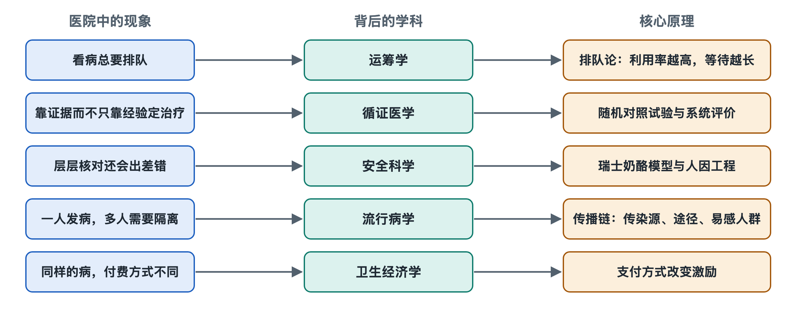

# 8.1 循证医学：用证据做决定

一位来看咳嗽的中年人拿着挂号记录走进诊室。他可能以为，医生只需听完症状，就能凭经验给出答案。实际的诊疗决策往往要多走几步：医生了解病情和既往情况，判断还缺少什么信息，再结合检查结果、临床研究和患者的具体处境作出决定。检查申请单、病历和医嘱，是这些判断在医院系统中留下的痕迹。

循证医学要回答的不是“医生该听论文的，还是听自己的”，而是：**当一种做法可能带来获益，也可能有局限和风险时，怎样尽量依据可靠的信息作出判断？**

## 8.1.1 三种信息，缺一不可

循证医学（Evidence-Based Medicine，EBM）通常把三方面放在一起：当前可获得的最佳研究证据、医务人员的专业判断，以及患者的具体情况与意愿。

研究证据回答“在接受研究的人群中，这种做法通常有什么效果”。专业判断回答“眼前的情况与研究中的情况是否相近，还有哪些需要留意的线索”。患者的情况与意愿则提醒我们：同样的获益和不便，对不同人可能有不同分量。这里的“最佳”，也不是指最新发表或结论最肯定，而是指针对当前问题、方法较可靠且适用的证据。

因此，循证医学不是让医生照着论文机械操作，更不是让患者凭一篇文章自行决定检查或治疗。医生需要解释证据适用于谁、尚有哪些不确定之处，并结合诊疗现场作判断；涉及个人健康问题，应以医生意见为准。

## 8.1.2 从一项研究到一条建议

假设一种新的检查方法声称能更早发现某类疾病。医院不能只看“发现得更早”这一句话，还要追问：研究与什么方法比较？纳入的是哪些人？结果是否可能受到其他因素影响？多发现的问题，是否真的改善了患者重要的健康结局？研究方法不同，回答问题的能力也不同。

随机对照试验（Randomized Controlled Trial，RCT）通过随机分组，尽量减少两组原有差异对结果的干扰；但并非每个医疗问题都适合或能够这样研究。观察性研究可利用真实诊疗中的资料，覆盖更广的人群，却需要特别留意：接受不同诊疗的人，起初可能就不一样。系统综述（Systematic Review，SR）则按预先确定的方法搜集、评价并汇总相关研究；它的结论仍取决于所纳入研究的质量，以及研究结果能否合理地放在一起。

把研究变成临床建议，还要经过一道“翻译”。指南制定者需要比较可能的获益与不利影响，判断证据有多确定，并考虑患者看重什么、医疗资源能否支持等因素。国际上使用的“证据质量与推荐强度分级、评估、制定与评价”体系（GRADE）提供了一套常用框架：**证据是否确定**与**建议应有多强**，是相关但不相同的两个问题。世界卫生组织（WHO）的指南编制资料也强调，应说明证据和建议之间的推理过程，让使用者知道一条建议从何而来。

| 医院里看到的东西 | 它与证据的关系 |
| --- | --- |
| 临床研究 | 产生关于效果、风险等问题的信息 |
| 临床指南 | 综合证据，提出适用于特定情形的建议 |
| 临床路径 | 在特定机构的条件下，组织较常见诊疗过程的协作 |
| 个人病历 | 记录眼前患者的信息、判断与实际决策 |

这四者不能互相代替。指南不是每个人的固定处方；临床路径也不是一条不许偏离的流水线。

## 8.1.3 证据怎样进入医院的日常运转

一条指南建议要在医院发挥作用，不能只停留在文件里。科室需要讨论适用范围，相关人员需要知道何时使用；检查、检验、药房和护理环节，还要能接住随之而来的申请与医嘱。有的医院会在电子病历中设置提示或规范化项目，但提示只是在合适时机呈现信息，不能代替核实病情和专业判断。

回到那张挂号记录：患者从诊室走向检验科，再带着报告回来，看似只是“多走了一趟”。从循证医学的角度看，检查的意义在于减少某个决策所需的不确定性，而不是项目越多，诊断就一定越好。医生还需判断，获得的信息能否改变下一步安排，以及检查本身带来的负担是否值得。不同患者即使症状相似，也未必需要完全相同的流程。

证据进入日常工作后，还需要回头检视。指南会随研究积累而更新；医院也会通过病例讨论、质量管理等方式，检查实际执行是否符合预期。发现做法与建议不同，并不必然表示有人做错了：可能是患者情况不适用，也可能是流程需要改进。重要的是把原因说清楚，而不是把“遵循指南”简化成勾选表格。

## 8.1.4 在确定与不确定之间作决定

循证医学最难的地方，常常不在于找到一个结论，而在于承认结论的边界。某项研究可能做得严谨，却没有覆盖眼前这类患者；某项措施的平均效果可能明确，落实到个人仍存在差异。医生要把群体研究提供的依据，放回具体患者身上；医院则要让可靠信息能够被找到、讨论、记录和更新。

由此看，挂号单连接的不只是诊室和检查室，也连接着医院之外长期积累的研究证据。它们不能消除所有不确定性，却能让诊疗决定有依据、可解释，并在新证据出现时得到修正。
