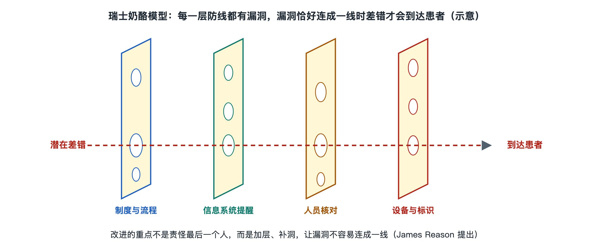

# 8.3 系统安全与人因工程：瑞士奶酪模型

## 8.3.1 一张检验单，为什么要核对好几次

一位虚构的患者拿着挂号记录来到诊室。医生开出检验申请，护士或采血人员核对身份、采集标本并贴上标签；实验室接收标本，仪器生成结果，工作人员审核后发出报告。患者看到的也许只是一张检验单，背后却有许多人和系统接力。

为什么已经核对过姓名，后面还要核对标本条码？因为安全不能完全寄托于某个人“始终不出错”。患者可能同名，标签可能贴错位置，系统中的申请与实物标本也可能不一致。每一道核对都针对不同环节的风险：发现不符时先停下来查清，而不是让问题继续传递。

医院是一个**复杂系统**：人员、设备、药品、信息和时间相互依赖。一个看似局部的偏差，若没有被及时发现，就可能沿工作流程向下游传播。系统安全研究关心的不只是“谁做错了”，还包括“什么条件使偏差容易发生、哪些防线本可以发现它”。

## 8.3.2 奶酪片上的孔：防线为何需要叠加

英国心理学家詹姆斯·里森提出的“瑞士奶酪模型”，常用来解释复杂系统中的事故防范。把一道道安全措施想象成多片叠放的奶酪：每片都有孔，表示这道防线并非万无一失；当多个薄弱处在某种情境下连成通路，风险才可能穿过层层防线。

在医院，防线既包括看得见的动作，也包括不容易被患者注意到的安排：

| 防线 | 在检验流程中的例子 | 主要作用 |
|---|---|---|
| 工作设计 | 按规定在采集现场确认患者与申请信息 | 减少身份混淆 |
| 技术支持 | 用条码关联申请、标本与报告 | 减少转录和传递中的混淆 |
| 人员核查 | 对信息不符的标本暂停处理、进一步核实 | 阻止偏差继续传递 |
| 组织管理 | 培训、维护设备、复盘流程问题 | 改善容易反复出错的条件 |

这里的“孔”并不都等于某个人的疏忽。标签打印不清、界面把关键字段放在不显眼的位置、工作台上同时摆着多个待处理标本，都可能增加混淆机会。另一方面，核对也不能只求次数多：如果几个人照着同一份错误信息重复确认，看似有多道防线，实际上未必增加了发现问题的能力。有效的防线应尽量在不同环节、依据可靠信息发挥作用。

瑞士奶酪模型是一幅帮助思考的图，不是计算事故概率的公式。它也不意味着出了问题就必然能找到一串排列整齐的“孔”。真实的医院工作会随患者情况、人员配合和现场负荷变化，分析时仍须回到具体流程与证据。

## 8.3.3 人因工程：让正确操作更容易做到

**人因工程**（Human Factors Engineering，HFE）研究人的能力与局限，进而改进工具、环境和工作流程。它不是研究怎样把人训练成“永不分心的机器”，而是承认人的注意力、记忆力和反应速度都有边界。

例如，病房交接班需要传递患者状态、待完成事项和需要留意的变化。如果交接只靠临时回忆，就容易遗漏；采用约定的结构记录和口头确认，能帮助接班者把信息接起来。又如，手术安全核查要求团队在关键节点共同确认患者、手术部位及拟实施的操作等事项。其价值不只在于“填完一张表”，更在于让不同岗位有机会说出疑问、发现信息不一致。

技术同样需要按人的实际工作方式设计。电子系统可以提示重复信息、显示检验状态，但若无关紧要的提醒过多，重要提示就可能淹没在连续弹窗里，这称为**警报疲劳**（Alert Fatigue）。因此，安全设计既要考虑“能否提醒”，也要考虑“何时提醒、提醒谁、收到后能做什么”。

患者常会遇到医护人员再次询问姓名或重复确认事项。这未必表示前一个人没有认真工作，而可能是不同岗位在各自的节点重新建立可靠联系。核对时患者参与提供信息，是一道有益的补充防线；但建立安全流程的责任仍在医疗机构，不能转嫁给患者。

## 8.3.4 从“找责任人”走向“改进系统”

当流程出现险些造成影响的偏差，或发生需要处理的安全事件，复盘要同时回答两类问题：当时发生了什么？以后怎样降低再次发生的可能？前者需要核实事实和履行相应责任；后者则要检查环境、设备、信息显示、人员配置与交接方式，而不能停留在一句“以后注意”。

这也解释了为什么医院重视报告和讨论**未遂事件**（Near Miss）：问题被及时拦住，仍可能暴露流程中的薄弱处。鼓励如实报告、保护患者隐私，与依法依规明确责任并不矛盾。目的不是用模型替任何行为开脱，而是让改进有据可依。

回到那张检验单：从身份确认到报告审核，每一道防线都有限，却能在相互配合时提高发现偏差的机会。理解系统安全，不是从此对医院的每个动作感到不安，而是看懂那些重复询问、暂停核实和团队确认背后的用意：现代医院依靠的不是某个永不犯错的人，而是能让问题被发现、被阻断、被持续改进的系统。
