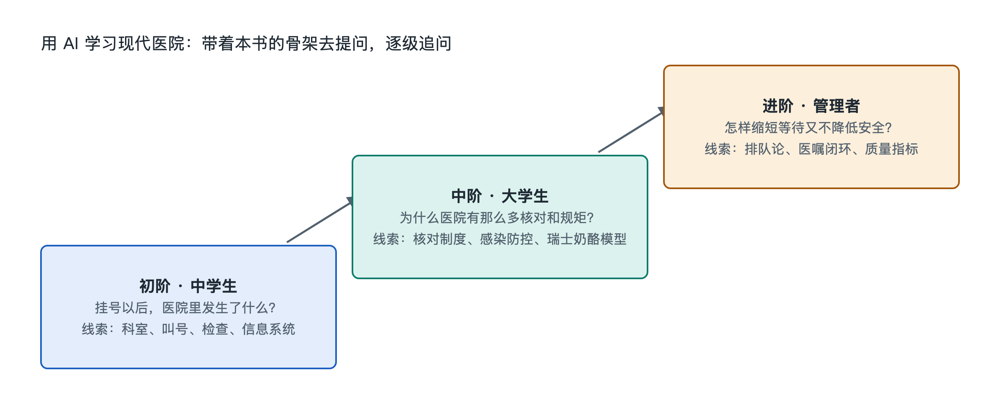

# 9.3 三阶提问阶梯：从中学生到医院管理者

手机里的一条预约挂号记录，通常只告诉你科室、时间和地点。可一旦追问“挂号之后，医院里谁先知道我要来”，问题就从屏幕伸进了医院内部：叫号系统要安排顺序，接诊人员要核对信息，医生可能开出检查申请，检验或影像科室接收任务，报告再回到医生手中。同一张挂号单，既能用来认识就诊流程，也能用来讨论信息连接、资源分配和安全管理。

使用人工智能（AI）学习医院，不必一开始就问复杂问题。可以沿着一架三阶梯子往上走：**第一阶看见环节，第二阶解释连接，第三阶讨论取舍。**阶梯不是给读者分等级；中学生也能提出管理问题，医院管理者也需要从基本流程核对事实。它区分的是问题的深度，而不是提问者的身份。

## 9.3.1 第一阶：看见了什么，下一站在哪里

这一阶先把看得见的物品和动作排成顺序。假设有一位虚构的就诊者，已在中国一家医院预约普通门诊，手机显示“上午、某科室、候诊区”。可以这样问 AI：

> “请以中国医院常见的普通门诊为例，从预约记录开始，画出候诊、接诊、可能的检查检验、取得报告和再次与医生沟通的流程。每一步分别写出就诊者看得见的物品，以及可能参与的岗位；不要假定每个人都必须做检查。”

这个问题有明确起点、范围和输出格式。AI 若把挂号、缴费、检查写成所有医院完全相同的固定顺序，就需要修正：医院安排、就诊情形和当地支付流程可能不同。“可能”与“必须”的区别，正是读流程图时要留意的地方。

这一阶适合配合实物核对。拿出自己的预约页面，或查看医院公开的就诊指南，试着标出入口、候诊区和报告查询方式。看到“请先签到”却不明白原因，可以继续问：“签到与预约有什么不同？它可能怎样帮助叫号系统确认谁已经到场？”这里不需要上传含姓名、证件号码或就诊号码的截图；把无关个人信息删去后，用文字描述也能提问。

## 9.3.2 第二阶：谁把信息交给谁，哪里需要核对

当流程能画出来，就可以追问连接。仍以一张挂号记录为起点：医生开出检验申请后，去采样窗口的不只是患者本人；申请信息也要到达相应系统，标本需要与正确的身份信息关联，报告还要回到能够查看它的医护人员那里。患者流、信息流和标本流走的不是同一条路，却必须在关键节点对得上。

第二阶的问题可以写得更具体：

> “请把‘医生提出检验申请—采集标本—实验室检测—报告返回’分成患者流、信息流、标本流三条线。标出每条线由谁负责，以及在哪些节点需要确认身份或信息一致。只解释流程，不解读个人检验结果。”

这样的提问比“医院检验是怎么做的”更容易得到可检查的回答。若 AI 漏掉标本接收、报告审核等环节，可要求它补全；若它声称“所有医院都使用同一种软件”，则要追问依据。医院信息系统（Hospital Information System，HIS）和实验室信息系统（Laboratory Information System，LIS）可以承担不同任务，具体系统的名称、功能划分和连接方式因医院而异。

这一阶还可以练习分清**制度要求**与**本院做法**。例如，身份核对是医疗安全中的基本要求；某家医院使用纸质单据、腕带或电子提示来落实核对，则属于具体工作安排。问 AI 时加上一句“请分别说明普遍原则和可能因医院而异的实现方式”，答案往往更清楚。

## 9.3.3 第三阶：资源有限时，怎样比较方案

再往上一阶，问题不只是“怎样运行”，而是“如果改变一个环节，会影响什么”。医院的诊室、检查设备、人员时间都不是无限的。假设某院公开的就诊指南提示，部分检查需要预约。我们可以设想管理问题，却不必虚构这家医院的门诊量或等待时间：

> “如果一家医院希望减少门诊检查后的等待，请比较增加检查时段、优化预约安排、改进报告传递三类做法。分别说明可能改善哪段等待、需要哪些资源、可能带来什么新问题，以及应观察哪些指标；不要替某家真实医院作结论。”

这个问法把目标、方案、约束和评价放在一起。增加时段可能需要人员与设备支持；调整预约可能改变患者到达的分布；报告传递更快，也不等于医生立刻有空解释。只盯住一个数字，容易把等待从一处挪到另一处。比较方案时，还要问：患者是否更方便？医护工作是否可持续？安全核对有没有受到影响？不同患者是否都能使用新的安排？

医院管理者可以用这类问题组织讨论，但 AI 不能代替现场调查、专业判断和正式决策。真实改进需要依据本院经核实的数据、岗位经验和适用规范。普通读者也可以借此理解：叫号屏上的等待，并非单由某一个窗口决定，而是多个环节共同作用的结果。

## 9.3.4 同一架阶梯，始终保留核实这一步

三阶提问有一条共同规则：让 AI 说清它知道什么、假设了什么、还缺什么。提问时可在末尾加上：“请标出哪些是中国医院常见做法，哪些可能因地区或医院而异；涉及现行制度时给出可供核对的主管部门或医院公开资料类型。”随后用医院官网、公开就诊指南，以及国家卫生健康委员会等主管部门的公开资料核对，不把流畅的回答当作证据。

还要守住信息边界。学习流程通常只需一张经过隐去个人信息的挂号记录，甚至只需文字描述；无需把病历、完整检验单或他人的就诊信息交给 AI。遇到个人检查结果和健康疑问，应以医生的意见为准。

从“下一站在哪里”，到“信息怎样接上”，再到“改变流程会影响谁”，这三阶问题让挂号单逐渐变成一张医院系统地图。AI 可以帮我们展开地图，但地图上的道路，仍要靠可核实的资料和真实场景来校准。
