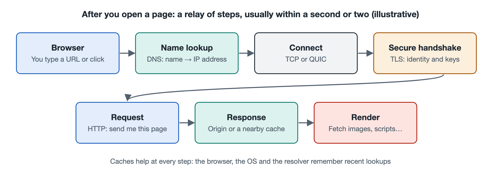

# 1.1 After You Click a Link: What Happens in One Second

It's ten o'clock at night. You're lying on the sofa and open a news site in your phone's browser. You type the address into the address bar and tap "Go." In less than a second, the headlines, images, and articles appear on the screen. You do this dozens of times a day, and it is so ordinary that you never think about it. Yet in that brief moment, your phone, the router at home, the fiber in the stairwell, your carrier's equipment rooms, and perhaps a server in another city have already exchanged messages many times. This section slows that second down and walks through what happens, step by step. Later chapters take each step apart in detail. Here, the goal is a complete overall picture.

## 1.1.1 Asking for Directions: Turning a Name into an Address

What you type is a name, such as `www.example.com`. Devices on the network don't understand names. They understand only numeric addresses, known as IP addresses (Internet Protocol addresses). So the browser's first task is a kind of directory lookup. It asks the Domain Name System (DNS) which address goes with this name.

This is a lot like checking your contacts before making a call. The phone first checks whether it has looked up the name recently. If it has, it uses that answer. If not, it passes the question to a DNS server run by the carrier or another public provider. If that server has no ready answer either, it asks level by level. It starts at the root servers, moves on to the servers responsible for ".com," and finally reaches the servers responsible for this particular website. The result is a string of digits: the address. Because every level keeps a cache, popular websites can often be resolved in a few milliseconds to a few tens of milliseconds.

## 1.1.2 Handshakes and Encryption: Setting Up a "Trusted Channel"

Once it has the address, the browser doesn't ask for the page right away. It first says hello to the other side. The traditional method is the TCP (Transmission Control Protocol) three-way handshake. I say, "Can you hear me?" You say, "I can hear you. Can you hear me?" I reply, "Yes." These three messages confirm that both sides are online and ready.

Today the vast majority of websites use HTTPS, which the secure-connection indicator in the address bar (a padlock or similar icon) signals. So after the handshake comes a round of TLS (Transport Layer Security) negotiation. The browser verifies the server's identity, the two sides agree on an encryption method, and they exchange keys. After that, devices along the route can see only that data is passing between you and the website. They cannot see what it says.

A newer approach called QUIC combines connection setup and encryption negotiation into one step, cutting down on round trips. As of this writing, many large websites and major browsers already support it (HTTP/3 is built on top of it). Chapter 7 covers it in detail.

## 1.1.3 Sending the Request: Data Is Cut into Small Packets

With the channel in place, the browser sends its request: "Please send me the home page." Neither this message nor the page that comes back travels as one solid block. Each is cut into many small pieces. Every piece is labeled with information such as the sender's and receiver's addresses, and each becomes a packet.

The packets' journey looks roughly like this:

| Segment | Devices or networks passed through | What happens |
|---|---|---|
| At home | Phone → Wi-Fi router → optical modem | Wireless signals become wired signals, then optical signals |
| Access | Neighborhood fiber → carrier's central-office equipment | Traffic from thousands of households is aggregated |
| Backbone | Carrier backbone networks, exchange points | Traffic is forwarded between cities, provinces, and even countries |
| Destination | Server or a nearby cache node | The request is received and the content is prepared |

Every router along the way does one simple thing. It reads the destination address on the packet, checks its own routing table, and hands the packet to the next stop. No router knows the full route. A relay race works the same way: each runner only has to pass the baton to the next.

## 1.1.4 The Server Responds, and the Page Is "Assembled"

When the request arrives, the server sends back the main body of the page, the HTML file. The browser reads it and finds that it refers to stylesheets, scripts, images, and fonts. It then sends dozens or even hundreds more requests to fetch them. Public web statistics commonly show that an ordinary news home page involves somewhere between several dozen and a few hundred resources.

Many images and videos don't come from the website's "headquarters." They come from a nearby node of a Content Delivery Network (CDN). A CDN works like a chain of local branches: it stores popular content close to users ahead of time. A shorter trip means a faster load.

When the packets arrive, your phone still has to check for any that are missing or out of order. If one is missing, it asks the other side to resend it. If they are out of order, it rearranges them by sequence number. Finally, the browser combines the text, styles, and images and draws the page on the screen.

## 1.1.5 Where the Second Goes

Put all the steps together and you get a rough breakdown of the time. The values below are typical ranges and vary widely with network conditions.

- Domain lookup: almost zero on a cache hit, tens of milliseconds when a level-by-level lookup is needed;
- Connection setup and encryption: depends on the number of round trips and the distance, usually tens of milliseconds within the same city and up to several hundred milliseconds across an ocean;
- Transferring the page and its resources: depends on page size and bandwidth;
- Browser parsing and rendering: depends on the phone's performance and the page's complexity.

Notice that speed often depends less on how many megabits per second your connection offers and more on how many round trips are needed and how far each one goes. Light travels through optical fiber at about 200,000 kilometers per second, so even a single round trip across the Pacific takes more than a hundred milliseconds. That is why engineers work so hard to reduce handshakes and to place content closer to users.

## 1.1.6 Summary: The Whole Network Behind a Single Web Page

Look back at that one second. A name was turned into an address. The two sides shook hands and set up encryption. The data was cut into small packets, which crossed the home network, the access network, and the backbone to reach a server or cache node. The response then traveled back along the route and was checked, put in order, and assembled into the page you see. The process involved end devices, cables, and data centers. It relied on addressing, naming, routing, and reliable transmission. It also depended on many devices that belong to no single company, all working together.

That raises the next question: what kind of system connects so many independent networks? The next section answers the question "What is the Internet?"
