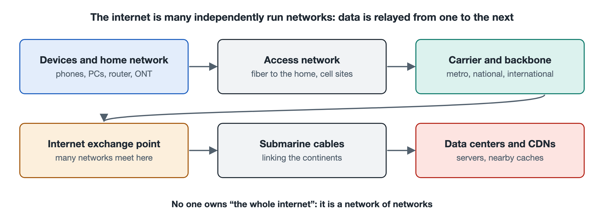

# 2.1 End Devices and Home Networks: Phones, Computers, Routers, and Optical Modems

You come home in the evening, your phone joins the Wi-Fi on its own, your computer opens a browser, and the TV starts streaming a video. It all feels so natural that we rarely notice that, between you and the entire Internet, a small network is already quietly running inside your home. Its boundary usually sits in two or three boxes with blinking indicator lights, tucked in a corner of the living room or inside the low-voltage wiring cabinet. In this section, we start from the devices at hand and take apart the layer of the Internet closest to you.

## 2.1.1 End Devices: Where the Network Begins and Ends

In networking terminology, devices such as phones, computers, tablets, smart TVs, smart speakers, and cameras, which people use directly or which directly produce data, are collectively called **end devices**, also known as **hosts**. They are the "senders" and "recipients" of data: when you open a web page, the request leaves from an end device, and the page content ultimately returns to an end device to be displayed.

To get online, an end device needs three things:

- **Network interfaces**: the Ethernet port on a computer, and the Wi-Fi chip and cellular baseband chip inside a phone, which turn data into electrical signals or radio waves. Each interface is assigned a **MAC address** (Media Access Control address) at the factory, used to identify the device within the same local area network, much like a resident's unit number within a building.
- **Protocol software**: the operating system implements TCP/IP and a whole suite of communication rules (covered in detail in Chapters 3 and 6), responsible for packaging, numbering, and checking data.
- **Applications**: browsers, video apps, and chat apps, the programs that actually "want" the data.

One point worth remembering: the Internet leaves most of the "intelligence" at the end devices. Confirming whether all the data has arrived, deciding whether lost data should be resent, and determining how content is encrypted are mainly handled by end devices, while the network equipment in between simply does its best to forward data. This design philosophy is called the end-to-end principle, and we will revisit it in Chapter 8.

## 2.1.2 The Home Router: Several Roles in One Box

What we usually call a "router" at home is, strictly speaking, a device that combines several functions. Taken apart, it typically plays the following roles at once:

| Role | What it does | Analogy |
|---|---|---|
| Switch | Forwards data between devices in the home, based on MAC addresses | The hallways inside a building |
| Wireless access point (AP, Access Point) | Turns the wired network into a Wi-Fi signal | The loudspeaker in the stairwell |
| Router | Forwards data between the home network and outside networks, based on IP addresses | The mailroom at the complex gate |
| DHCP server | Automatically assigns IP addresses and other parameters to newly joined devices | The front desk handing out temporary unit numbers |
| NAT gateway | Lets multiple devices at home share a single external address | A unified mailing address for the outside world |
| Firewall | Blocks connections initiated from outside by default | The security guard |

Two of these matter most to your everyday online experience.

**DHCP** (Dynamic Host Configuration Protocol): in the second or two it takes your phone to join the Wi-Fi, it "asks" the router for an address. The router assigns it a **private address** such as 192.168.1.23, and also tells it where the gateway and the domain name servers are. Addresses beginning with 192.168, 10, or 172.16–172.31 are designated by the standards document RFC 1918 for use only within internal networks, so countless households around the world can reuse the same ranges.

**NAT** (Network Address Translation): since private addresses cannot travel directly on the Internet, the router replaces the addresses on data sent by every device in the home with its own external address, and keeps a record of "which request came from whom." When the replies arrive, it hands them back to the right devices. It is like residents of a building all writing the property management office's address on their letters; when replies come back, the office distributes them according to its logbook. NAT eases the shortage of IPv4 addresses, but it also means outsiders cannot reach devices in the home on their own initiative. This is a natural layer of protection, yet it also causes trouble for peer-to-peer applications such as video calls and online multiplayer games. Its details are covered in Section 5.2, and IPv6, the fundamental solution to the address shortage, is covered in Section 7.1.

## 2.1.3 The Optical Modem: The Dividing Line Between Your Home Network and the Carrier

The network cable plugged into the router's port labeled WAN (Wide Area Network) usually connects to another box: the **optical modem**, formally known as the **Optical Network Terminal** (ONT; some sources also call it an ONU). In Chinese it is nicknamed "guangmao," or "light cat," because "mao" (cat) is a phonetic rendering of "modem" from the early days of dial-up access, and the name has stuck.

The optical modem's core job is **optical-electrical conversion**: what enters the home is a thin optical fiber carrying light signals, while the devices in the home use electrical signals. The optical modem translates between the two and communicates with the carrier's central office equipment according to the rules of the access network. In the fiber-to-the-home deployments common in China, this access network mostly uses Passive Optical Network (PON) technology, in which a single trunk fiber is split by an optical splitter and shared among multiple households. The underlying principles are left to Section 2.2 and to the *Optical Fiber Communication* volume in this series.

It should be noted that home equipment setups are not uniform:

- Some carriers provide an optical modem that itself has routing and Wi-Fi built in, so the home has only one box;
- Some users set the optical modem to "bridge" mode so that it only performs optical-electrical conversion, leaving dial-up authentication and routing to a router they bought themselves;
- Households connected through cable TV networks or telephone lines use boxes called "cable modems" or "DSL modems," which work on similar principles over different media.

Which arrangement is used depends on the local carrier's practices and the user's settings; at the time of writing, all of the above scenarios exist both in China and abroad. Whatever the combination, the outside of the optical modem is usually where the carrier's network begins, and it is also the line that determines "whose responsibility it is" when a household reports a fault.

## 2.1.4 Putting a Single Online Session Together

Now let's link these pieces into a single chain. When you press Enter in your phone's browser:

1. The phone has already obtained a private address via DHCP and knows that the gateway is the router;
2. The data travels over Wi-Fi radio waves to the router's wireless access point;
3. The router sees that the destination lies outside the home network, performs NAT address translation, and sends the data out through the WAN port;
4. The optical modem converts the electrical signal into a light signal and sends it along the fiber into the carrier's access network;
5. The returning data follows the reverse path, passing through the optical modem and router back to your phone.

If your connection drops, this chain also gives you a troubleshooting order: first check whether the phone is connected to Wi-Fi and has obtained an address; then check whether the router's WAN port has obtained an external address; finally, check whether the indicator light for the optical signal on the optical modem (labeled differently by different manufacturers, commonly PON, LOS, and so on) looks normal. Many home network problems can be mostly pinpointed by following this near-to-far order.

The home network is the smallest, yet most complete, miniature of the entire Internet: it has end devices, switching, routing, address assignment, and an exit to the outside world. Once data leaves through the optical modem's fiber, it enters the carrier's world. In the next section, we follow that fiber, along with the invisible wireless link on your phone, to see how the access network brings countless homes online.
