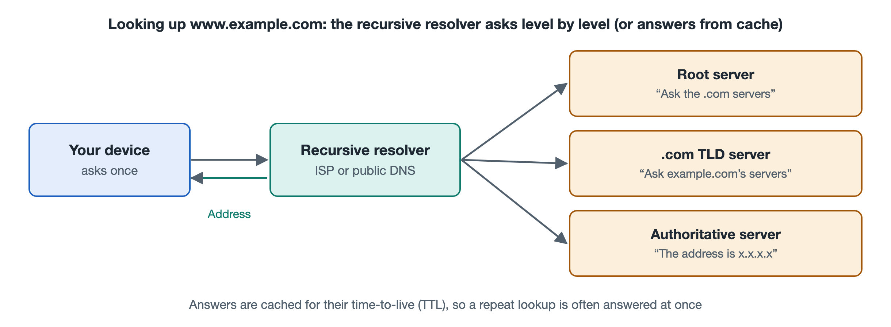

# 3.2 Naming: How the Domain Name System Turns Names into Addresses

Type a web address into your browser's address bar, say the name of a news site, press Enter, and the page appears. Yet as the previous section explained, what the network actually uses to find the other side is an IP address: a string of numbers (IPv4) or a long run of hexadecimal characters (IPv6). Nobody memorizes these numbers. The translation between names and addresses is handled by a service called the Domain Name System (DNS). It answers trillions of queries every day, yet most people have never noticed it. This section covers what it does and why it is designed the way it is; the detailed steps of a lookup are left for Chapter 6.

## 3.2.1 Why Names and Addresses Are Kept Separate

Think of your phone's contacts: you remember "Mom" or "Mr. Zhang," and the phone dials the matching number for you. Even if Mr. Zhang changes his number, you can still reach him as long as the contact entry is updated.

The Domain Name System offers the same benefits, which come down to roughly three:

- **Easy to remember**: People remember names, machines use numbers, and each side plays to its strengths.
- **Portable**: When a website moves to a new server or data center and its IP address changes, only the record for the domain name needs updating; users don't have to change anything they do.
- **One name, many addresses**: The name of a popular website can map to the addresses of many servers, with users in different regions directed to different addresses. Content delivery networks, covered in Chapter 7, rely heavily on this.

In the early Internet there were very few hosts, and the table matching names to addresses lived in a single file called HOSTS.TXT, maintained centrally by one organization and periodically downloaded by each host. As the number of hosts grew, this approach became impossible to maintain and too slow to update. Around 1983, Paul Mockapetris proposed the design of DNS; the core specifications in use today are RFC 1034 and RFC 1035, published in 1987. Your computer very likely still has a hosts file, a holdover from that era.

## 3.2.2 An Upside-Down Tree: The Hierarchy of Domain Names

Instead of relying on a single master table, DNS organizes names into an inverted tree. Take `www.example.com` as an example; it is read from right to left:

| Level | Example | Meaning |
|---|---|---|
| Root | The implicit "." at the end | The starting point of the entire tree |
| Top-Level Domain (TLD) | `com`, `cn`, `org` | Generic or country/region categories |
| Second-level domain | `example` | Usually registered by an organization or individual |
| Hostname or subdomain | `www` | Set up by the domain holder |

The tree's most important design feature is **delegation**: the root only needs to know who manages each top-level domain, `com` only needs to know who manages `example.com`, and the holder of `example.com` decides for itself what names exist beneath it. Each level manages only its own small piece, called a "zone." A server responsible for giving authoritative answers about a zone is called an authoritative name server.

In this way, the world's names are spread across thousands upon thousands of organizations, each maintaining its own part, and no single machine needs to store every name. This is how the "network of networks" idea shows up in naming.

## 3.2.3 Who Looks It Up for You: Resolvers and Caching

Your phone doesn't go asking level by level on its own. The division of labor usually looks like this:

1. **Stub resolver**: A small piece of software in the operating system whose only job is to hand the question off.
2. **Recursive resolver**: Usually provided by your Internet service provider, though it can also be a public DNS service. It asks on your behalf, starting from the root and working down level by level, and finally brings the answer back.
3. **Authoritative servers**: The servers for the root, the top-level domains, and individual domains, each answering questions within its own jurisdiction.

If every visit to the web started by asking the root, the root servers would be overwhelmed and pages would load slowly. So DNS makes heavy use of **caching**. Every record carries a Time To Live (TTL), measured in seconds, with common values ranging from tens of seconds to a day. Until the TTL expires, a resolver simply uses the cached answer. The browser, the operating system, the home router, and the recursive resolver may each keep their own copy. That is why, after a website changes its address, some people reach the new server right away while others have to wait a while: caches in various places haven't expired yet.

It is often said that there are "only 13 root servers in the world." More precisely, there are 13 root server names (lettered a through m), operated by a dozen or so different organizations, and behind each name, anycast technology deploys it at a large number of sites around the globe. According to data published by the root server operators, the total number of sites exceeded one thousand at the time of writing.

## 3.2.4 DNS Stores More Than Addresses

DNS is essentially a distributed database whose entries are called resource records. Common types include:

| Record type | Purpose |
|---|---|
| A | The IPv4 address for a name |
| AAAA | The IPv6 address for a name |
| CNAME | An alias pointing to another name |
| MX | Which server should receive mail for this domain |
| NS | Which authoritative servers are responsible for this zone |
| TXT | Arbitrary text, often used to verify domain ownership and to fight email spoofing |

When you email a friend, the mail system looks up the MX record of the recipient's domain, not the A record. In this way, the same tree of names simultaneously serves web pages, email, and all kinds of verification.

## 3.2.5 The Costs of the Design and Their Remedies

When DNS was born, the network was small and most participants trusted one another, so queries and answers were originally sent in plain text with no verification. This led to two kinds of problems:

- **Privacy**: Networks along the way can see which sites you are looking up. DNS over TLS (DoT, RFC 7858) and DNS over HTTPS (DoH, RFC 8484) later appeared, placing queries inside an encrypted channel.
- **Authenticity**: A forged answer can steer users to a fake website; such attacks are collectively called "DNS spoofing" or "cache poisoning." The DNS Security Extensions (DNSSEC) add digital signatures to records, letting resolvers verify that an answer really came from the authoritative source. At the time of writing, however, the extent of its deployment varies widely across top-level domains and websites.

For ordinary users, the basic precautions are: use a trustworthy DNS service, check that the address in the address bar begins with https and that the domain name is correct, and don't casually change the DNS settings on your router. How HTTPS can still expose a fake website when a name has been tampered with will be explained in Chapter 6, in the discussion of TLS.

## 3.2.6 Summary

Through three techniques, hierarchy, delegation, and caching, DNS spreads the job of "remembering names" across the whole world. Addresses answer "where"; names answer "who." The next section turns to a third question: once the destination address is known, how does a packet find its way there, one hop at a time?
