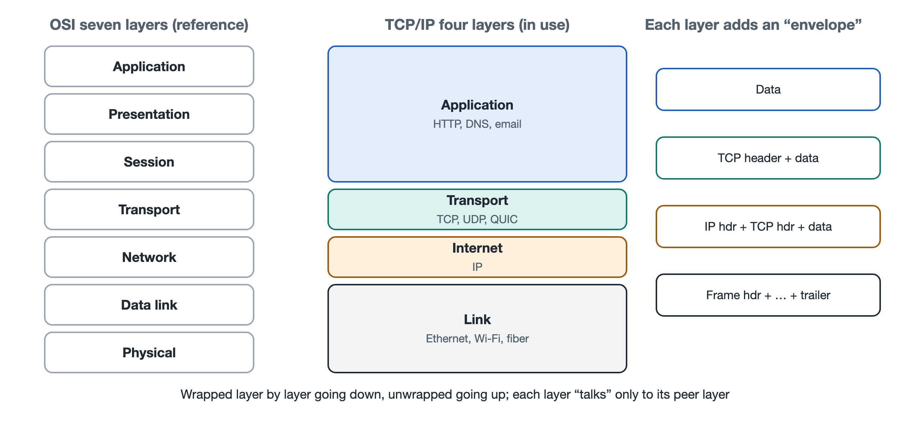

# 4.1 Layered Models: The Four-Layer TCP/IP Model and the Seven-Layer OSI Model

When you send a parcel by courier, all you have to do is write the delivery address clearly, pack the item in a box, and hand it to the courier. You don't need to care whether the parcel travels by truck or by plane, nor do you need to know how the sorting center scans barcodes. The courier, in turn, doesn't care whether the box holds books or clothes. Each stage does only its own job and hands off only to the stages next to it, and the whole logistics system keeps running.

The internet is organized the same way. When you press Enter in your browser, the browser only has to say clearly, "I want this web page." How many packets that request gets split into, which fiber-optic cables it travels along, how many routers it passes through: none of that is the browser's concern. This way of organizing things, with "each layer minding its own part and handing off layer by layer," is called a **layered model**. The first three chapters took the internet apart into its components and explained what each part does; starting with this chapter, we look at how they connect, and layering is the first thread to follow.

## 4.1.1 Why Layering: Breaking One Big Problem into Several Small Ones

Getting a phone to exchange web pages reliably with a distant server involves solving many problems: how electrical or optical signals represent 0s and 1s, how data on the same wire is divided among different devices, how data crosses dozens of networks to find its destination, how lost data gets resent, and how the received content is interpreted as a web page. If all of this were written as one giant monolithic program, any change anywhere would ripple through the whole thing.

Layering works like this: arrange these problems into several layers according to "how close they are to the physical world," with each layer relying only on the services provided by the layer below it while providing services to the layer above it. The agreed-upon way that adjacent layers hand off to each other is called an **interface**; the two parties at the same layer talk according to a shared set of rules, and that set of rules is called a **protocol**. This approach brings three benefits:

- **Replaceability**: If your home switches from Wi-Fi to an Ethernet cable, the browser and TCP at the upper layers don't need to change at all.
- **Division of labor**: Chipmakers, operating system developers, and website builders each need to master only their own layer.
- **Evolvability**: When a new technology appears at one layer, such as QUIC at the transport layer (covered in detail in Chapter 7), the other layers are unaffected as long as the interface holds.

## 4.1.2 The Four-Layer TCP/IP Model: The One the Internet Actually Uses

What the internet actually runs on today is the **TCP/IP model**, named after two of its core protocols: the Transmission Control Protocol (TCP) and the Internet Protocol (IP). The authoritative document describing it is RFC 1122, which divides a host's communication functions into four layers.

| Layer | Main Responsibility | Typical Protocols or Technologies | Related Earlier Content |
|---|---|---|---|
| Application layer | Defines what a specific application says | HTTP, DNS, SMTP | 3.2 Naming, 3.5 Application Services |
| Transport layer | Delivers data end to end to the right program, guaranteeing reliability as needed | TCP, UDP | 3.1 Ports, 3.4 Reliable Transmission |
| Internet layer (network layer) | Gives packets addresses and forwards them hop by hop across networks | IP (IPv4, IPv6) | 3.1 IP Addresses, 3.3 Routing |
| Link layer | Carries data within the same stretch of line or the same local area network | Ethernet, Wi-Fi | 2.1 Home Networks, 2.2 Access Networks |

Textbooks name the bottom layer a little differently: some call it the "network interface layer," while others split physical transmission into its own layer, producing a "five-layer teaching model." The names differ, but the idea is the same.

The most crucial part of this model is the middle layer: **IP is the common language that every network must speak**. All kinds of applications can run above it, and below it can be fiber, copper, or radio, but in the middle there is only IP. People often draw this structure as an "hourglass": wide at both ends, narrow in the middle. It is precisely this narrow waist that allows tens of thousands of technologically diverse networks to interconnect into a "network of networks." We will return to this design in Chapter 8 when discussing the end-to-end principle.

## 4.1.3 The Seven-Layer OSI Model: A Finer-Grained Reference Framework

Textbooks also frequently present another model: the **Open Systems Interconnection Reference Model** (OSI), developed by the International Organization for Standardization (ISO) from the late 1970s into the 1980s under the standard number ISO/IEC 7498. It divides communication into seven layers, from bottom to top:

1. **Physical layer**: how bits become voltages, light pulses, or radio waves;
2. **Data link layer**: how adjacent devices frame data and detect errors;
3. **Network layer**: addressing and routing across networks;
4. **Transport layer**: reliable end-to-end delivery;
5. **Session layer**: establishing, managing, and ending a conversation;
6. **Presentation layer**: data formats, encoding, encryption, and compression;
7. **Application layer**: specific user-facing services.

The two models correspond roughly as follows: OSI's physical and data link layers correspond to TCP/IP's link layer; the network and transport layers map essentially one to one; and OSI's session, presentation, and application layers are merged into the application layer in TCP/IP. Take the encryption in HTTPS (TLS is covered in Chapter 6): functionally it looks like presentation-layer work, but in practice it is implemented as a layer of software between the application and TCP, making it hard to fit strictly into any single box.

As a complete suite of concrete protocols, OSI did not become mainstream in its competition with TCP/IP; but its seven-layer division is clear and its terminology complete, so to this day it serves as the "common coordinate system" for networking education and engineering communication. When operations engineers say "this is a Layer 2 problem," "Layer 3 switch," or "Layer 7 load balancing," they are using OSI layer numbers. So here's a way to remember it: **TCP/IP is the road the internet actually travels; OSI is the map grid used to describe that road.**

## 4.1.4 Encapsulation and Decapsulation: The Traces Layering Leaves on Packets

Layering is not just a concept; you can see it in every single packet. After your browser sends an HTTP request, the data is "put into envelopes" layer by layer from the top down, a process called **encapsulation**:

- The application layer writes the request content, such as "please give me a certain page";
- The transport layer adds a TCP header in front, specifying the source and destination ports, sequence numbers, and so on;
- The internet layer then adds an IP header, specifying the source and destination IP addresses;
- Finally, the link layer adds an Ethernet or Wi-Fi frame header and trailer, specifying the hardware address (MAC address) of the next-hop device.

When this packet reaches your home router, the router opens the outermost link-layer envelope, glances at the IP header to decide where to send it, then puts it in a new link-layer envelope and sends it on. Every router along the way repeats this step, generally looking only at Layer 3 and leaving the TCP and HTTP inside untouched. When the packet finally reaches the server, the server unwraps it layer by layer from the bottom up, a process called **decapsulation**, and ultimately hands the request to the website's program.

It's like sending an international parcel: the innermost layer is the letter you wrote, outside that is the international postal form, and on the very outside is the shipping label for each leg of transport. The shipping label is replaced every time the parcel changes vehicles, the postal form stays the same all the way, and only the recipient opens the letter.

Of course, real networks aren't always so tidy. The address translation done by home routers (NAT, see Section 5.2) rewrites transport-layer ports, and firewalls and content delivery networks often read higher-layer information as well. Layering is a design principle, not a law of physics; its value lies in letting you quickly judge "which layer is broken" when something goes wrong: an unplugged cable is a link-layer problem, failing to get an address or broken routing is a network-layer problem, a blocked port is a transport-layer problem, and a web page showing a 404 error is an application-layer problem.

Layering solves the problem of "how communication is organized inside a single device." But the internet is pieced together from networks operated independently by tens of thousands of organizations, so what rules connect these networks to one another? In the next section, we step out from inside a single device to look at the interconnection relationships between autonomous systems and network operators.
