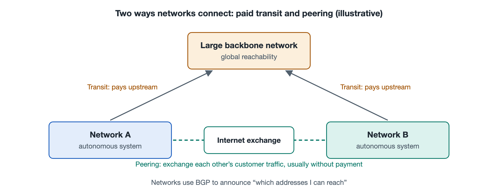

# 4.2 Autonomous Systems and Carrier Interconnection: Peering and Transit

Open a command line on your computer and run a traceroute to a website hosted abroad. The screen fills with a dozen or so lines of unfamiliar addresses. Look those addresses up on a public network-information lookup site, and you will find that they belong to several different organizations. First comes your home broadband provider. Next there may be an international carrier. Only at the end do you reach the cloud provider or content delivery network that hosts the website. A single web request often crosses the networks of several unrelated companies. These companies compete with one another, yet they must also connect to one another. What agreements bring them together? That is the subject of this section: autonomous systems and carrier interconnection.

## 4.2.1 Autonomous Systems: The "Independent Kingdoms" of the Internet

The Internet is pieced together from tens of thousands of independent networks. Each one has its own operators, its own equipment, and its own routing policies. To tell them apart at a global level, engineers introduced the concept of the **Autonomous System** (AS). RFC 1930 describes an autonomous system as a group of IP address prefixes, run by one or more network operators, that presents a single, clearly defined routing policy to the outside world.

Think of autonomous systems as "independent kingdoms." Inside each kingdom, the king alone decides how the roads are built and how traffic flows. The rules for travel between kingdoms, however, have to be settled through diplomatic negotiation. Every autonomous system has a globally unique number called an **Autonomous System Number** (ASN). Early ASNs were 16 bits long, which allowed only about 65,000 of them. As the number of networks grew, standards such as RFC 6793 extended ASNs to 32 bits, raising the supply to more than 4 billion. ASNs are assigned by the Regional Internet Registries, which Section 4.4 covers in more detail.

Which organizations hold autonomous system numbers? Common examples include:

- telecom carriers and broadband providers;
- large cloud providers and content delivery networks;
- universities, research networks, and government agencies;
- large enterprises that need to connect to several carriers at once.

Ordinary households do not have an autonomous system of their own. Your home network is just a tiny part of your carrier's autonomous system. Public sources commonly put the number of active autonomous systems visible in the global routing table somewhere between tens of thousands and about one hundred thousand.

## 4.2.2 Two Basic Relationships: Transit and Peering

How do autonomous systems connect to one another? Commercially, there are two basic kinds of relationship.

**Transit** is a buyer–seller relationship. A small network pays a large one, and in return the large network promises to "carry your traffic anywhere on the Internet, and let the whole world reach you." It is like a small town paying to join the national highway network, which then gives it a route to anywhere in the country.

**Peering** is an exchange relationship. Two networks of similar size, with heavy traffic flowing between them, agree to a simple deal: "I'll hand traffic for your users directly to you, and you do the same for me." Usually neither side pays the other, which is why this arrangement is also called settlement-free peering. There is one key restriction. Peers exchange only traffic for themselves and their own customers. Neither forwards the other's traffic on to third parties. It is like two neighboring cities building a direct road between them for their own residents, while refusing to let outside traffic use it as a shortcut.

| Aspect | Transit | Peering |
|---|---|---|
| Business relationship | Customer pays provider | Usually no payment either way |
| Reachable scope | The entire Internet | Only the two parties and their customers |
| Typical parties | A small network and a large network | Networks of comparable size and traffic |
| Main benefit | One connection reaches the whole Internet | Saves transit fees; shorter paths and lower latency |

Hybrid arrangements such as paid peering also exist. Their terms are negotiated case by case, practices vary widely from company to company, and there is no industry-wide standard contract.

## 4.2.3 The Hierarchy and "Tier 1" Carriers

As transit relationships stack on top of one another, the Internet takes on a loose hierarchy. At the top are the networks commonly called **Tier 1** carriers. They all peer with one another and can reach every part of the Internet without buying transit from anyone. Below them are Tier 2 carriers, which buy transit from above and also peer widely with their equals. Further down are the access networks that serve homes and businesses.

Note, however, that "Tier 1" is not a title granted by any standards body. It is an industry label based on interconnection relationships, and the list of Tier 1 carriers changes over time. Over the past decade or more, large content companies and cloud providers have built their own global backbones and peered directly with many access providers. As a result, more and more traffic bypasses the traditional upper-tier transit networks. Researchers call this shift the "flattening" of the Internet's structure. The tiered diagram, then, is only a simplified model to aid understanding. The real Internet looks more like a dense, crisscrossing web.

## 4.2.4 Where Networks Shake Hands: Private Interconnects and Exchange Points

Once the business terms are agreed, the networks still need a physical connection. There are two common ways to make one.

The first is a **Private Network Interconnect** (PNI). The two networks run a dedicated link between their equipment in the same data center. This suits pairs of networks that exchange very large volumes of traffic.

The second is to connect at an **Internet Exchange Point** (IXP). As Section 2.3 explained, an exchange point is essentially a shared switching platform. Many networks plug their routers into it and can then peer with many partners on the platform, without running a separate line to each one. Many exchange points also offer "route servers," which let a member set up peering with many parties through a single configuration. Think of it as a marketplace: rather than going door to door to trade, everyone agrees to set up stalls in the same place.

## 4.2.5 From Relationships to Routes: Policy Determines the Path

These business relationships ultimately shape how routes are chosen. Autonomous systems use the **Border Gateway Protocol** (BGP) to announce to one another which addresses they can reach. Internal routing protocols simply look for the shortest path. BGP route selection, by contrast, answers first to business policy. Researchers have distilled a widely cited rule of thumb:

- **Prefer customer routes first**, because customers pay me, so more traffic is better;
- **Use peer routes next**, because they cost nothing;
- **Use transit routes last**, because I have to pay my upstream provider.

When announcing routes, a network typically advertises its customers' routes to everyone. It does not pass routes learned from one peer or upstream provider on to another peer or upstream provider. Doing so would mean carrying someone else's traffic for free. This is why your packets often take not the geographically shortest path but the "commercially most suitable" one. When a traceroute shows traffic detouring through a distant city before doubling back, interconnection relationships like these are often the reason.

Section 6.3 explains how BGP works in detail and where its weaknesses lie.

## 4.2.6 Summary

The Internet has no central authority running the whole system. It is tens of thousands of autonomous systems linked together through individual bilateral agreements. Transit lets small networks reach the whole world through a single connection. Peering saves large networks money and speeds up traffic between them. Exchange points lower the cost of interconnecting. Once you understand these relationships, you can see why the "network of networks" can span the globe, and why business considerations shape its choice of paths at every turn. In the next section, we turn from the links between networks back to the two ends of a communication, and look at how clients and servers divide the work.
