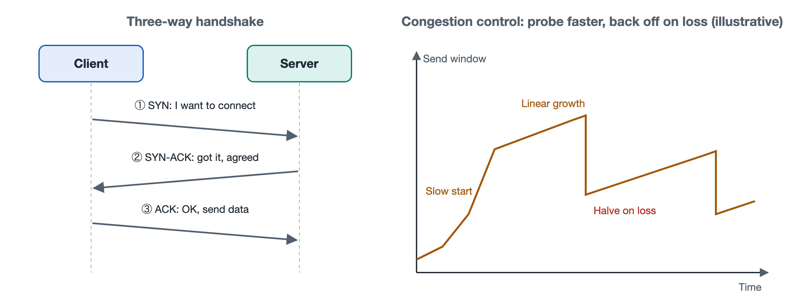

# 6.2 TCP Handshakes, Acknowledgments, and Congestion Control

When downloading an installer of several hundred megabytes, you may have watched the progress bar: at first the speed climbs gradually, after a while it levels off, and when someone at home starts streaming HD video it drops back down a notch. When the download finishes, not a single byte of the file is wrong, even though the network stalled several times along the way. Why does the speed rise "tentatively"? Where does lost data go, and how is it recovered? All of this is handled by one protocol: the Transmission Control Protocol (TCP). Section 3.4 described the problems reliable transmission must solve; this section opens up TCP to see how it turns a "best-effort" IP network into a reliable byte pipe. TCP's core specification was originally RFC 793; the current version is RFC 9293, published in 2022.

## 6.2.1 The Three-Way Handshake: First Confirm Both Sides Are Present

On a phone call, the two parties first say, "Hello, can you hear me?" "Yes, I can hear you. Can you hear me?" "Yes." Only after confirming the line works at both ends do they get down to business. TCP establishes a connection with the same idea, called the three-way handshake:

| Step | Direction | Segment Flags | Meaning |
|---|---|---|---|
| 1 | Browser → Server | SYN | I want to establish a connection; my initial sequence number is x |
| 2 | Server → Browser | SYN + ACK | Got your x; my initial sequence number is y |
| 3 | Browser → Server | ACK | Got your y; we can start sending data |

SYN is short for "synchronize," and ACK is short for "acknowledgment." The purpose of the handshake is to exchange both sides' initial sequence numbers; once it completes, every byte has a number. To guard against forged segments and interference from leftover segments of old connections, initial sequence numbers do not start at 0 but are chosen, per the specification, in a hard-to-predict way.

The handshake has a cost: the browser cannot send its first request until at least one Round-Trip Time (RTT) has passed. If the server is on another continent, one RTT can reach one or two hundred milliseconds, and with the subsequent TLS encryption handshake (see Section 6.5) added on, users can notice the wait. This is precisely why QUIC, introduced in Section 7.2, can shorten this setup time.

When the connection ends, each side sends a FIN (finish) segment and receives an acknowledgment, which usually takes four segments. The reason is that TCP is full-duplex, so the data streams in the two directions must be closed separately.

## 6.2.2 Sequence Numbers and Acknowledgments: A Receipt for Every Byte

Once the connection is established, the sender cuts data into segments and sends them, each carrying a sequence number. The acknowledgment number the receiver sends back means "I have received all bytes up to this number; please start sending from here next." This approach is called cumulative acknowledgment.

There are two ways to handle packet loss:

- **Timeout retransmission**: The sender sets a retransmission timer for sent data, and if no acknowledgment arrives before it expires, it resends. The timeout is computed dynamically from measured RTT (RFC 6298). It cannot be too short, or data will be needlessly resent; nor too long, or stalls will drag on.
- **Fast retransmission**: If a segment in the middle is lost while later segments still arrive, the receiver repeatedly acknowledges the same number. When the sender receives three duplicate acknowledgments in a row, it infers that segment was lost and resends it immediately without waiting for a timeout.

Modern TCP also widely supports Selective Acknowledgment (SACK, RFC 2018), which lets the receiver tell the sender explicitly, "1000–2000 didn't arrive, 2000–5000 has been received," so the sender fills in only the missing part.

Segments that arrive out of order are reassembled by the receiver according to their sequence numbers before being handed to the application. The browser always receives a complete, ordered stream of bytes, and cannot see what happened in the network below.

## 6.2.3 Two Windows: Don't Overwhelm the Receiver, Don't Clog the Network

If each segment had to wait for its acknowledgment before the next could be sent, transoceanic connections would be very slow. TCP lets the sender have multiple unacknowledged segments in flight at once, and how much it may send is limited jointly by two "windows":

| Window | Determined By | What It Prevents |
|---|---|---|
| Receive window (rwnd) | Advertised by the receiver in its segments | Sending too fast and overflowing the receiver's buffer; this is called flow control |
| Congestion window (cwnd) | Estimated by the sender from network conditions | Sending too aggressively and causing queuing and packet loss at intermediate routers; this is called congestion control |

The amount that can actually be sent is the smaller of the two. Flow control involves only the two endpoints, whereas congestion control concerns the network as a whole. Intermediate routers won't tell you "I'm congested"; the sender can only infer it from signs such as packet loss and changes in delay.

## 6.2.4 Congestion Control: Feeling Your Way Along an Unseen Road

Classic congestion control as described in RFC 5681 can be summarized as four actions:

1. **Slow start**: When a connection begins, the congestion window is small (most mainstream implementations now use an initial value of about 10 segments; see the experimental specification RFC 6928), and it roughly doubles every RTT. Despite the word "slow" in its name, growth is actually exponential; "slow" refers to the low starting point. The climb at the start of the download progress bar is mainly this phase.
2. **Congestion avoidance**: Once the window grows to a threshold, it switches to adding just one segment per RTT, cautiously approaching the network's capacity limit.
3. **Fast recovery**: When loss is detected through duplicate acknowledgments, the network is assumed to be only mildly congested, so the window is halved and sending continues.
4. **Timeout fallback**: If no acknowledgment arrives before a timeout, the situation is more serious, so the window drops back to a very small value and slow start begins again.

This combination of "additive increase, multiplicative decrease" (AIMD) has an important property: when multiple connections share the same bottleneck link, their rates gradually converge toward a fair allocation. When your download slows as a family member starts watching video, that is two connections redistributing bandwidth at the bottleneck.

This mechanism treats packet loss as a congestion signal, but wireless interference can also cause loss, in which case TCP misjudges the situation and slows down. This has led to a variety of improved algorithms: CUBIC was standardized in RFC 9438 and, at the time of writing, is the default algorithm in many mainstream operating systems; BBR, proposed by Google, tries to estimate network capacity by measuring bandwidth and minimum RTT rather than relying entirely on loss. Which algorithm is used varies by system and version. In addition, Explicit Congestion Notification (ECN, RFC 3168) allows routers to mark segments as "nearly congested" before dropping them, letting senders slow down in advance.

## 6.2.5 Summary: Reliability at the Ends, Simplicity in the Network

TCP's handshake, sequence numbers, acknowledgments, retransmission, and windows all run on the hosts at the two ends; by design principle, routers along the path only forward packets and need not keep connection state (real-world devices such as NATs and firewalls are exceptions). This is exactly the division of labor described in Section 6.1 between the "best-effort" network and "smart end systems," and Chapter 8 will explain the reasons for this design from the perspectives of the end-to-end principle and queuing theory. The next section leaves this connection between two hosts behind to look at how the routing protocol BGP decides which paths these packets take across tens of thousands of networks.
