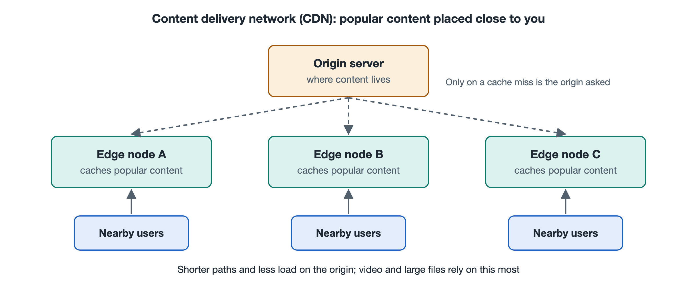

# 7.3 Content Delivery Networks and Edge Caching

You open a video site in the evening, click on a popular TV series, and playback starts almost instantly. At the same moment, thousands of people across your city may be watching the same episode. If every one of those requests had to cross the backbone network, perhaps even an undersea cable, to fetch data from a handful of servers at the site's headquarters, the headquarters' outbound bandwidth could not cope. Every link along the way would also be clogged with the same data again and again. In practice, the video you see most likely comes from a cache server not far from you, possibly sitting in your carrier's facility in your own city. Moving content close to users ahead of time is what a Content Delivery Network (CDN) does. Section 2.5 of Chapter 2 introduced the CDN as a component, and Section 5.4 of Chapter 5 traced how content flows to you. This section takes a different angle. It treats the CDN as a key technology and looks at the mechanisms that make it "near, fast, and economical."

## 7.3.1 From "Shipping Direct from the Warehouse" to "Forward Warehouses"

Online shopping offers a ready-made analogy. Early e-commerce companies shipped everything from one central warehouse, and a package from a Beijing warehouse took several days to reach Guangzhou. Later, merchants built forward warehouses in each region and stocked them in advance with frequently purchased items. Orders now ship from the nearest warehouse and can arrive the same day. A CDN is structured in a similar way:

| E-commerce Logistics | CDN |
|---|---|
| Central warehouse | Origin server, the authoritative source of the content |
| Forward warehouse | Edge node, a cluster of cache servers deployed in facilities around the region |
| Regional distribution center | Mid-tier cache, called a parent node or regional node in some systems |
| Order allocation system | Request routing, which decides which node serves you |
| Stocking best-sellers in advance | Caching or prewarming popular content ahead of time |

This tiered structure solves three problems. Shorter distances cut the round-trip time (RTT). Because the same content is fetched locally again and again, the load on the backbone and the origin drops sharply. When a node fails, requests can be redirected to other nodes, so the system as a whole holds up better under stress.

## 7.3.2 Request Routing: How You Are Led to the Nearest Node

The first key mechanism of a CDN is directing user requests to a suitable edge node. Two approaches are common.

**DNS-based routing.** A website typically uses a CNAME (alias) record to point one of its domain names to a domain owned by the CDN provider. When your device resolves that name, the CDN's authoritative DNS server gives the final answer. It looks at where the query came from, usually the address of the recursive resolver you use. From that it estimates your region and carrier, then returns the IP address of a nearby node. This approach has a known limitation. If you use a public resolver that is far away, the CDN sees the resolver's location rather than yours and may route you to the wrong place. To address this, the IETF defined the EDNS Client Subnet (ECS) extension in RFC 7871. ECS lets a resolver include part of the user's subnet in the query, which makes routing more accurate. It is also controversial on privacy grounds, and not all resolvers enable it.

**Anycast-based routing.** With anycast, servers in multiple locations announce the same IP address prefix. Using BGP, covered in Chapter 6, the network routes each user's packets to the location that is "nearest" in network terms. This method does not depend on a DNS decision, and failover happens automatically through routing. At the time of writing, many large CDNs and public DNS services use anycast, and some providers combine the two approaches. Note that "nearest" in the BGP sense reflects routing preferences along the path. It is not always the geographically closest location.

Routing decisions usually weigh more than distance. Node load, link quality, carrier affiliation, and cost all count. Each provider's algorithm is its own engineering design, and there is no unified standard.

## 7.3.3 Caching: What to Store, How Long, and What Happens When It Expires

When a request reaches an edge node, the node first checks whether it holds the content locally. If it does, that is a "hit," and the node returns the content directly. If it does not, that is a "miss." The node then fetches the content from the next cache tier up or from the origin. It passes the content to the user and keeps a copy for later. The hit ratio is one of the core metrics of how well a CDN performs.

How long content is stored is governed mainly by the HTTP protocol. In its responses, the origin uses header fields such as Cache-Control to tell caches how long the content may be stored (max-age), whether shared caches may store it, and whether a cache must check with the origin once it expires. These rules are defined in RFC 9111 (HTTP Caching). Expired content does not necessarily need to be downloaded again. A cache can send the ETag (entity tag) or last-modified time to the origin and ask whether the content has changed. If it has not, the origin replies with a short 304 response, which saves a great deal of traffic.

Caching is a natural fit wherever many people view the same thing, such as images, scripts, stylesheets, software installers, and video segments. Video suits CDNs especially well for another reason. Most modern online video is cut into segments a few seconds long, and each segment is a separate cacheable file. The segments of a popular series therefore get hit at edge nodes again and again. Personalized content is the opposite. Your shopping cart or account balance is unique to you and changes constantly, so it is usually not cached, or the edge only accelerates and forwards it.

When content must be updated immediately, a website can ask the CDN to "refresh" or "purge" it, telling every node to discard its old copy. For popular content about to launch, the site can "prewarm" the CDN, pushing the content to the edge in advance. This prevents a flood of requests from all going back to the origin the moment a show premieres.

## 7.3.4 From "Caching" to "the Edge"

At the time of writing, CDNs do far more than store files. Many CDN nodes also terminate HTTPS connections, meaning the node nearest you completes the TLS handshake and shortens connection setup. They support HTTP/3 and QUIC, bringing the speedups from the previous section to the edge. They also absorb and filter distributed denial-of-service (DDoS) attack traffic, spreading abnormal traffic across nodes worldwide so it can be soaked up. Some providers even let websites deploy small programs that run on edge nodes and handle requests close to users. This is commonly called edge computing, and its exact form varies by provider. For more depth, see the volume in this series on data centers and cloud computing.

Handing content to a CDN has costs too. A website must trust the CDN to hold its certificates or handle encrypted connections on its behalf. Because copies of the content live in many places, updates can be briefly inconsistent. And because so many websites depend on a few large CDNs, an outage at one of them can have wide-reaching effects. This is a real-world example of the trade-off between "efficiency and resilience" that Chapter 8 will discuss.

## 7.3.5 Summary

At its core, a CDN trades space for time. It spreads large numbers of caches across the network edge and places content close to users. Request routing decides "where to fetch from," and caching decides "what to store and for how long." Both are built on DNS, BGP, HTTP, and TLS, which earlier chapters of this book covered. A CDN does not invent new low-level protocols. Instead, it combines existing ones into a distribution system that covers the entire network. The next section, on software-defined networking, shifts the focus from "where content is placed" to "how the network itself can be controlled flexibly."
