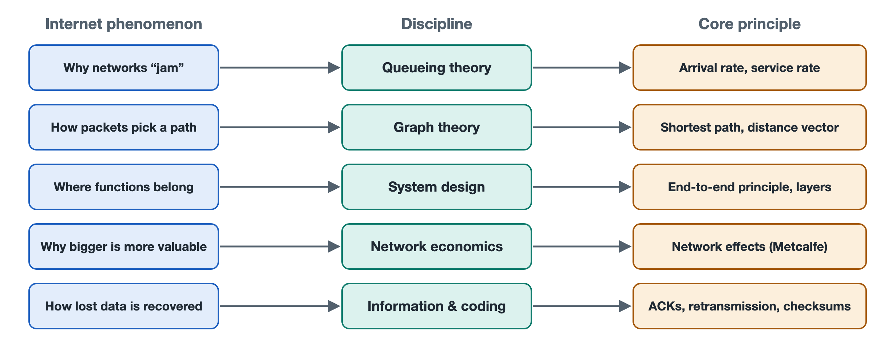

# 8.1 The End-to-End Principle and Layered Design

You send a friend a photo from your phone. Halfway through the upload, the elevator doors close and the signal drops. When you step out, the chat app quietly finishes sending the photo on its own. The routers along the way did not "remember" the photo for you. The software on your phone and the server on the other end checked their records, found which pieces were missing, and sent those pieces again. The devices in between only pass packets forward. The two ends handle the rest: whether the data arrived, whether all of it arrived, and whether it arrived in order.

Network design has a name for this division of labor: the End-to-End Principle. TCP retransmission, TLS encryption, and QUIC's user-space implementation of transport, all covered in earlier chapters, are connected to it. This section explains what the principle says, why it holds, and how it works together with layered design to form the basic logic of internet architecture.

## 8.1.1 The Question Raised by One Paper: Where Should a Function Go?

In 1981, J. H. Saltzer, D. P. Reed, and D. D. Clark of the Massachusetts Institute of Technology presented the paper *End-to-End Arguments in System Design*, which appeared in an ACM journal in 1984. Its central claim runs roughly as follows: **if a function can be implemented completely and correctly only with the help of the applications at the two ends of a communication, then building it into the underlying communication system is both incomplete and not worth the cost. The lower layers may provide a partial version, but only as an aid to performance.**

The paper uses "reliable file transfer" as its example. Moving a file from host A to host B can go wrong at many points:

- A's disk returns an error when the file is read;
- A's software makes an error while copying the data in memory;
- packets are lost, corrupted, or duplicated in the network;
- B makes an error when writing to disk;
- either machine crashes partway through.

Suppose the network checked every link rigorously and guaranteed that "not a single bit goes wrong on any link." Errors of the first, second, fourth, and fifth kinds would still happen. To confirm that the file is truly intact, B must still compute a checksum over the whole file, compare it with A's result, and request a retransmission if they differ. Since the two ends must perform this check anyway, the guarantees layered inside the network duplicate work that is already being done. Every application also pays for that overhead, including those that do not need it at all.

## 8.1.2 Why a "Dumb Network with Smart Endpoints" Works Better

Applying this principle to the internet gives a simplified comparison:

| Design approach | Traditional telephone network | Internet |
|---|---|---|
| Inside the network | Complex: sets up circuits and maintains call state | Relatively simple: best-effort, packet-by-packet forwarding (see Section 6.1) |
| Endpoints | Simple: the phone only dials and sends and receives voice | Complex: computers and phones run a full protocol stack |
| Where new services come from | Mainly deployed inside the network by the operator | Anyone can publish one by writing a program on an endpoint |
| Effect of an intermediate node failure | Calls in progress may be dropped | After traffic is rerouted, the connection between the two ends often continues |

This approach has three advantages.

**First, it lightens the network's load and accommodates different needs.** Web pages and file downloads cannot tolerate even one wrong byte, so they can use TCP to acknowledge and retransmit between the two ends. Video calls are more sensitive to delay: losing a video frame is more acceptable than waiting for it to be resent, so they can use protocols built on UDP. If the network itself required reliable delivery, applications of the second kind would be slowed down.

**Second, resilience.** In a 1988 paper looking back on the design philosophy of the DARPA internet protocols, Clark described the idea of "fate-sharing": connection state is kept on the two end hosts, not in the routers between them. As long as both hosts are still running, a failed router in the middle only means the traffic takes another path. The connection itself is not lost.

**Third, a low barrier to innovation.** The network does not need to understand which applications run on top of it. As a result, email, the World Wide Web, instant messaging, and video platforms could all appear without any changes to routers. This is a major reason network effects (see Section 8.4) could play out so fully.

Note that the end-to-end principle does not forbid the network from doing anything. The paper itself acknowledges that some work at lower layers can improve performance. A common example today is Wi-Fi retransmitting locally over the wireless link. Wireless signals have high error rates, and waiting for the two ends to detect every problem and retransmit would cost too much. The principle concerns **who is ultimately responsible for correctness**. It does not say that the network may have no functions at all.

## 8.1.3 Layered Design: Building the End-to-End Principle into the Structure

Section 4.1 introduced the four-layer TCP/IP model. Layering and the end-to-end principle work together. Layering gives each layer its own job and lets layers interact only through agreed interfaces. The end-to-end principle answers which layer a function belongs to and where it should sit.

Take opening a web page as an example:

- **The link layer** only delivers frames to the next device on the same network segment. It might be Ethernet, Wi-Fi, or fiber access, and the specific technology can be swapped out.
- **The network layer (IP)** only forwards packets hop by hop toward the destination address and does not guarantee delivery.
- **The transport layer (TCP, UDP, QUIC)** runs only on the two end hosts and handles reliability, ordering, and congestion control.
- **The application layer (HTTP, DNS, and others)** deals with the meaning of the specific task.

Routers in the middle usually process packets only up to the network layer. The transport and application layers exist only at the two ends. People often draw this structure as an "hourglass." Many applications sit at the top and many link technologies sit at the bottom, and the middle narrows to a single shared IP layer. Any network that can carry IP can join the internet, and any application that communicates over IP can run on any network. This is also why deploying IPv6 has been so hard (see Section 7.1). It must replace the narrowest part of the hourglass, the one layer everyone shares.

## 8.1.4 Departures in Practice: Middleboxes and the Encryption Response

Today's internet does not fully match the ideal model. Network Address Translation (NAT, see Section 5.2) in home routers rewrites addresses and ports. Corporate firewalls, carrier traffic-management equipment, and transparent proxies inspect and sometimes modify transport-layer information. Devices like these, which sit in the middle of the network, are collectively called "middleboxes." They solve real problems such as address shortages and security isolation. The cost is that the network starts to depend on details of the layers above it. If a device only recognizes common TCP options, a new transport-layer improvement may be dropped along the way. The industry calls this difficulty in deploying new protocols "ossification."

QUIC's design can be read as a response to this problem. It runs over UDP and encrypts most of its transport-layer control information (see Section 7.2). Devices in the middle cannot see that information, so they cannot interfere with it, and control over how the protocol evolves returns to the two ends. The spread of HTTPS has had a similar effect. This brings its own trade-offs, however. For example, carriers and corporate network administrators find traditional troubleshooting and traffic analysis harder to do. Section 8.5 returns to this tension.

## 8.1.5 Summary

The end-to-end principle answers the question of where a function belongs. Anything that can only be guaranteed by the two ends should be left to the two ends. The network stays simple and general-purpose and does only what helps performance. Layered design answers the question of how the system is organized. Each layer relies only on the services of the layer below it, and everything converges on IP in the middle. Together they explain why your photo finishes sending automatically after the connection drops, and why new applications can appear without a carrier's approval. But a "simple network" also means a network that only makes a best effort. When traffic exceeds capacity, queuing and congestion are unavoidable. The next section uses queuing theory to examine this.
