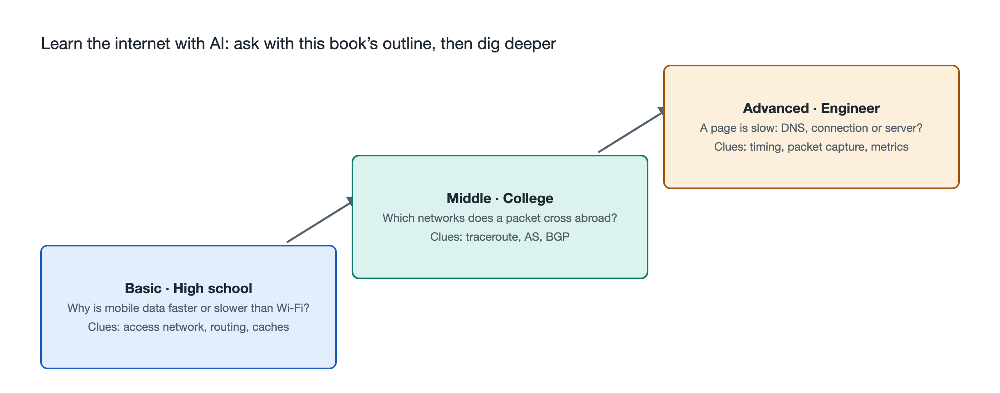

# 9.3 A Three-Step Questioning Ladder: From Middle Schooler to Engineer

Take the same question, "Why do web pages load slowly at my house?" A secondary school student, a computer science undergraduate, and an operations engineer responsible for a company website each want to know something different. The student wants to understand where a web page comes from and which stretch of the journey is slow. The undergraduate wants to map the symptom onto the TCP, DNS, and queuing concepts from the textbook. The engineer needs a practical troubleshooting sequence and clear criteria for judgment. Toss the bare question at an AI, and it will most likely return a generic checklist: "restart your router, try another browser, check your connection speed." That serves none of them well.

This section organizes the framework of the previous eight chapters into a three-rung questioning ladder. Readers choose a rung that matches where they are, use the concepts in this book as handholds, and let the AI build outward along that framework instead of circling through a pile of scattered answers.

## 9.3.1 Why Questions Should Be Tiered

How deep an AI chat assistant (built on a Large Language Model, LLM) goes in its answer depends largely on how much context and how many constraints the question supplies. Add "I'm a tenth-grader, please use a parcel delivery analogy" or "Please give a troubleshooting order based on the OSI layers, and explain which metrics to check at each step" to the same question, and the answers will differ markedly in depth and organization.

Tiering also prevents two kinds of waste: reaching too high and asking too low. Pressing on BGP path attributes without the necessary background yields answers you can't follow; asking "What is DNS?" when you already work in operations just repeats what you know. By locating themselves on this book's nine-level ladder, readers can first determine whether what they currently lack is "objects and structure" or "mechanisms and principles," then decide how deep to ask.

The three rungs break down as follows:

| Rung | Typical reader | Corresponding levels in this book | Questioning goal | Common handholds |
|---|---|---|---|---|
| Rung 1: Understand | Secondary school students, general readers | Objects, structure, function | Know what the parts are and what each does | Analogies, diagrams, one-paragraph explanations |
| Rung 2: Explain | University students, newcomers to the field | Connections, flows, mechanisms | Clearly describe the full course of a request and the reasons behind it | Layering, timing, comparison |
| Rung 3: Deliver | Operations staff, developers, product people | Key technologies, principles, troubleshooting | Locate problems, evaluate solutions, weigh trade-offs | Metrics, logs, hypotheses and verification |

These rungs are not identity labels. A product manager encountering IPv6 can start at Rung 1, and a secondary school student curious about routing algorithms is perfectly free to try climbing to Rung 3.

## 9.3.2 Rung 1: Understand—Building the Big Picture with Analogies

The task at Rung 1 is to turn an invisible network into a picture in your head. Questions at this level have three key points: state your level, ask for an analogy, and ask the AI to point out where the analogy breaks down.

You might ask:

- "I'm a middle school student. Using sending a parcel as an analogy, explain which stops are involved between my tapping a web page on my phone and the page appearing. Then tell me how this analogy differs from a real network."
- "What do the optical modem and the wireless router at home each do? If only one of them broke, what would I notice?"
- "Why is the Domain Name System (DNS) often compared to a phone book? What does this metaphor leave out?"

That final clause, "how it differs," matters. Analogies help people get started, but they also make it easy to remember things wrong. The parcel analogy, for example, suggests that a web page arrives whole as "one package," when in fact it is split into many packets that may travel different paths and are reassembled on arrival. Having the AI proactively state the limits of its analogy helps readers avoid such misconceptions, and it leads naturally into the packet switching covered in Chapter 6.

## 9.3.3 Rung 2: Explain—Unfolding the Process by Layer and by Time

Rung 2 moves from "what the parts are" to "how it happens step by step." The handholds here are the layered model from Chapter 4 and the various "flows" from Chapter 5. When asking, you can have the AI list the steps by layer or in chronological order and explain why each step exists.

Sample questions:

- "List, in chronological order, the full process of a browser opening an HTTPS web page: DNS lookup, the TCP three-way handshake, the TLS handshake, and the HTTP request and response. For each step, state which of the four TCP/IP layers it belongs to and what would go wrong if that step were skipped."
- "Compare the number of round trips TCP and QUIC need to establish an encrypted connection. Present the differences in a table, and explain why QUIC chose to build on top of UDP."
- "In a home network, at what moment do DHCP, NAT, and DNS each come into play? Draw a text-based sequence diagram."

At this rung, develop the habit of checking sources. Protocol details have authoritative references: TCP is defined in RFC 9293, QUIC in RFC 9000, and HTTP/3 in RFC 9114. You can ask the AI to "cite the RFC numbers it relies on," then look up the relevant sections of the original text on the IETF website yourself. AI occasionally misremembers numbers or details, and checking against the original is the most reliable way to catch errors.

## 9.3.4 Rung 3: Deliver—Troubleshooting and Deciding with Evidence

Rung 3 deals with real problems, so the phrasing should shift from "please explain" to "please help me judge." The key is to hand the AI evidence—output from diagnostic commands, numbers from monitoring screenshots, the time window and scope of the problem—while also stating your constraints.

Sample questions:

- "Below are the traceroute results for our company website (internal addresses redacted). After hop 7, latency jumps from 20 ms to 180 ms, but latency at the final destination is only 35 ms. Does this indicate a problem with the link? Give the basis for your judgment and the next step to verify it."
- "Users report slow access in some regions while other regions are fine. Give me a troubleshooting checklist in the order 'local network → access network → DNS resolution → CDN node → origin server.' For each item, state which metric to look at, roughly what the normal range is, and which tool to use to obtain it."
- "We're considering enabling HTTP/3 for our website. List the benefits, the risks, and the conditions we need to confirm first, such as restrictions on UDP in intermediate networks."

The phenomenon in the first question was covered in Chapter 7: routers often give low processing priority to probe packets addressed to themselves, so high latency at an intermediate hop does not mean the whole path is slow. A good AI answer should point this out. If it doesn't, readers can follow up with, "Could this be caused by rate limiting on the router's control plane?" Using principles learned from this book to test the AI's conclusions is precisely where the value of this rung lies.

Two cautions apply. First, before pasting logs, strip out sensitive information such as public IP addresses, account names, and internal hostnames. Second, verify any commands or configuration suggestions from the AI in a test environment or in read-only mode before applying them to production systems. On security topics, discuss only principles and defenses; do not ask the AI to generate probing or attack steps aimed at other people's systems.

## 9.3.5 Moving Up and Down the Ladder

The three-rung questioning ladder is one you can climb in both directions. An engineer facing an unfamiliar BGP alert can step back down to Rung 1 and ask, "Explain in one paragraph what a BGP route leak is." A secondary school student who has grasped the parcel analogy can step up and ask, "So when a packet gets lost, who is responsible for resending it?"—and thereby enter the world of TCP.

One practical technique is the "three-question volley": on a single topic, first ask a Rung 1 question to confirm you understand the big picture; then ask a Rung 2 question to work through the process; finally, ask a Rung 3 question grounded in something you've observed yourself. Taking DNS as an example, first ask "What does it do?", then "Which servers does a recursive resolution pass through, and where does caching come in?", and finally, using lookup results from your own computer, ask "Why do some websites load faster after I switch DNS servers?" After these three questions, the content of Chapters 3 and 6 is tied to the network right at your fingertips.

The book provides the skeleton; the questioning ladder determines which bone you grow flesh from. The next section gathers this chapter's methods into a checklist you can reach for anytime.
