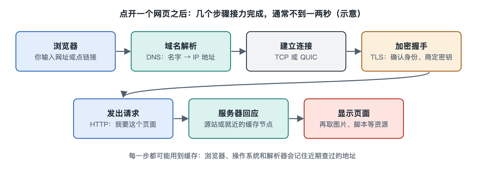

# 1.1 点开一个网页之后：一秒钟里发生了什么

晚上十点，你躺在沙发上，用手机浏览器打开一个新闻网站。手指在地址栏里敲下网址，按下“前往”，不到一秒，标题、图片和正文就出现在屏幕上。这件事你每天做几十次，平常到不会多想。可就在这短短的一瞬，你的手机、家里的路由器、楼道里的光纤、运营商的机房、可能远在另一座城市的服务器，已经来回对话了许多次。本节就把这一秒钟“放慢”，看看里面依次发生了哪些事。后面各章会把每一步拆开细讲，这里先建立一个完整的印象。

## 1.1.1 先问路——把名字换成地址

你输入的是一个名字，比如 `www.example.com`。网络里的设备并不认识名字，只认识数字形式的地址，也就是 IP 地址（Internet Protocol Address，互联网协议地址）。所以浏览器要做的第一件事是“查号”：向域名系统（Domain Name System，DNS）询问，这个名字对应哪个地址。

这一步很像打电话前翻通讯录。手机会先看自己最近有没有查过，有就直接用；没有，就把问题交给运营商或其他公共的 DNS 服务器。如果那里也没有现成答案，它会按层级逐级询问，从根服务器问到负责“.com”的服务器，再问到负责这个网站的服务器，最终拿到一串地址。由于各层都有缓存，常见网站往往在几毫秒到几十毫秒内就能查到。

## 1.1.2 握手与加密——先建立一条“可信的通道”

拿到地址后，浏览器不会立刻要网页，而是先和对方“打招呼”。传统做法是用 TCP（Transmission Control Protocol，传输控制协议）进行三次握手：我说“能听到吗”，你说“能听到，你能听到我吗”，我再说“能”。三句话确认双方都在线、都准备好了。

如今绝大多数网站使用 HTTPS，地址栏里的安全连接标志（锁形或其他图标）就是提示。所以握手之后还要再走一轮 TLS（Transport Layer Security，传输层安全）协商：确认服务器身份、商定加密方式、交换密钥。完成后，你和网站之间传送的内容，路上的设备只能看到“有数据在传”，看不到具体是什么。

还有一种较新的方式叫 QUIC，它把连接建立和加密协商合并起来，减少来回次数。写作时，许多大型网站和主流浏览器已经支持它（HTTP/3 就建立在它之上），第七章会专门介绍。

## 1.1.3 发出请求，数据被切成小包上路

通道建好，浏览器发出请求：“请把首页给我。”这句话连同之后返回的网页，都不会整块传送，而是被切成许多小段，每段加上收发地址等信息，成为一个个数据包（packet）。

这些包的旅程大致如下：

| 路段 | 经过的设备或网络 | 做了什么 |
|---|---|---|
| 家里 | 手机 → Wi-Fi 路由器 → 光猫 | 无线信号转成有线，再转成光信号 |
| 接入 | 小区光纤 → 运营商局端设备 | 把成千上万户的流量汇集起来 |
| 骨干 | 运营商骨干网、交换中心 | 在城市、省份乃至国家之间转发 |
| 目的地 | 服务器或附近的缓存节点 | 接收请求，准备内容 |

沿途每台路由器只做一件简单的事：看一眼包上的目的地址，查自己的路由表，把包交给下一站。没有哪台路由器知道完整路线，就像接力赛里每个选手只负责把棒交给下一个人。

## 1.1.4 服务器回应，网页被“拼装”出来

请求到达后，服务器把网页的主体，也就是 HTML 文件，发回来。浏览器读了它，发现里面还引用了样式表、脚本、图片、字体，于是继续发出几十甚至上百个请求去取这些资源。一个普通新闻首页，涉及的资源数量在几十到上百个之间，是公开网页统计资料中常见的量级。

很多图片和视频并不是从网站的“总部”取的，而是从离你较近的内容分发网络（Content Delivery Network，CDN）节点取得。它像开在各地的分店，把热门内容提前存在用户附近，路程短了，速度自然快。

数据包到达后，你的手机还要检查有没有丢失或错乱：缺了就请对方重发，乱了就按编号重新排好。最后浏览器把文字、样式和图片组合起来，画到屏幕上。

## 1.1.5 一秒钟的时间账

把各步骤放在一起，大致是这样一张时间账（数值为典型范围，因网络环境差异很大）：

- 查询域名：命中缓存时几乎为零，需要逐级查询时为几十毫秒；
- 建立连接与加密：取决于来回次数和距离，同城通常为几十毫秒，跨洋可达数百毫秒；
- 传输网页与资源：取决于页面大小和带宽；
- 浏览器解析和绘制：取决于手机性能和页面复杂度。

你会注意到，影响速度的常常不是“网速有多少兆”，而是“要来回多少次、每次多远”。光在光纤中每秒约传播二十万公里，跨越太平洋一个来回也要上百毫秒。这就是为什么工程师花大力气减少握手次数、把内容放得离用户更近。

## 1.1.6 小结：一个网页背后的整张网

回头看这一秒钟：名字被换成地址，双方握手并加密，数据被切成小包，穿过家庭网络、接入网、骨干网，抵达服务器或缓存节点，再沿路返回，被检查、排序、拼装成你看到的页面。这当中有终端、有线路、有机房，有寻址、命名、路由、可靠传输等功能，也有许多不属于任何单一公司的设备在共同协作。

这就引出下一个问题：把这么多各自独立的网络连在一起的，究竟是一个怎样的系统？下一节，我们来回答“互联网是什么”。
