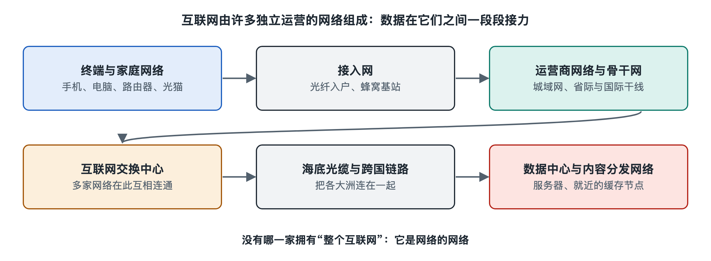

# 2.1 终端与家庭网络：手机、电脑、路由器与光猫

晚上回到家，手机自动连上 Wi-Fi，电脑打开浏览器，电视开始播放视频。这一切顺理成章，以至于我们很少注意到：在你和整个互联网之间，家里其实已经有一张小小的网络在默默运转。它的边界通常就在客厅角落或弱电箱里那两三个闪着指示灯的盒子上。这一节，我们就从手边的设备出发，拆开互联网最靠近你的这一层。

## 2.1.1 终端：网络的起点与终点

在网络术语里，手机、电脑、平板、智能电视、智能音箱、摄像头这些直接供人使用或直接产生数据的设备，统称为**终端**（end device），也叫**主机**（host）。它们是数据的“发货人”和“收货人”：你点开网页时，请求从终端发出，网页内容最终也回到终端上被显示出来。

终端要联网，需要三样东西：

- **网络接口**：电脑上的网线口、手机里的 Wi-Fi 芯片和蜂窝基带芯片，负责把数据变成电信号或无线电波。每个接口出厂时带有一个**MAC 地址**（媒体访问控制地址，Media Access Control address），用于在同一个局域网内部识别设备，好比住户在楼里的门牌。
- **协议软件**：操作系统里实现了 TCP/IP 等一整套通信规则（第三、六章会详细展开），负责打包、编号、校验数据。
- **应用程序**：浏览器、视频软件、聊天软件，它们真正“想要”数据。

值得记住的一点是：互联网把大部分“聪明”留在了终端上。确认数据有没有收全、丢了要不要重发、内容怎么加密，主要由终端完成，中间的网络设备只管尽力转发。这一设计思想叫端到端原则，我们会在第八章回头细看。

## 2.1.2 家庭路由器：一个盒子里的几种角色

家里常说的“路由器”，严格说是一台把多种功能合在一起的设备。拆开来看，它通常同时扮演以下角色：

| 角色 | 做什么 | 类比 |
|---|---|---|
| 交换机（switch） | 在家中设备之间转发数据，依据 MAC 地址 | 楼内的走廊 |
| 无线接入点（AP，Access Point） | 把有线网络变成 Wi-Fi 信号 | 楼道里的广播喇叭 |
| 路由器（router） | 在家庭网络与外部网络之间转发数据，依据 IP 地址 | 小区大门的收发室 |
| DHCP 服务器 | 给新加入的设备自动分配 IP 地址等参数 | 前台发临时门牌 |
| NAT 网关 | 让家里多台设备共用一个对外地址 | 统一对外的收发地址 |
| 防火墙 | 默认拦截外部主动发起的连接 | 门卫 |

其中两项与你每天的上网体验关系最大。

**DHCP**（动态主机配置协议，Dynamic Host Configuration Protocol）：手机连上 Wi-Fi 的那一两秒里，会向路由器“要”一个地址，路由器分给它一个类似 192.168.1.23 的**私有地址**，同时告诉它网关和域名服务器在哪里。这类以 192.168、10、172.16–172.31 开头的地址由标准文档 RFC 1918 划定，只在内部网络使用，全世界无数家庭可以重复使用同一段。

**NAT**（网络地址转换，Network Address Translation）：既然私有地址不能直接在互联网上通行，路由器就把家里所有设备发出的数据统一换成自己对外的地址，再记下“哪个请求是谁发的”，回包到达时再转交给对应设备。这就像一栋楼的住户寄信都写物业的地址，物业收到回信再按登记表分发。NAT 缓解了 IPv4 地址不够用的问题，但也让外部无法主动找到家中设备——这既是一层天然保护，也给视频通话、联机游戏等点对点应用带来麻烦。它的细节见 5.2 节，地址紧缺的根本解法 IPv6 见 7.1 节。

## 2.1.3 光猫：家庭网络与运营商的分界点

路由器上那根标着 WAN（广域网）的网线，通常插在另一个盒子上——**光猫**，正式名称是**光网络终端**（ONT，Optical Network Terminal；部分资料也称 ONU）。“猫”来自早年拨号上网时代的调制解调器（modem）的音译，叫法沿用了下来。

光猫的核心工作是**光电转换**：入户的是一根细细的光纤，里面传的是光信号；家里的设备用的是电信号。光猫在两者之间翻译，并按照运营商接入网的规则与局端设备通信。在国内常见的光纤入户方式中，这套接入网多采用无源光网络（PON）技术，一根主干光纤经分光器分给多户共享，相关原理留到 2.2 节和本系列的《光纤通信》专册。

需要说明的是，家庭设备的组合方式并不统一：

- 有的运营商提供的光猫本身就带路由和 Wi-Fi 功能，家里只有一个盒子；
- 有的用户把光猫设为“桥接”模式，只做光电转换，拨号和路由交给自己买的路由器；
- 使用有线电视网络或电话线接入的家庭，盒子叫“线缆调制解调器”或“DSL 调制解调器”，原理相近而介质不同。

具体采用哪种方式，取决于当地运营商的做法和用户设置，写作时国内外都存在上述几种情形。无论哪种组合，光猫的外侧通常就是运营商网络的起点，也是家庭报修时“谁的责任”的分界线。

## 2.1.4 把一次上网串起来

现在把这几样东西连成一条线。当你在手机浏览器里按下回车：

1. 手机已通过 DHCP 拿到私有地址，知道网关是路由器；
2. 数据经 Wi-Fi 无线电波到达路由器的无线接入点；
3. 路由器发现目的地在家庭网络之外，做 NAT 地址替换，从 WAN 口送出；
4. 光猫把电信号转成光信号，沿光纤送入运营商的接入网；
5. 回来的数据按相反路径，经光猫、路由器转交回你的手机。

如果断网了，这条链条也给出了排查顺序：先看手机是否连上 Wi-Fi、是否拿到地址，再看路由器 WAN 口是否获得外部地址，最后看光猫上代表光信号的指示灯（不同厂家标注不同，常见为 PON、LOS 等）是否正常。很多家庭网络问题，按这个由近及远的顺序就能定位大半。

家庭网络是整个互联网最小、却最完整的缩影：有终端、有交换、有路由、有地址分配，也有通往外部的出口。走出光猫那根光纤，数据就进入了运营商的世界。下一节，我们沿着这根光纤，以及手机上那根看不见的无线链路，去看接入网是怎样把千家万户接进来的。
